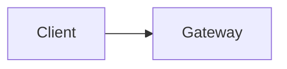
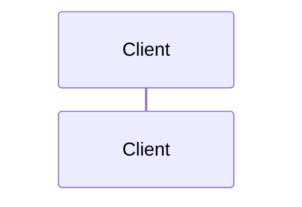

# Thiết kế: <tên>

## 1. Bối cảnh
Tóm tắt spec (link `spec`), vấn đề cần giải, phạm vi thiết kế này (và cái không thuộc phạm vi).

## 2. Yếu tố quyết định (drivers)

### 2.1 FR then chốt
| ID | Yêu cầu | Tác động tới thiết kế |
|---|---|---|

### 2.2 NFR (có số đo)
| ID | Thuộc tính | Mục tiêu | Nguồn (spec / giả định) |
|---|---|---|---|
| NFR-001 | Độ trễ p95 | | |

### 2.3 Ràng buộc
Stack (ADR 0005), AWS, ngân sách, quy mô đội, kiến trúc bắt buộc của service. Ràng buộc không thay cho lý do: lý do ranh giới, DB và kiến trúc nội bộ nằm ở D0.

## 3. Ước lượng nhanh
| Đại lượng | Giá trị | Công thức / giả định |
|---|---|---|

Kết luận bậc độ lớn:

## 4. Tổng quan kiến trúc

Chú thích: <sơ đồ thể hiện điều gì>

## 5. Các quyết định chính

### D0. Quyết định cấp service (bắt buộc cho service mới hoặc khi chạm lưu trữ/ranh giới)

Làm cả khi đã bị ràng buộc bởi ADR/`PROJECT.md`. Mỗi mục ≥ 2 phương án thật, vì sao không chọn, nhãn, tín hiệu xem lại. Người dùng chọn hoặc xác nhận từng mục (ghi vào Confirm log); "Agent chọn theo uỷ quyền" chưa phải xác nhận.

#### D0.1 Ranh giới (service riêng / module / managed)
- Lý do kỹ thuật thật (cách ly dữ liệu/khoá, hồ sơ tải, độc lập triển khai) tách khỏi lý do để học:
- **Nhãn:** `[Cần]` / `[Chọn để học]`

| Phương án | Ưu | Nhược |
|---|---|---|

#### D0.2 Mức cô lập database
- Mức (database/schema/instance riêng; chung instance ở dev?), lý do, rủi ro chung instance:

| Phương án | Cô lập | Chi phí | Ghi chú |
|---|---|---|---|

#### D0.3 Loại database
- Yêu cầu dữ liệu làm tiêu chí (unique, giao dịch/CAS, truy vấn, hết hạn, chi phí biên, chạy local, công cụ):

| Tiêu chí | Loại A | Loại B | Loại C |
|---|---|---|---|

- Phần yếu / phương án thay thế nghiêm túc nhất và khi nào nó thắng (không dùng "đa dạng công nghệ" làm lý do kỹ thuật):

#### D0.4 Kiến trúc nội bộ
| Tiêu chí | Kiến trúc đã chọn | Phương án 2 | Phương án 3 |
|---|---|---|---|

- Điểm yếu cần giảm bằng thiết kế:

### D1. <Bài toán>
- **Tiêu chí và trọng số:**
- **Nhãn:** `[Cần]` / `[Chọn để học]` (nếu học: ghi cách dự án thực tế làm và mức xa thực tế *Gần*/*Xa*; *Xa* cần người dùng xác nhận)

| Phương án | Mô tả | Tiêu chí 1 | Tiêu chí 2 | Tiêu chí 3 |
|---|---|---|---|---|
| A | | | | |
| B | | | | |

- **Khuyến nghị:** A, vì …
- **Vì sao không chọn B:** … **B sẽ đúng khi:** …
- **Đánh đổi chấp nhận / rủi ro:**
- **Khả năng đảo ngược:**
- **Tín hiệu xem lại:** (chỉ số đo được)
- **Use case tương tự:**

| Bài toán gốc | Lựa chọn phổ biến | Vì sao hợp | Khác với trường hợp của ta | Tin cậy |
|---|---|---|---|---|

(Lặp lại cho D2…Dn)

## 6. Thiết kế chi tiết

### 6.1 Trách nhiệm và dữ liệu
Service sở hữu gì; ranh giới giao dịch và nhất quán cuối cùng.

### 6.2 Mô hình dữ liệu (mức khái niệm)
| Thực thể | Thuộc tính chính | Chỉ mục | Vòng đời |
|---|---|---|---|

### 6.3 Hợp đồng
- API: (theo `api-endpoints.md`)
- Sự kiện: (theo `messaging.md`) tên, trường, bên phát, bên nhận

### 6.4 Luồng chính

### 6.5 Luồng lỗi quan trọng

## 7. Chế độ lỗi
| Tình huống | Hậu quả | Cách xử lý |
|---|---|---|

## 8. Bảo mật
AuthN/AuthZ, IDOR, dữ liệu nhạy cảm, bí mật, mã hoá truyền/lưu, least privilege (IAM).

Mô hình đe doạ nhẹ (STRIDE) theo ranh giới tin cậy:

| Ranh giới / tài sản | Mối đe doạ (S/T/R/I/D/E) | Biện pháp | Rủi ro còn lại |
|---|---|---|---|

## 9. Quan sát
Trace, metric, log, cảnh báo; chỉ số theo dõi các revisit trigger.

## 10. Triển khai và vận hành
ECS/Lambda, cấu hình, migration, rollback.

### Chi phí (ước tính, kèm giả định và nguồn giá)

| Thành phần | Cấu hình | Chạy 24/7? | Ước tính/tháng (USD) | Giả định / nguồn giá | Cách tắt |
|---|---|---|---|---|---|

- Tổng ước tính dev / stg / prod:
- So với trần ngân sách (`config/project.yaml` → `quality.monthlyBudgetUsd`):
- Phương án rẻ hơn đã cân nhắc và vì sao chưa chọn:
- Chi phí của độ phức tạp (vận hành, học, debug):

## 11. Chiến lược test
Kịch bản BDD chính, TDD, contract test, test tải (nếu cần).

## 12. Lộ trình mở rộng
| Mức tải | Điểm nghẽn đầu tiên | Cách xử lý | Chi phí/rủi ro |
|---|---|---|---|
| 10x | | | |
| 100x | | | |

Chủ ý **chưa làm** (và vì sao chưa cần):

## 13. Rủi ro và pre-mortem
| Nguyên nhân thất bại khả dĩ | Xác suất | Tác động | Giảm thiểu | Tín hiệu cảnh báo sớm |
|---|---|---|---|---|

## 14. Câu hỏi mở và giả định

Giả định:

| # | Giả định | Người xác nhận | Trạng thái |
|---|---|---|---|

Câu hỏi mở: mỗi câu phải có **lựa chọn, khuyến nghị kèm lý do và hậu quả nếu chưa chốt**; câu hỏi trần là chưa đủ.

| # | Câu hỏi | Người trả lời | Hạn | Trạng thái (`open`/`answered`/`deferred`) |
|---|---|---|---|---|

### Q-01 <tên ngắn>
- **Lựa chọn:** A) … B) … (2–4 lựa chọn, mỗi cái kèm đánh đổi chính)
- **Khuyến nghị:** A, vì … (chỉ để tham khảo, không áp dụng khi người dùng chưa trả lời)
- **Hậu quả nếu chưa chốt:** …
- **Mặc định nếu quá hạn:** …

## 15. Ghi chú học tập
- Khái niệm chính:
- Câu hỏi thử thách (tự trả lời):
- Điều rút ra:

## 16. Liên kết
ADR, issue, spec, tài liệu tham khảo (kèm mức xác minh nguồn).

## 17. Lịch sử thay đổi
| Ngày | Thay đổi | Lý do |
|---|---|---|
| YYYY-MM-DD | Tạo bản nháp | |
