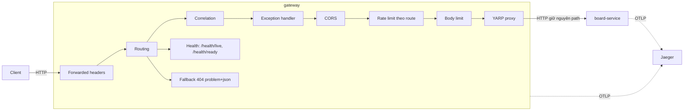
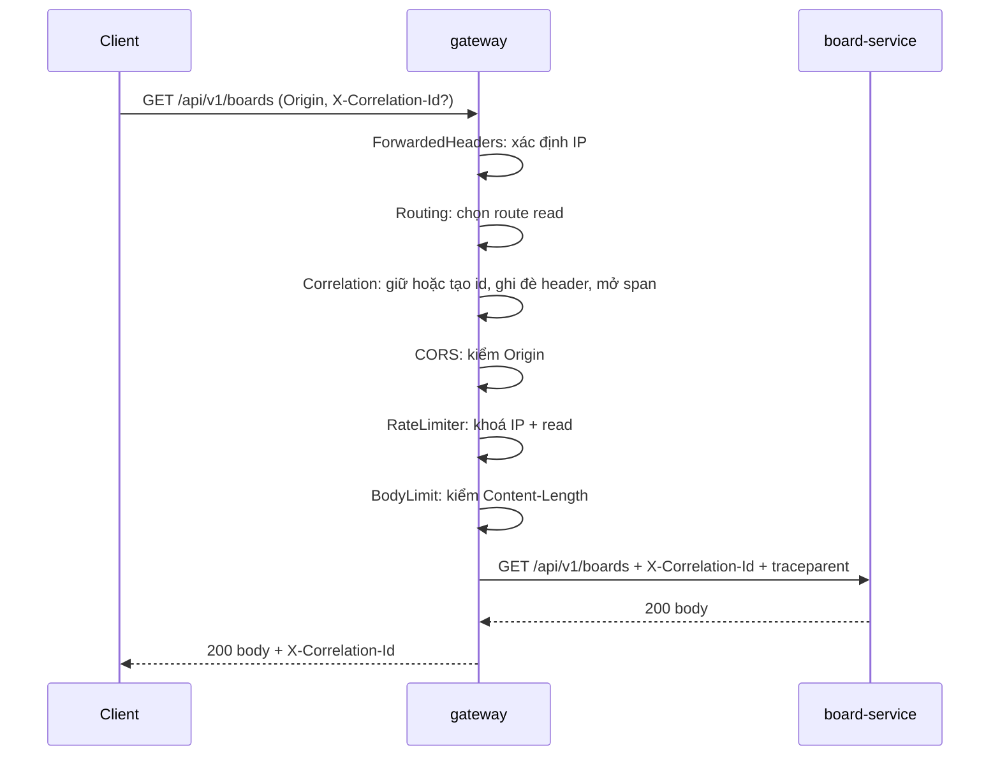
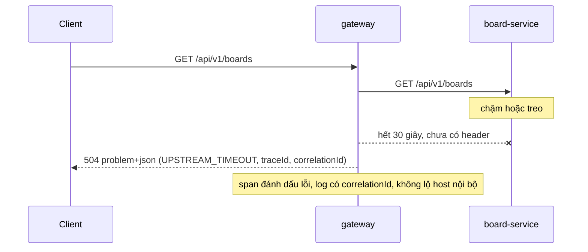

# Thiết kế: API gateway (YARP) mỏng

## 1. Bối cảnh

Spec [`api-gateway.md`](../spec/api-gateway.md) (`confirmed`) yêu cầu một cửa vào duy nhất cho API công khai: routing `/api/v1/boards/**` tới `board-service`, health, `X-Correlation-Id` + `traceparent`, rate limit theo IP (mức riêng từng route), CORS theo allowlist, lỗi `502/503/504` và `413` dạng `problem+json`. Kiểm JWT, retry, circuit breaker, rate limit theo user nằm ngoài phạm vi.

Phạm vi thiết kế này: kiến trúc của service `gateway`, cách cài từng yêu cầu của spec, thứ tự middleware, chế độ lỗi, bảo mật ranh giới internet → gateway. Không thuộc phạm vi: chọn dịch vụ AWS cụ thể (skill `aws-service-selection`, giai đoạn 4), kiểm JWT (design riêng khi có identity).

### Thuật ngữ dùng trong tài liệu

| Thuật ngữ | Nghĩa ngắn |
|---|---|
| Gateway / reverse proxy | Cửa vào duy nhất: nhận request công khai rồi chuyển tới service phía sau |
| YARP | Thư viện reverse proxy của Microsoft chạy trong ASP.NET Core |
| Middleware | Bước xử lý nằm trên đường đi của request trong ASP.NET Core, chạy theo thứ tự |
| Preflight | Request `OPTIONS` mà trình duyệt gửi trước để hỏi server có cho gọi chéo origin không (CORS) |
| Hop-by-hop header | Header chỉ có nghĩa giữa hai nút liền kề, proxy không được chuyển tiếp nguyên văn |
| Span / OTLP / baggage | Span là một đoạn công việc trong trace; OTLP là giao thức gửi telemetry OpenTelemetry; baggage là cặp khoá-giá trị đi kèm cả trace |
| SLI / SLO / error budget | SLI là số đo chất lượng (ví dụ tỉ lệ request thành công); SLO là mục tiêu cho số đó; error budget là phần sai sót còn được phép |
| p95 | 95% request nhanh hơn giá trị này |
| Little's law | Số kết nối đồng thời ≈ tốc độ request × thời gian xử lý |
| STRIDE | Cách liệt kê mối đe doạ: giả mạo, sửa đổi, chối bỏ, lộ thông tin, từ chối dịch vụ, nâng quyền |
| IDOR | Truy cập tài nguyên của người khác bằng cách đoán/đổi id |
| Log injection | Chèn ký tự điều khiển hoặc dữ liệu giả vào log qua đầu vào của client |
| Slowloris | Kiểu tấn công giữ nhiều kết nối mở chậm để làm cạn tài nguyên server |
| DDoS / WAF | Tấn công từ chối dịch vụ phân tán / tường lửa ứng dụng web |
| ALB | Application Load Balancer của AWS, phân tải và kết thúc TLS |
| mTLS | TLS hai chiều: cả hai bên đều xuất trình chứng chỉ |
| BFF | Backend for Frontend: lớp backend phục vụ riêng một giao diện, có thể tổng hợp dữ liệu |
| Graceful shutdown | Tắt dịch vụ có trật tự: ngừng nhận request mới, cho request đang chạy hoàn tất |
| Pre-mortem | Giả sử dự án đã thất bại rồi tìm nguyên nhân trước khi bắt đầu |
| Blast radius | Phạm vi bị ảnh hưởng khi một thành phần lỗi |

## 2. Yếu tố quyết định (drivers)

### 2.1 FR then chốt
| ID | Yêu cầu | Tác động tới thiết kế |
|---|---|---|
| FR-001 | Route `/api/v1/boards/**` → board-service, giữ nguyên path; không khớp thì `404` `problem+json` | Chọn reverse proxy; route khai báo; fallback `404` |
| FR-002 | Health, ready độc lập downstream, không bị rate limit | Endpoint health nằm ngoài route proxy, không gắn policy rate limit |
| FR-003 | Tạo/giữ `X-Correlation-Id`, truyền `traceparent` | Middleware đứng trước proxy; ghi đè header gửi xuống upstream; mọi lỗi và log mang id |
| FR-004 | Rate limit IP, mức đọc/ghi riêng | Nơi giữ bộ đếm, thuật toán, khoá phân vùng, cách gắn theo route |
| FR-005 | CORS theo allowlist | Policy CORS đặt trước rate limit, cấu hình header cho phép/lộ ra |
| FR-006 | `502/503/504` dạng `problem+json` | Ánh xạ lỗi proxy; chỉ khả thi trước khi gửi header response |
| FR-007 | Body > 1 MiB → `413` | Giới hạn kích thước ở Kestrel/middleware; hành vi với body chunked |

### 2.2 NFR (có số đo)
| ID | Thuộc tính | Mục tiêu | Nguồn |
|---|---|---|---|
| NFR-001 | Độ trễ thêm vào | p95 < 20 ms ở tải dev | Spec A-02 |
| NFR-002 | Quan sát | Trace nối gateway → service trong Jaeger | Spec |
| NFR-003 | Timeout upstream | Tổng 30 giây (route `Timeout`) và idle ≤ 30 giây (`ActivityTimeout`), cấu hình được | Spec A-03, chốt ở design-review vòng 1 |
| NFR-004 | Cấu hình | Ngưỡng, origin, địa chỉ service nằm trong config, không secret | Spec |
| NFR-005 | Khởi động | `ready` trong < 10 giây ở máy dev | Spec A-06 |
| NFR-006 | GDPR | IP ghi nguyên văn, lưu ≤ 7 ngày (dev); không log token/body | Spec Q-04 |

SLI/SLO (giả định DA-01, đã xác nhận):
- **SLI tính vào SLO của gateway:** tỉ lệ request (trừ health) không kết thúc bằng lỗi do chính gateway (`500 INTERNAL_ERROR`). Lỗi `502/503/504` do upstream được theo dõi riêng, không trừ vào SLO của gateway.
- **SLI độ trễ:** độ trễ thêm vào = tổng thời gian xử lý − thời gian chờ upstream, đo bằng histogram riêng.
- **SLO khởi điểm:** 99,5% request không lỗi gateway trong 30 ngày (error budget 0,5%, tức 5 request lỗi trên 1.000 request); p95 độ trễ thêm vào < 20 ms.

### 2.3 Ràng buộc
ASP.NET Core .NET 10 (ADR 0005). YARP đã được duyệt T1, MIT (`config/dependencies.yaml`, ADR 0007; trạng thái `verified: false`, phải kiểm tra trang chính thức trước khi dùng). Gateway không có database (`config/services.yaml`). Quy ước API: `api-endpoints.md` (không tên service trong path, `problem+json`, `X-Correlation-Id`, `429` và `503` kèm `Retry-After`, CORS và rate limit đặt ở gateway). Ràng buộc không thay cho lý do: lý do ranh giới và kiến trúc nội bộ nằm ở D0.

## 3. Ước lượng nhanh
| Đại lượng | Giá trị | Công thức / giả định |
|---|---|---|
| Người dùng đồng thời (dev/học) | 1–5 | Giả định, một người học |
| RPS đỉnh thiết kế | 50 | Giả định hào phóng để chọn ngưỡng và kiểm cấu hình; không đo |
| Kích thước request/response | ≤ 1 MiB (1.048.576 byte) / vài KB điển hình | FR-007; JSON board nhỏ |
| Bộ đếm rate limit | ≤ vài nghìn khoá | Số IP × 2 nhóm route; mỗi khoá vài chục byte trong bộ nhớ |
| Kết nối đồng thời | ≈ RPS × thời gian xử lý ≈ 50 × 0,1 s ≈ 5 | Little's law, upstream 100 ms (giả định) |

Kết luận bậc độ lớn: tải rất nhỏ; một instance, bộ nhớ và không cache là đủ. Điểm cần quan tâm không phải thông lượng mà là tính đúng đắn (correlation, lỗi, bảo mật) và khả năng quan sát.

## 4. Tổng quan kiến trúc

Chú thích: client chỉ nói chuyện với gateway; gateway là một host ASP.NET Core mỏng chạy YARP theo cấu hình. Request đi qua chuỗi middleware theo thứ tự cố định (khoá bằng test, xem 6.4); health và fallback 404 là endpoint riêng, không đi qua rate limit; telemetry đi tới Jaeger.

## 5. Các quyết định chính

### D0. Quyết định cấp service

#### D0.1 Ranh giới (service riêng / module / managed)
- **Lý do kỹ thuật thật:** một điểm vào chung để áp rate limit, CORS, correlation một lần cho mọi service; client không biết địa chỉ service; triển khai và mở rộng độc lập với service nghiệp vụ. Hồ sơ tải gateway khác service nghiệp vụ (nhiều kết nối ngắn, không có DB).
- **Lý do để học:** vận hành một gateway tự host, nối trace xuyên proxy.
- **Nhãn:** `[Cần]` cho việc có một cửa vào; `[Chọn để học]` ở phần **tự host** thay vì managed.
- **Cách dự án thực tế thường làm:** trên AWS thường dùng dịch vụ managed (API Gateway, ALB) hoặc Envoy/Kong/NGINX; với đội .NET, YARP tự host là lựa chọn phổ biến (Tin cậy: Vừa; đã đối chiếu tài liệu YARP của Microsoft về route policy, timeout, forwarded headers trong design-review, còn lại là thực hành chung). **Mức xa thực tế: Gần** (tự host YARP là thực hành có thật; việc không dùng managed là chủ ý để học vận hành).

| Phương án | Ưu | Nhược |
|---|---|---|
| A. Service riêng tự host bằng YARP (người dùng chọn) | Chạy giống hệt local/ECS; kiểm soát correlation, lỗi, trace; một công nghệ (.NET); khớp ADR/PROJECT | Tự vận hành, tự lo rate limit/CORS ở lớp trên YARP, một điểm lỗi đơn |
| B. Managed (AWS API Gateway hoặc ALB) | Ít vận hành, sẵn rate limit/CORS/WAF, có HA | Không chạy local giống hệt; khó tuỳ biến correlation/problem+json; phát sinh chi phí; tách khỏi ADR hiện tại (cần ADR mới) |
| C. Module trong board-service | Ít thành phần nhất | Phá ranh giới client → gateway → service; không dùng chung cho service khác |

- **Vì sao không chọn B:** quy ước dự án (`api-endpoints.md`) yêu cầu `problem+json` và correlation thống nhất, ADR 0003 chạy service dạng container ECS và cần chạy được ở local giống môi trường thật; B tốn chi phí và không giúp học vận hành gateway. **B sẽ đúng khi** có yêu cầu WAF/DDoS ở cạnh hoặc không còn người vận hành gateway; có thể đặt B (ALB) **phía trước** A.
- **Vì sao không chọn C:** mất điểm vào chung. **C sẽ đúng khi** hệ thống chỉ có một service.
- **Tín hiệu xem lại:** chi phí/giờ vận hành gateway vượt giá trị học được, hoặc cần WAF.

#### D0.2 Mức cô lập database
Không áp dụng: gateway không sở hữu dữ liệu (BR-002). Trạng thái rate limit nằm trong bộ nhớ tiến trình (D1). Nếu sau này cần lưu cấu hình động hoặc bộ đếm chung thì mở lại mục này. (Người dùng đã xác nhận.)

#### D0.3 Loại database
Không áp dụng, cùng lý do D0.2. Phương án thay thế nghiêm túc nhất nếu cần bộ đếm chung: kho khoá-giá trị chung (D1, phương án B). (Người dùng đã xác nhận.)

#### D0.4 Kiến trúc nội bộ
- **Nhãn:** `[Cần]`. **Cách thực tế làm:** gateway thường là proxy cấu hình + plugin/middleware, hiếm khi chia tầng. **Mức xa thực tế: Gần.**

| Tiêu chí | A. Host mỏng: YARP theo cấu hình + middleware (người dùng chọn) | B. Clean Architecture như board-service | C. Tự viết proxy bằng HttpClient |
|---|---|---|---|
| Phù hợp miền (không nghiệp vụ) | Tốt | Kém: không có domain để bảo vệ | Vừa |
| Độ phức tạp, số project | Tốt: 1 project (+ test) | Kém: 3–4 project cho vài middleware | Kém: tự xử lý streaming, hop-by-hop, WebSocket |
| Khả năng test | Tốt: host test in-process + upstream giả | Vừa | Kém |
| Phù hợp ADR 0007 (nền tảng trước) | Tốt (YARP T1 đã duyệt) | Tốt | Kém: tự viết thứ đã có thư viện |
| Giá trị học kiến trúc | Vừa | Vừa | Cao nhưng mức Xa |

- **Vì sao không chọn B:** cắt tầng khi không có logic nghiệp vụ chỉ thêm file; `architecture.md` ghi gateway chỉ routing/authN/rate limit, không nghiệp vụ. **B sẽ đúng khi** gateway nhận thêm logic tổng hợp (BFF) đáng kể.
- **Vì sao không chọn C:** rủi ro sai sót ở chi tiết proxy HTTP (header hop-by-hop, streaming, giữ nguyên body), ADR 0007 ưu tiên nền tảng. **C sẽ đúng khi** YARP không đáp ứng một hành vi cần thiết mà không mở rộng được.
- **Điểm yếu cần giảm:** logic cross-cutting rải trong middleware dễ lệch thứ tự → khoá thứ tự bằng test (mục 11) và ghi rõ ở 6.4.
- **Phần dùng chung (Q-D2, đã chốt A):** thư viện nhỏ trong `src/shared` (tên dự kiến `Teamboard.Shared.Http`, chốt ở plan, thêm vào `teamboard.slnx`) chứa: dựng/ghi `problem+json` kèm `traceId` và `correlationId`, middleware correlation (kiểm định dạng, ghi đè header, đặt vào response), hằng số `code` lỗi dùng chung (`INTERNAL_ERROR`, `VALIDATION_FAILED`...). Chỉ nằm trong gateway: ForwardedHeaders, rate limit, CORS, ánh xạ lỗi YARP, các `code` riêng của gateway. Không có business logic (`PROJECT.md`). Lát đầu của gateway tạo thư viện này; các service sau dùng lại.

### D1. Nơi giữ bộ đếm rate limit và cách cài
- **Tiêu chí và trọng số:** phù hợp tải/instance (cao), độ phức tạp vận hành (cao), tuân ADR 0007 (cao), đúng khi nhiều instance (thấp ở giai đoạn này), chi phí (vừa).
- **Nhãn:** `[Cần]` cho việc có rate limit; chọn bộ nhớ vì đơn giản nhất đủ NFR. **Cách thực tế:** thường đếm cục bộ ở mỗi instance proxy (xấp xỉ), chỉ dùng kho chung khi cần chính xác tuyệt đối (Tin cậy: Chắc).

| Phương án | Mô tả | Phù hợp tải | Vận hành | ADR 0007 | Đúng khi N instance |
|---|---|---|---|---|---|
| A. RateLimiter có sẵn của ASP.NET Core, bộ nhớ từng instance (người dùng chọn) | Gắn theo route qua `RateLimiterPolicy` của YARP | Tốt | Tốt: không thêm thành phần | Tốt (T0) | Kém: giới hạn thực ≈ N lần |
| B. Kho chung (Redis/DynamoDB) | Mọi instance đếm chung | Thừa | Kém: thêm thành phần, chi phí | Kém: Redis vướng giấy phép | Tốt |
| C. Tự viết thuật toán đếm | Tự cài sliding window/token bucket | Tốt | Vừa | Kém: có thư viện nền tảng | Như A |

- **Vì sao không chọn B:** 50 RPS và một instance không cần đếm chung; B thêm thành phần và chi phí. **B sẽ đúng khi** chạy ≥ 3 instance và cần giới hạn chính xác theo IP, hoặc có route nhạy cảm (login) cần chặn brute force toàn cục. **Vì sao không chọn C:** thư viện nền tảng đã có; C là mức Xa.
- **Cách cài:** policy có khoá phân vùng (`AddPolicy` với `RateLimitPartition.GetSlidingWindowLimiter(khoá, ...)`) vì bản đăng ký theo tên không phân vùng sẽ thành một bộ đếm chung cho mọi IP. Hai policy `read` và `write` gắn vào hai route YARP bằng `RateLimiterPolicy`. Mã trả về mặc định của rate limiter không phải `429` nên đặt `RejectionStatusCode = 429` và `OnRejected` để ghi `problem+json` (`RATE_LIMIT_EXCEEDED`) kèm `Retry-After` (lấy từ metadata của lease nếu có, nếu không dùng độ dài cửa sổ 60 giây); kiểm bằng test khi cài.
- **Đánh đổi chấp nhận / rủi ro:** khi chạy N instance, giới hạn thực lỏng hơn N lần; khởi động lại xoá bộ đếm; IP sau proxy sai nếu cấu hình `ForwardedHeaders` sai (D5).
- **Khả năng đảo ngược:** dễ; policy nằm trong phần cài đặt, đổi sang kho chung chỉ thay phần đó.
- **Tín hiệu xem lại:** triển khai > 1 instance (giai đoạn 4) hoặc có route đăng nhập; tỉ lệ `429` bất thường so với số IP.
- **Use case tương tự:**

| Bài toán gốc | Lựa chọn phổ biến | Vì sao hợp | Khác với ta | Tin cậy |
|---|---|---|---|---|
| Rate limiter (System Design Interview) | Token bucket/sliding window ở gateway, Redis khi nhiều node | Đếm cục bộ rẻ, chấp nhận sai lệch | Ta chỉ 1 instance, không Redis | Chắc |
| Bảo vệ endpoint đăng nhập | Giới hạn chặt theo IP và theo tài khoản | Chống brute force | Chưa có login; để sau khi có identity | Chắc |

### D2. Thuật toán và khoá phân vùng rate limit
- **Tiêu chí:** đúng tiêu chí chấp nhận FR-004 (cao), tránh burst ở rìa cửa sổ (vừa), dễ test (cao), đơn giản (vừa). **Nhãn:** `[Cần]`. (Người dùng đã xác nhận D2.)

| Phương án | Mô tả | Burst rìa cửa sổ | Dễ test | Ghi chú |
|---|---|---|---|---|
| A. Sliding window (đã chọn) | Cửa sổ trượt 1 phút chia đoạn nhỏ | Tốt: giảm burst gấp đôi | Vừa: phụ thuộc đồng hồ | Có sẵn trong RateLimiter nền tảng |
| B. Fixed window | Reset mỗi phút | Kém: tối đa ~2N trong vài giây quanh biên | Tốt | Đơn giản nhất |
| C. Token bucket | Nạp token đều, cho burst có kiểm soát | Tốt | Vừa | Khó giải thích ngưỡng "N/phút" khớp spec |

- **Khoá phân vùng:** `IP client + nhóm route` (nhóm `read` cho `GET`, `write` cho `POST/PUT/PATCH/DELETE`). IPv4 khoá theo địa chỉ đầy đủ; **IPv6 gộp theo /64** (người dùng đã chọn) để kẻ tấn công không xoay địa chỉ trong một dải mà né giới hạn hay làm phình bộ đếm. Ngưỡng khởi điểm 120 (đọc) và 30 (ghi) mỗi phút, đọc từ cấu hình.
- **Vì sao không chọn B/C:** B cho burst ~2N ở rìa; C đổi ngữ nghĩa ngưỡng. **B sẽ đúng khi** cần test đơn giản tuyệt đối và chấp nhận burst; **C** khi muốn cho burst ngắn có chủ đích.
- **Khả năng đảo ngược:** dễ. **Tín hiệu xem lại:** test không ổn định do ranh giới cửa sổ, hoặc client hợp lệ bị `429` oan.
- **Tính test:** kiểm bằng burst ngắn với policy cấu hình nhỏ trong test (ví dụ 3/phút) để không phụ thuộc đồng hồ; ngưỡng thật kiểm bằng cấu hình mặc định.

### D3. Cấu hình route (tĩnh hay động)
- **Tiêu chí:** đơn giản (cao), đổi route không cần build lại (thấp), khớp NFR-004 (cao). **Nhãn:** `[Cần]`. (Người dùng đã xác nhận.)

| Phương án | Mô tả | Đơn giản | Đổi route nóng | Test |
|---|---|---|---|---|
| A. File cấu hình tĩnh (`appsettings` + biến môi trường), nạp lại khi file đổi (đã chọn) | Routes/Clusters trong mục `ReverseProxy` | Tốt | Vừa: YARP nạp lại config | Tốt |
| B. Nguồn động (service discovery, API) | Cloud Map/Consul/API quản lý | Kém | Tốt | Vừa |
| C. Cứng trong code | Tạo route bằng mã | Tốt | Kém | Tốt |

- **Vì sao không chọn B/C:** B đúng khi nhiều service tự đăng ký; C đúng khi route không bao giờ đổi và muốn kiểu mạnh. **Khả năng đảo ngược:** dễ. **Tín hiệu xem lại:** > 5 service hoặc phải đổi route thường xuyên.

### D4. Timeout, lỗi phía sau, retry và circuit breaker
- **Timeout (đã chốt):** tổng 30 giây bằng `Timeout` của route (thời gian toàn bộ request), cộng `ActivityTimeout` của cluster ≤ 30 giây (ngắt khi upstream im lặng); `ConnectTimeout` của forwarder mặc định 15 giây giữ nguyên (đã đọc trong tài liệu YARP). Response streaming dài hơn 30 giây sẽ bị cắt: chấp nhận vì API chỉ trả JSON ngắn.
- **Ánh xạ lỗi (đã chốt chỉ trước khi gửi header):** gateway tự ánh xạ lỗi của forwarder thành `503` (không có đích khả dụng/không kết nối được), `502` (lỗi giao thức, upstream ngắt khi chưa trả header), `504` (quá timeout khi chưa trả header). **Sau khi đã gửi header response** thì không đổi được status: gateway ngắt kết nối với client, ghi log và tăng metric `gateway_upstream_aborted` có `correlationId`. Ánh xạ cụ thể của YARP (tài liệu xử lý lỗi chưa đọc được trong review) phải được kiểm bằng test với upstream giả: đóng cổng, ngắt giữa chừng, treo.
- **`Retry-After` trên `503`:** theo `api-endpoints.md` §6; giá trị mặc định 5 giây, cấu hình được (con số do design đặt, giả định DA-05).
- **Retry/circuit breaker:** không có trong lát này (spec mục 4). **Lệch có chủ ý so với** `architecture.md`/ADR 0002 ("sync service-to-service: timeout, retry có jitter, circuit breaker"): người dùng đã chấp nhận ở spec và ghi "bài sau". **Vì sao không retry ở gateway:** gateway không biết request nào idempotent; retry cộng dồn với retry của service gọi nhau nhân tải khi service chậm. **Sẽ đúng khi** có route `GET` idempotent hoặc upstream lỗi thoáng qua thường xuyên (tỉ lệ `502/503` > 1% kéo dài); thêm bằng lát/ADR sau. **Tin cậy:** Chắc (*Release It!*); AWS Builders' Library về timeout/retry là `Vừa`.
- (Người dùng đã xác nhận D4.)

### D5. Xác định IP client, correlation và header chuyển xuống upstream
- **IP client:** `ForwardedHeaders` đặt **đầu pipeline**. Mặc định của middleware chỉ tin loopback trong `KnownProxies/KnownNetworks`; chỉ thêm địa chỉ proxy tin cậy vào danh sách (giai đoạn 4: dải của ALB). **Cấm đặt `ASPNETCORE_FORWARDEDHEADERS_ENABLED=true`** vì nó gỡ giới hạn proxy và nhiều image container bật sẵn; test cấu hình đảm bảo biến này không có trong compose. Nếu tin mọi `X-Forwarded-For`, kẻ tấn công đổi IP mỗi request để né rate limit. Dưới Docker Desktop (NAT) mọi client cục bộ có thể hiện cùng một IP cầu nối, nên kịch bản "IP khác" kiểm bằng test với `RemoteIpAddress` giả, không kiểm end-to-end qua compose.
- **Correlation:** nhận `X-Correlation-Id` hợp lệ (`[A-Za-z0-9._-]`, ≤ 64 ký tự), ngược lại tạo mới (GUID dạng chuỗi) và **ghi đè** `X-Correlation-Id` của request trước khi proxy (YARP chuyển header nguyên văn nên không ghi đè sẽ để lọt giá trị sai xuống upstream). Đặt vào response, tag của `Activity`, log scope. Không dùng baggage (không có trong spec, và sinh thêm header `baggage` xuống upstream).
- **`X-Forwarded-*` xuống upstream:** cấu hình transform đặt lại `X-Forwarded-For/Proto/Host` theo giá trị gateway xác định, không nối thêm vào giá trị client gửi (hành vi mặc định của YARP chưa kiểm; xác nhận bằng test để `board-service` không nhận IP giả).
- **Phương án thay thế correlation:** luôn tạo mới và lưu id client ở trường khác; không chọn vì `api-endpoints.md` §6 quy định "nhận từ client hoặc gateway tạo nếu thiếu" (đã chốt ở Q-02 của spec).
- (Người dùng đã xác nhận D5; các chi tiết kỹ thuật bổ sung ở trên thuộc DA-05.)

## 6. Thiết kế chi tiết

### 6.1 Trách nhiệm và dữ liệu
Gateway: nhận request công khai, áp biên bảo vệ (rate limit, CORS, giới hạn body), gắn correlation/trace, chuyển tiếp tới upstream, đổi lỗi hạ tầng thành `problem+json`. Không có nghiệp vụ, không có DB. Giao dịch và nhất quán: không áp dụng. Trạng thái duy nhất là bộ đếm rate limit trong bộ nhớ.

### 6.2 Mô hình dữ liệu (mức khái niệm)
| Thực thể | Thuộc tính chính | Chỉ mục | Vòng đời |
|---|---|---|---|
| Cấu hình route/cluster | Path, methods, policy, địa chỉ đích, timeout | Không áp dụng | Nạp khi khởi động, nạp lại khi file đổi |
| Bộ đếm rate limit | khoá = IP (IPv6 gộp /64) + nhóm route; số request trong cửa sổ | Từ điển trong bộ nhớ | Mất khi khởi động lại; dọn tự động khi hết cửa sổ |

### 6.3 Hợp đồng
- **Route (theo `api-endpoints.md`, không tên service trong path):**

| Route | Methods | Đích | Rate limit policy | CORS |
|---|---|---|---|---|
| `/api/v1/boards/{**catch-all}` | `GET`, `HEAD` | board-service | `read` (120/phút/IP) | allowlist |
| `/api/v1/boards/{**catch-all}` | `POST, PUT, PATCH, DELETE` | board-service | `write` (30/phút/IP) | allowlist |
| `/health/live`, `/health/ready` | `GET` | gateway tự xử lý | Không áp dụng (không gắn policy) | Không áp dụng |
| Mọi thứ còn lại (kể cả method khác trên path boards) | bất kỳ | fallback của gateway | Không áp dụng | Không áp dụng |

  Fallback trả `404 problem+json` (`ROUTE_NOT_FOUND`) cho mọi request không khớp route, gồm cả method không hỗ trợ (đơn giản hoá có chủ ý, thay vì `405`; giả định DA-05).
- **CORS (FR-005):** origin lấy từ cấu hình (mặc định `http://localhost:4200`); method `GET, HEAD, POST, PUT, PATCH, DELETE, OPTIONS`; header cho phép `Authorization, Content-Type, X-Correlation-Id, Idempotency-Key, If-Match`; header lộ ra cho trình duyệt đọc `X-Correlation-Id, Retry-After, ETag, Location`; **không** bật credentials và không dùng `*` (`api-endpoints.md` §7); preflight cache 600 giây (giá trị do design đặt, DA-05).
- **Header:** nhận/trả `X-Correlation-Id`; truyền `traceparent` (forwarder mặc định của YARP đã truyền trace context, đã đọc trong tài liệu); `Retry-After` kèm `429` và `503`.
- **Lỗi do gateway (`problem+json`, theo `api-endpoints.md` §5):**

| Tình huống | Status | `code` ổn định |
|---|---|---|
| Không khớp route / method không hỗ trợ | 404 | `ROUTE_NOT_FOUND` |
| Vượt rate limit | 429 | `RATE_LIMIT_EXCEEDED` |
| Body > 1 MiB | 413 | `PAYLOAD_TOO_LARGE` |
| Không có đích / không kết nối | 503 | `UPSTREAM_UNAVAILABLE` |
| Lỗi giao thức / ngắt trước khi trả header | 502 | `UPSTREAM_BAD_GATEWAY` |
| Upstream quá timeout trước khi trả header | 504 | `UPSTREAM_TIMEOUT` |
| Lỗi chưa lường của gateway | 500 | `INTERNAL_ERROR` |

  Đây là mã mới do gateway định nghĩa, là một phần hợp đồng công khai; người dùng đã xác nhận (DA-02). Lỗi sau khi đã gửi header: ngắt kết nối, không có status mới (D4).
- **Giới hạn body (FR-007):** 1 MiB = 1.048.576 byte. Request có `Content-Length` lớn hơn giới hạn bị từ chối `413` ngay, **không** gửi xuống upstream. Body chunked (không có `Content-Length`): ngắt luồng khi vượt giới hạn; upstream **có thể đã nhận một phần** body (người dùng chấp nhận; spec FR-007 được sửa câu chữ cho khớp).
- **Sự kiện:** không có (spec mục 11).

### 6.4 Luồng chính

**Thứ tự middleware (duy nhất, khoá bằng test):** `ForwardedHeaders` → `Routing` → `Correlation` → `ExceptionHandler (problem+json)` → `CORS` → `RateLimiter` → `BodyLimit` → `YARP`. Vì sao thế này: `ForwardedHeaders` phải chạy đầu để có IP đúng; `Routing` chạy trước vì policy CORS/rate limit theo route đọc metadata của endpoint (đã đọc trong tài liệu YARP: `UseCors()`/`UseRateLimiter()` đặt trước `MapReverseProxy()`); `Correlation` đứng trước `ExceptionHandler` và ghi `X-Correlation-Id` bằng `Response.OnStarting` để lỗi vẫn mang id (handler có thể xoá header đã đặt, cần test); **CORS đứng trước rate limit** (lệch có chủ ý so với thứ tự mô tả ở spec mục 8.1, đã sửa spec) để preflight không bị tính vào giới hạn và response `429` vẫn mang header CORS cho trình duyệt đọc được. Health và fallback là endpoint không gắn policy nên không bị giới hạn.

### 6.5 Luồng lỗi quan trọng
Upstream không trả header trong 30 giây.

Nếu upstream đã trả header rồi mới treo hoặc ngắt: gateway ngắt kết nối với client, ghi log và metric `gateway_upstream_aborted`; không có `504` (status đã gửi).

## 7. Chế độ lỗi
| Tình huống | Hậu quả | Cách xử lý |
|---|---|---|
| board-service chết | `503`, mọi route boards lỗi, gateway vẫn sống | `503 problem+json` kèm `Retry-After`; `ready` không phụ thuộc (spec); cảnh báo theo tỉ lệ 5xx |
| board-service chậm | Kết nối giữ lâu, tăng số kết nối đồng thời | Timeout 30 giây → `504` (trước header); giới hạn số kết nối tới upstream (`MaxConnectionsPerServer`, giá trị khởi điểm 200, DA-05); theo dõi p95 upstream |
| Upstream ngắt/treo sau khi đã trả header | Client nhận response cụt | Ngắt kết nối, log + metric `gateway_upstream_aborted` (không đổi được status) |
| Client spam | Quá tải | Rate limit → `429` + `Retry-After`; body > 1 MiB → `413` |
| Giả `X-Forwarded-For` để né rate limit | Mất tác dụng rate limit | Chỉ tin proxy tin cậy, cấm biến môi trường bật mọi proxy (D5) |
| Xoay địa chỉ IPv6 trong một /64 | Né rate limit, phình bộ đếm | Khoá IPv6 theo /64 (D2) |
| `X-Correlation-Id` độc hại/quá dài | Log injection, bơm log | Kiểm định dạng, thay bằng id mới, ghi đè header xuống upstream (D5) |
| Slowloris, header quá lớn | Cạn kết nối | Giữ giới hạn mặc định của Kestrel (thời gian chờ header, kích thước header tổng, tốc độ tối thiểu của body), ghi tường minh trong cấu hình (DA-05) |
| Gateway khởi động lại / tắt | Mất bộ đếm, request đang chạy bị ngắt | Graceful shutdown: `ShutdownTimeout` ≥ 30 giây và `stop_grace_period` compose 35 giây; chấp nhận mất bộ đếm |
| Cấu hình route sai | Toàn bộ API `404` | Kiểm cấu hình khi khởi động (route phải có cluster); test cấu hình; rollback bằng cấu hình cũ |
| Một instance (điểm lỗi đơn) | Mất mọi API | Chấp nhận ở local; nhiều instance sau ALB ở giai đoạn 4 |

## 8. Bảo mật

AuthN/AuthZ: không có ở lát này (spec mục 10); mọi client đều qua. **Hạn chế đã chấp nhận:** không đưa gateway ra internet thật trước khi có kiểm JWT; ghi thành một mục cảnh báo trong README/runbook của gateway ở lát đầu. IDOR: không áp dụng ở gateway (kiểm quyền tài nguyên ở service). Dữ liệu nhạy cảm: không log `Authorization`, cookie, body (NFR-006); IP ghi nguyên văn theo Q-04 (GDPR). Bí mật: không có secret trong cấu hình gateway. Mã hoá truyền: HTTP trong mạng nội bộ ở local; TLS kết thúc ở ALB khi lên AWS (ngoài phạm vi). Container chạy user không phải root, không mount secret. IAM: chưa có.

Mô hình đe doạ nhẹ (STRIDE):

| Ranh giới / tài sản | Mối đe doạ | Biện pháp | Rủi ro còn lại |
|---|---|---|---|
| Internet → gateway: IP client | S: giả `X-Forwarded-For` | `KnownProxies` rỗng ngoài loopback (mặc định), cấm bật mọi proxy (D5) | Cấu hình sai khi lên ALB (kiểm ở giai đoạn 4) |
| Internet → gateway: correlation id | T/R: id giả, log injection | Kiểm định dạng và độ dài, tạo mới nếu sai, ghi đè xuống upstream | Id hợp lệ nhưng trùng id người khác (chỉ ảnh hưởng tra log) |
| Internet → gateway: log | I: lộ token/PII | Không log `Authorization`/body; IP theo GDPR, lưu ≤ 7 ngày | IP là dữ liệu cá nhân, cần kiểm soát truy cập log |
| Internet → gateway: băng thông, kết nối | D: spam, body lớn, slowloris, xoay IPv6 | Rate limit (IPv6 /64), giới hạn body, timeout, giới hạn mặc định của Kestrel, giới hạn kết nối upstream | Đếm theo instance (D1); DDoS lớn cần WAF/ALB (giai đoạn 4) |
| Internet → gateway: hành vi sau này bị chối bỏ | R: không truy được ai gọi gì | Access log có `correlationId`, IP, route, status (lưu ≤ 7 ngày) | Chưa có danh tính người dùng (chưa JWT) |
| Gateway → board-service | S: client giả gateway | Mạng nội bộ compose; chưa có mTLS | Service tin mọi nguồn trong mạng; xem lại khi có JWT (service tự kiểm quyền) |
| Gateway → board-service | I: lộ host nội bộ trong lỗi; `X-Forwarded-*` giả | `problem+json` không chứa host/stack; đặt lại `X-Forwarded-*` | — |
| Gateway: tiến trình | E: nâng quyền qua container | User không root, không mount secret, cấu hình chỉ đọc | Ảnh nền có lỗ hổng (quét ở gate) |
| Cấu hình route | T/E: sửa cấu hình mở route trái phép | Cấu hình trong repo, qua review | Chưa có phê duyệt cấu hình động |

## 9. Quan sát

- **Trace:** OpenTelemetry (qua `ServiceDefaults` của TB-001); span của gateway là cha của span upstream nhờ `traceparent`; tag `correlationId`, route, status.
- **Metric:** số request theo route/status; histogram tổng thời gian và histogram **độ trễ thêm vào** (tổng − thời gian chờ upstream, để đo NFR-001); số `429`; số lỗi `502/503/504`; `gateway_upstream_aborted`; số kết nối đang mở; thời gian từ khởi động đến `ready` (NFR-005).
- **Log:** có cấu trúc, mỗi dòng có `traceId`, `correlationId`, route, status, IP (GDPR); không log `Authorization`/body.
- **Thời hạn lưu log (NFR-006):** local: giới hạn `max-size/max-file` của log driver Docker và TTL của lưu trữ Jaeger đặt ở 7 ngày; AWS (giai đoạn 4): log group CloudWatch đặt retention 7 ngày bằng Terraform, quyền đọc chỉ cho chủ dự án qua IAM.
- **Cảnh báo (đề xuất, khi có hạ tầng):** tỉ lệ `500` của gateway > 0,5% trong 5 phút (SLO); tỉ lệ `429` tăng đột biến; `502/503/504` kéo dài.
- **Theo dõi revisit trigger:** số instance (D1), tỉ lệ `502/503` kéo dài (D4), số service phía sau (D3).

## 10. Triển khai và vận hành

- **Local:** thêm service `gateway` vào `src/docker-compose.yml`, cổng host cố định chốt ở plan (hiện `TODO` trong `config/services.yaml`), phụ thuộc mạng tới `board-service`, `stop_grace_period` 35 giây. Cấu hình qua biến môi trường (`ReverseProxy__Clusters__...`, ngưỡng, origin CORS).
- **Rollout/rollback:** thay đổi route bằng cấu hình: rollback = trả lại cấu hình trước và nạp lại; thay đổi mã: triển khai bản trước. Dữ liệu: không có nên không có vấn đề đọc ghi chéo phiên bản. Không cần feature flag cho lát đầu. Tương thích ngược: thêm route mới là thay đổi cộng thêm; đổi path công khai hay đổi `code` lỗi là breaking (cần versioning ở `api-endpoints.md`).
- **ECS/ALB:** chưa thiết kế ở đây (skill `aws-service-selection`, giai đoạn 4).

### Chi phí (ước tính, kèm giả định và nguồn giá)

Chỉ bật trên AWS **trong giờ lab và `destroy` sau mỗi buổi** (người dùng chọn ở design-review). Cơ sở giờ: 60 giờ/tháng (giả định). Giá từ trí nhớ về giá công khai (khoảng us-east-1), **chưa xác minh** và region chưa chốt; kiểm lại bằng `aws-service-selection` trước khi dựng Terraform.

| Thành phần | Cấu hình | Chạy 24/7? | 24/7 (USD/tháng) | 60 giờ/tháng (USD) | Giả định / nguồn giá | Cách tắt |
|---|---|---|---|---|---|---|
| Local (compose) | 1 container | Không | 0 | 0 | Máy cá nhân | Dừng compose |
| ECS Fargate (giai đoạn 4) | 1 task nhỏ (khoảng 0,25 vCPU, 0,5 GB) | Không | khoảng 9–10 | khoảng 1 | Trí nhớ, chưa xác minh | `destroy` hoặc số task = 0 |
| ALB (giai đoạn 4) | 1 ALB dùng chung nhiều service | Không | khoảng 16–25 | khoảng 2–3 | Trí nhớ, chưa xác minh; gồm một ít LCU | `destroy` bằng Terraform |
| CloudWatch Logs | Ingest log gateway, retention 7 ngày | Theo log | dưới 1 | dưới 1 | Khối lượng log nhỏ (giả định) | Xoá log group |
| Truyền dữ liệu ra | Vài MB/ngày | Theo dùng | dưới 1 | dưới 1 | Tải học nhỏ (giả định) | – |

- **Tổng ước tính:** local 0; AWS 24/7 ≈ 25–35; theo giờ lab (60 giờ) ≈ 3–5, phần lớn ALB dùng chung.
- **So với trần ngân sách:** `quality.monthlyBudgetUsd` = 20 (người dùng chốt Q-D3). Bật 24/7 vượt trần nên **không** được để chạy ngoài giờ lab.
- **Phương án rẻ hơn đã cân nhắc:** bỏ ALB, task nhận IP công khai: rẻ hơn nhưng mất TLS/HA, kém an toàn; không chọn (đánh đổi bảo mật lấy chi phí cần người dùng quyết, họ đã chọn giữ ALB).
- **Chi phí của độ phức tạp:** thêm một service phải vận hành, giám sát, nâng cấp; đổi lại có điểm vào chung và học vận hành gateway.

## 11. Chiến lược test

- **Khung:** xUnit (đề xuất, chưa chốt ở `tool-versions.yaml`), host test in-process (`WebApplicationFactory`) với **upstream giả** (Kestrel/TestServer) theo A-01; BDD bằng Reqnroll nếu được duyệt (T2, đang `watch`) hoặc xUnit viết tay.
- **Kịch bản chính (ánh xạ FR/NFR):**
  - FR-001: route và giữ path; `404 problem+json` khi không khớp, gồm `HEAD` được route và method lạ nhận `404`.
  - FR-002: health `200`; ready không phụ thuộc upstream chết; health không bị rate limit.
  - FR-003: tạo/giữ/thay `X-Correlation-Id` và **header xuống upstream bị ghi đè**; truyền `traceparent`; `X-Forwarded-*` không mang giá trị giả.
  - FR-004: `429` ở request ghi thứ 31 và đọc thứ 121 (policy nhỏ trong test); IP khác không bị ảnh hưởng; hai địa chỉ IPv6 cùng /64 dùng chung bộ đếm; `Retry-After` đúng.
  - FR-005: CORS cho origin trong/ngoài allowlist; header lộ ra có `X-Correlation-Id`, `Retry-After`; preflight không tính rate limit.
  - FR-006: `503/502/504` từ upstream giả (đóng cổng, ngắt trước header, treo quá timeout cấu hình ngắn); ngắt sau header chỉ ngắt kết nối và ghi metric; `503` có `Retry-After`.
  - FR-007: đúng 1.048.576 byte qua, 1.048.577 byte nhận `413`; `Content-Length` lớn không tới upstream; chunked bị ngắt luồng.
  - NFR-005: thời gian đến `ready` đo được trong test khởi động.
  - NFR-006: log có IP và `correlationId`, không có `Authorization`/body.
- **Test thứ tự middleware:** các phản hồi `404`, `413`, `429`, `5xx` đều mang `X-Correlation-Id`; `429` mang header CORS; preflight không đi qua rate limit; `ForwardedHeaders` không bị bật qua biến môi trường.
- **Smoke với service thật:** thêm khi `board-service` có `/api/v1/boards` (A-01).
- **Tải:** chưa cần; đo độ trễ thêm vào (NFR-001) bằng histogram ở bước vận hành.

## 12. Lộ trình mở rộng
| Mức tải | Điểm nghẽn đầu tiên | Cách xử lý | Chi phí/rủi ro |
|---|---|---|---|
| 10x (≈500 RPS) | Không đổi; CPU của một task proxy | Thêm instance; rate limit thành xấp xỉ theo N instance (D1) | Giới hạn lỏng hơn; chấp nhận hoặc chuyển kho chung |
| 100x (≈5.000 RPS) | Số kết nối/băng thông, bộ đếm rate limit đa instance | Nhiều instance sau ALB, kho chung hoặc đếm ở ALB/WAF, bật retry/circuit breaker có chọn lọc | Thêm thành phần vận hành và chi phí |

Chủ ý **chưa làm** (và vì sao chưa cần): kiểm JWT (chưa có identity), retry/circuit breaker (không có chỉ số cần), rate limit theo user (cần JWT), kho đếm chung (một instance), cache, cấu hình route động (một service), mTLS giữa gateway và service (mạng nội bộ ở local), WAF/TLS (giai đoạn 4), response streaming dài (API chỉ JSON ngắn).

## 13. Rủi ro và pre-mortem

| Nguyên nhân thất bại khả dĩ | Xác suất | Tác động | Giảm thiểu | Tín hiệu cảnh báo sớm |
|---|---|---|---|---|
| Cấu hình `ForwardedHeaders` sai khi có ALB, rate limit đếm theo IP của ALB hoặc bị giả IP | Vừa | Cao: chặn oan mọi người hoặc không chặn ai | Test cấu hình proxy tin cậy; cấm bật mọi proxy; kiểm ở giai đoạn 4 | `429` đồng loạt hoặc không bao giờ có `429` |
| Thứ tự middleware sai làm lỗi thiếu `correlationId` hoặc preflight bị giới hạn | Vừa | Vừa | Thứ tự duy nhất ở 6.4 + test thứ tự | Test đỏ hoặc log thiếu `correlationId` |
| Hành vi YARP khác điều design giả định (ánh xạ 502/503/504, `X-Forwarded-*`, 413 chunked) | Vừa | Vừa | Danh sách "cần kiểm khi cài" ở mục 16 và test với upstream giả | Test ánh xạ lỗi đỏ |
| Thành phần dùng chung (`src/shared`) phình thành nơi chứa logic | Thấp | Vừa | Chỉ chứa problem+json, correlation, hằng số `code`; review theo `PROJECT.md` | Có import business logic vào shared |
| Gateway thành điểm lỗi đơn khi lên AWS | Vừa | Cao | ≥ 2 task sau ALB ở giai đoạn 4, health check | Gateway restart thường xuyên |
| Quên `destroy` sau buổi lab, vượt trần 20 USD | Vừa | Vừa | Terraform `destroy` trong quy trình lab; cảnh báo ngân sách | Hoá đơn tăng bất thường |
| Ghi IP nguyên văn trái kỳ vọng GDPR khi có người dùng thật | Thấp (dự án học) | Cao nếu có dữ liệu thật | Lưu ≤ 7 ngày, hạn chế truy cập; che IP nếu có người dùng thật | Có người dùng thật trong dev/stg |

## 14. Câu hỏi mở và giả định

Giả định:

| # | Giả định | Người xác nhận | Trạng thái |
|---|---|---|---|
| DA-01 | SLO khởi điểm 99,5%/30 ngày (không lỗi `500` do gateway) và p95 độ trễ thêm vào < 20 ms | sondv | đã xác nhận 2026-10-22 |
| DA-02 | Mã `code` lỗi do gateway định nghĩa ở 6.3 là hợp đồng công khai | sondv | đã xác nhận 2026-10-22 |
| DA-03 | D2 sliding window theo `IP + nhóm route`; D3 cấu hình tĩnh | sondv | đã xác nhận 2026-10-22 |
| DA-04 | Giá AWS ở mục chi phí là ước tính từ trí nhớ, chưa xác minh | sondv | đã xác nhận 2026-10-22 |
| DA-05 | Chi tiết kỹ thuật bổ sung từ design-review vòng 1: `404` cho mọi method không hỗ trợ (không dùng `405`); `HEAD` thuộc route đọc; CORS: method/header cho phép/lộ ra như 6.3, không credentials, preflight 600 giây; `Retry-After` của `503` mặc định 5 giây; `MaxConnectionsPerServer` 200; giữ giới hạn mặc định của Kestrel; ghi đè `X-Correlation-Id` và đặt lại `X-Forwarded-*` xuống upstream; log/trace dùng tag thay vì baggage; `ShutdownTimeout` ≥ 30 giây | sondv | đã xác nhận 2026-10-23 |

Câu hỏi mở:

| # | Câu hỏi | Người trả lời | Hạn | Trạng thái (`open`/`answered`/`deferred`) |
|---|---|---|---|---|
| Q-D1 | Thứ tự với TB-001 (ServiceDefaults, tên board-service) | sondv | trước plan-init | answered (A, mục Confirm log) |
| Q-D2 | Thành phần `problem+json` và correlation dùng chung đặt ở đâu | sondv | trước plan-init | answered (A, D0.4) |
| Q-D3 | Trần chi phí AWS/tháng | sondv | trước design-review | answered (20 USD, `config/project.yaml`) |

Ghi chú đã chốt: **Q-D1** chọn A, làm TB-001 trước rồi mới tới gateway; **Q-D2** chọn A, thư viện nhỏ trong `src/shared` (nội dung ở D0.4); **Q-D3** chọn 20 USD/tháng, kèm cách xử lý chi phí ở mục 10.

## 15. Ghi chú học tập
- **Khái niệm chính:** reverse proxy và gateway; trust boundary và cách chọn IP client (không tin `X-Forwarded-For` bừa); rate limit cục bộ so với tập trung; timeout là phần của hợp đồng lỗi (`502/503/504`) và status không đổi được sau khi đã gửi header; correlation id và trace context.
- **Câu hỏi thử thách (tự trả lời):**
  1. Nếu gateway chạy 3 instance với ngưỡng 30/phút, một IP gửi được tối đa bao nhiêu request ghi mỗi phút, và vì sao?
  2. Nếu `board-service` chậm gấp 10 lần, kết nối đồng thời ở gateway thay đổi thế nào và điều gì xảy ra trước tiên?
  3. Nếu client gửi `X-Forwarded-For` giả mỗi request, rate limit hỏng thế nào và cấu hình nào chặn nó?
  4. Vì sao preflight `OPTIONS` không nên bị tính vào rate limit, và test nào bắt lỗi đó?
  5. Nếu retry được bật ở gateway và ở `board-service` gọi `task-service`, một lỗi nhỏ nhân lên bao nhiêu lần?
  6. Vì sao upstream treo sau khi đã trả header không thể thành `504`, và gateway làm gì thay thế?
- **Điều rút ra:** (điền sau khi người dùng trả lời).

## 16. Liên kết
- Spec: [`document/spec/api-gateway.md`](../spec/api-gateway.md).
- Issue: [`TB-007`](../issues/TB-007-api-gateway.md).
- **ADR đề xuất (chờ người dùng đồng ý, chưa tạo):** (1) gateway: lý do tự host YARP so với managed (D0.1), host mỏng (D0.4), rate limit trong bộ nhớ và khi nào chuyển kho chung (D1); bổ sung lý do vào ADR hiện có vì `PROJECT.md` chỉ ghi kết quả "YARP" (nguyên tắc 8); (2) hợp đồng lỗi công khai của gateway (bộ `code`, `502/503/504` chỉ trước khi gửi header, `Retry-After`); (3) lệch có chủ ý khỏi ADR 0002 về retry/circuit breaker ở lớp đồng bộ (bài sau).
- **Cần kiểm khi cài (chưa xác minh trong review):** ánh xạ lỗi forwarder của YARP sang 502/503/504; hành vi mặc định `X-Forwarded-*` của YARP; hành vi 413 của Kestrel với body chunked; mã trả về mặc định và metadata `Retry-After` của rate limiter; việc `UseExceptionHandler` có xoá header đã đặt hay không.
- **Đã đọc trong design-review (Microsoft Learn, mức xác minh `Chắc` cho các điểm này):** YARP route-level `RateLimiterPolicy`/`CorsPolicy` và thứ tự `UseCors`/`UseRateLimiter` trước `MapReverseProxy`; `Timeout` theo route và `ActivityTimeout` theo cluster (mặc định 100 giây); `ForwardedHeaders` mặc định chỉ tin loopback, `ASPNETCORE_FORWARDEDHEADERS_ENABLED` gỡ giới hạn proxy.
- Tham khảo khác: AWS Builders' Library về timeout/retry/backoff (`Vừa`, tìm theo tên); *Release It!* (`Chắc`); *System Design Interview* phần rate limiter (`Chắc`).
- Quy tắc: `api-endpoints.md`, `architecture.md`, `observability.md`, `dependency-policy.md`.

## 17. Lịch sử thay đổi
| Ngày | Thay đổi | Lý do |
|---|---|---|
| 2026-10-22 | Tạo bản nháp; D0.1, D0.4, D1 theo lựa chọn của người dùng; D2–D5 do agent khuyến nghị | system-design cho TB-007 |
| 2026-10-23 | Áp dụng design-review vòng 1: ghi quyết định đã xác nhận, sửa thứ tự middleware, cơ chế rate limit, ForwardedHeaders, timeout, lỗi giữa chừng, body chunked, IPv6, CORS, chi phí theo giờ, thuật ngữ, test | design-review TB-007 |

## 18. Confirm log

| # | Điểm cần chốt (fingerprint) | Câu hỏi | Quyết định của người dùng | Vòng | Ngày |
|---|---|---|---|---|---|
| 1 | system-design:api-gateway:d01-boundary | Ranh giới gateway | A: service riêng tự host bằng YARP | 0 | 2026-10-22 |
| 2 | system-design:api-gateway:d04-internal-arch | Kiến trúc nội bộ | A: host mỏng, YARP theo cấu hình + middleware | 0 | 2026-10-22 |
| 3 | system-design:api-gateway:d1-ratelimit-store | Nơi giữ bộ đếm rate limit | A: RateLimiter nền tảng, bộ nhớ từng instance | 0 | 2026-10-22 |
| 4 | system-design:api-gateway:d02-d03-na | D0.2 và D0.3 ghi "không áp dụng" | Xác nhận | 0 | 2026-10-22 |
| 5 | system-design:api-gateway:d2-d3-d4-d5 | D2 sliding window, D3 cấu hình tĩnh, D4 không retry, D5 IP/correlation; DA-01..DA-04 | Xác nhận | 0 | 2026-10-22 |
| 6 | system-design:api-gateway:q-d1-order-tb001 | Thứ tự với TB-001 | A: làm TB-001 trước | 0 | 2026-10-22 |
| 7 | system-design:api-gateway:q-d2-shared-problem | Thành phần problem+json/correlation dùng chung | A: thư viện nhỏ trong `src/shared` | 0 | 2026-10-22 |
| 8 | system-design:api-gateway:q-d3-budget | Trần chi phí AWS/tháng | A: 20 USD/tháng | 0 | 2026-10-22 |
| 9 | design-review:api-gateway:budget-vs-estimate | Ước tính 24/7 (25–35 USD) vượt trần 20 USD | Chỉ bật trên AWS trong giờ lab, destroy sau mỗi buổi | 1 | 2026-10-23 |
| 10 | design-review:api-gateway:timeout-semantics | Timeout 30 giây là tổng hay idle | Tổng 30 giây (route `Timeout`) + `ActivityTimeout` ≤ 30 giây | 1 | 2026-10-23 |
| 11 | design-review:api-gateway:fr007-chunked-forwarded | Body chunked vượt 1 MiB | Từ chối sớm khi `Content-Length` lớn; chunked thì ngắt luồng (sửa spec FR-007) | 1 | 2026-10-23 |
| 12 | design-review:api-gateway:midstream-failure-status | Lỗi sau khi đã gửi header | 502/504 chỉ trước khi gửi header; sau đó ngắt kết nối, ghi log/metric (sửa spec FR-006) | 1 | 2026-10-23 |
| 13 | design-review:api-gateway:ipv6-partition | Khoá IPv6 | Gộp theo /64 | 1 | 2026-10-23 |
| 14 | design-review:api-gateway:one-mb-unit | "1 MB" là bao nhiêu byte | 1.048.576 byte (1 MiB) | 1 | 2026-10-23 |
| 15 | design-review:api-gateway:da05-technical-details | Chi tiết kỹ thuật bổ sung DA-05 | Xác nhận toàn bộ | 2 | 2026-10-23 |

## 19. Review rounds

| Vòng | Ngày | Phạm vi | CONFIRM mở | FIX mở | Verdict |
|---|---|---|---|---|---|
| 1 | 2026-10-23 | Toàn bộ checklist A–G (sub-agent độc lập) | 6 → đã chốt cả 6; thêm DA-05 | 17 → đã sửa | NEEDS_CONFIRM |
| 2 | 2026-10-23 | Delta: design đã sửa, spec FR-004/006/007, NFR-003, mục 8.1; kiểm nhất quán số 1 MiB, thứ tự middleware, mã lỗi, trạng thái giả định | 0 | 0 | PASS |

### Fix log vòng 1 (các FIX agent đã sửa)

| Mã | Sửa gì |
|---|---|
| F01 | Ghi quyết định đã xác nhận vào Confirm log; đóng Q-D1..Q-D3 và DA-01..DA-04; cập nhật `config/project.yaml`, issue, state; mô tả nội dung `src/shared` |
| F02 | Một thứ tự middleware duy nhất (6.4), khớp sơ đồ mục 4; CORS trước rate limit và sửa spec 8.1; `X-Correlation-Id` qua `OnStarting`; test 5xx/429 |
| F03 | Nêu cơ chế rate limit có phân vùng, `OnRejected` để có `429` + `Retry-After` + `problem+json` |
| F04 | Thêm fallback `404`, quy ước method không hỗ trợ và `HEAD`, ánh xạ lỗi proxy tự định nghĩa, `Retry-After` cho `503` |
| F05 | Ghi đè `X-Correlation-Id` và đặt lại `X-Forwarded-*` xuống upstream; bỏ baggage |
| F06 | Sửa mô tả mặc định `ForwardedHeaders` (loopback); cấm biến môi trường bật mọi proxy; test bằng IP giả |
| F07 | Chốt chính sách CORS (header cho phép/lộ ra, không credentials, preflight) |
| F08 | Thêm FR-005, FR-007, NFR-005 vào bảng drivers và test |
| F09 | Cơ chế lưu log 7 ngày, graceful shutdown, cảnh báo "không ra internet trước JWT" |
| F10 | Định nghĩa SLI/SLO đo được, error budget theo số request, metric độ trễ thêm vào |
| F11 | Thêm hàng STRIDE (slowloris, kích thước header, kết nối upstream, chối bỏ, nâng quyền) |
| F12 | Ghi lệch có chủ ý so với `architecture.md`/ADR 0002 về retry/circuit breaker |
| F13 | Sửa nguồn trích dẫn (ADR 0003, `api-endpoints.md`) và nhãn tin cậy |
| F14 | Thêm bảng thuật ngữ giải thích lần đầu |
| F15 | Viết lại sơ đồ Mermaid (bỏ `direction`, trích dẫn nhãn health); chưa render được trong phiên này |
| F16 | Thêm bảng Review rounds, Fix log; mở rộng danh sách ADR đề xuất; sửa hàng trong `document/design/README.md` |
| F17 | Bảng chi phí thêm log, truyền dữ liệu, region, cơ sở giờ lab |
