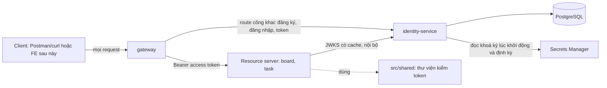
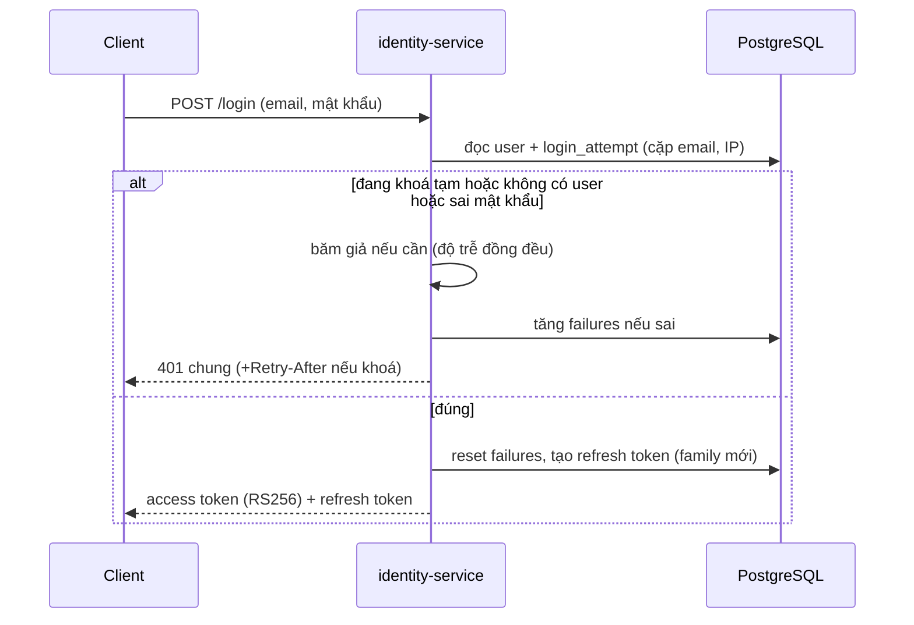
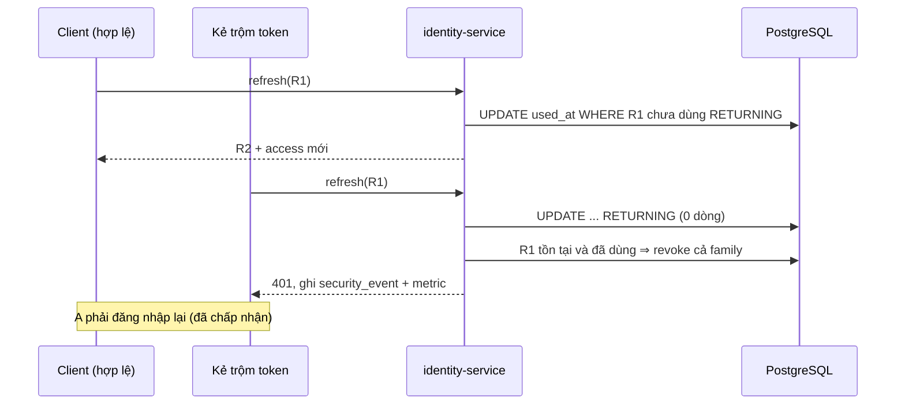

# Thiết kế: identity-service (xác thực và ủy quyền)

## 1. Bối cảnh

Spec `confirmed` (`document/spec/identity-auth.md`): tự xây `identity-service` theo I1–I8 (ADR 0006 `[Chọn để học]`, mức xa thực tế: Xa có giới hạn, xem D0.1): đăng ký/đăng nhập, JWT RS256, JWKS và xoay khoá, refresh token xoay vòng, Authorization Code + PKCE, Client Credentials, OIDC, ủy quyền theo scope. Kiến trúc service bắt buộc: Vertical Slice + PostgreSQL (`PROJECT.md`).

**Phạm vi thiết kế này (đã chốt ở design-review, Confirm log #1):** I1–I4 và I6. **I5 (Authorization Code + PKCE, trang đăng nhập, phiên cookie), I7 (OIDC) và I8 (scope, introspection)** được thiết kế bổ sung (design riêng hoặc phụ lục) **sau khi spec FE `confirmed`** (`document/spec/web-identity-ui.md`, spec identity-auth Q-13), vì chúng phụ thuộc quyết định của FE (nơi lưu token, một hay hai codebase, CORS). FR-011 (Must, I4) gồm phần huỷ phiên cookie của I5: ở I4 chỉ thu hồi refresh token, phần cookie thực hiện ở I5.

**Ngoài phạm vi thiết kế này:** I9 (gateway kiểm JWT, board-service yêu cầu đăng nhập), xác minh email, vai trò admin, giao diện (thuộc spec FE).

**Thay đổi phạm vi trong lúc design (2026-10-21):** người dùng chọn làm Angular FE để học (ADR 0009 đã chấp nhận, thay ADR 0008); spec identity-auth đã cập nhật (FR-019, NFR-010) và qua spec-review vòng 3. Cách xử lý ở D6.

### 1.1 Thuật ngữ nâng cao (giải thích lần đầu, theo `.agents/rules/explain-terms.md`)

Mục này chỉ giải thích nghĩa trong ngữ cảnh dự án, không đổi nội dung quyết định. Đọc nhanh theo nhóm; quay lại tra khi gặp từ lạ ở các mục sau.

**Token và xác thực**

| Thuật ngữ | Giải thích |
|---|---|
| JWT (JSON Web Token) | Chuỗi gồm ba phần `header.payload.chữ ký`. Payload chứa các "claim"; chữ ký cho biết ai phát token và token chưa bị sửa. Chữ ký không mã hoá nội dung nên ai cũng đọc được payload. |
| Claim | Một cặp tên và giá trị trong payload JWT. Ví dụ: `sub` (người hoặc client mà token nói về), `iss` (bên phát), `aud` (bên nhận dự kiến), `exp` (hạn), `nbf` (chưa có hiệu lực trước thời điểm này), `iat` (lúc phát), `jti` (mã duy nhất của token). |
| `aud` (audience) | Bên nhận mà token dành cho. Resource server từ chối token có `aud` không phải của mình, để token cấp cho dịch vụ A không dùng được ở dịch vụ B. |
| RS256, ES256, HS256 | Ba thuật toán ký JWT. RS256 là RSA + SHA-256: ký bằng khoá riêng, kiểm bằng khoá công khai. ES256 dùng đường cong elliptic (ECDSA), chữ ký nhỏ hơn. HS256 dùng một bí mật chung cho cả ký lẫn kiểm. |
| HMAC | Mã xác thực dùng một khoá bí mật chung. Ai kiểm được cũng ký được, nên không hợp khi nhiều service chỉ cần kiểm mà không được phép ký. |
| `kid` (key id) | Nhãn trong header JWT cho biết khoá nào đã ký, để bên kiểm chọn đúng khoá công khai khi có nhiều khoá (lúc xoay khoá). |
| JWKS (JSON Web Key Set) | Trang JSON công khai liệt kê các khoá công khai của identity. Resource server tải về, lưu cache và kiểm chữ ký tại chỗ, không phải gọi identity cho mỗi request. |
| Xoay khoá (key rotation) | Thay khoá ký bằng khoá mới theo thời gian, giữ khoá cũ thêm một lúc để token cũ còn hạn vẫn kiểm được. |
| `alg=none` và tráo khoá (key confusion) | Hai cách tấn công vào bước kiểm token: đặt header `alg` thành `none` (coi như không cần chữ ký) hoặc thành HS256 rồi dùng khoá công khai làm bí mật HMAC. Phòng bằng cách luôn ép thuật toán đã cấu hình, không tin header. |
| Refresh token, xoay vòng, phát hiện dùng lại, chuỗi (family) | Refresh token là chuỗi bí mật sống lâu để đổi lấy access token mới. Xoay vòng: mỗi lần dùng thì cấp token mới và vô hiệu token cũ. Phát hiện dùng lại: token cũ bị dùng lần nữa là dấu hiệu bị đánh cắp, nên thu hồi cả chuỗi (mọi token sinh ra từ cùng một lần đăng nhập). |
| Introspection | Endpoint để resource server hỏi identity "token này còn hiệu lực không?"; dùng khi cần thu hồi tức thời thay vì chờ token hết hạn. |
| IdP (identity provider) | Bên quản lý danh tính và đăng nhập, như Cognito, Keycloak hoặc `identity-service` tự xây. |

**OAuth và OIDC**

| Thuật ngữ | Giải thích |
|---|---|
| OAuth 2.0, OIDC | OAuth 2.0 là chuẩn để một ứng dụng (client) xin token truy cập tài nguyên. OIDC (OpenID Connect) là lớp thêm lên OAuth để biết ai đã đăng nhập (`id_token`, `userinfo`). |
| Authorization Code + PKCE | Luồng cho ứng dụng có người dùng đăng nhập: client chuyển người dùng sang identity, nhận về một mã dùng một lần rồi đổi mã lấy token. PKCE bổ sung `code_verifier` (chuỗi bí mật client tự tạo) và `code_challenge` (bản băm của nó, gửi trước) để kẻ chặn được mã cũng không đổi được token. |
| Client Credentials | Luồng giữa máy với máy: một service gửi `client_id` và bí mật của nó để nhận token, không có người dùng. |
| `redirect_uri` | Địa chỉ identity chuyển người dùng về sau khi đăng nhập. Phải khớp chính xác danh sách đã đăng ký, nếu không kẻ tấn công có thể nhận mã. |
| Scope | Chuỗi quyền mà token được cấp. Resource server kiểm scope trước khi cho thao tác. |
| `userinfo`, discovery | `userinfo` trả thông tin người dùng theo scope. Discovery (`/.well-known/openid-configuration`) là trang JSON liệt kê các endpoint để client tự cấu hình. |

**Trình duyệt và tấn công web**

| Thuật ngữ | Giải thích |
|---|---|
| SPA (single-page application) | Ứng dụng web chạy trong trình duyệt, tải một lần rồi tự cập nhật giao diện (Angular). Mã và token nằm ở máy người dùng. |
| Origin | Bộ ba giao thức, tên miền và cổng của một trang. Trình duyệt cô lập script và cookie theo origin. |
| CORS | Cơ chế cho trang ở origin này gọi API ở origin khác khi server cho phép. Cấu hình sai thì lộ API hoặc chặn nhầm. |
| CSRF | Tấn công khiến trình duyệt đã đăng nhập của nạn nhân tự gửi request không chủ ý (vì cookie gửi kèm tự động). Phòng bằng token chống giả mạo và thuộc tính cookie `SameSite`. |
| Clickjacking, CSP | Clickjacking: nhúng trang đăng nhập vào khung ẩn để lừa người dùng bấm. CSP (Content Security Policy) là header giới hạn nguồn script và khung được phép; `frame-ancestors none` cấm nhúng. |
| BFF (backend for frontend) | Một server nhỏ đứng giữa SPA và API, giữ token ở phía server để SPA chỉ cầm cookie. |

**Mô hình đe doạ và mật khẩu**

| Thuật ngữ | Giải thích |
|---|---|
| STRIDE | Sáu loại đe doạ để rà từng ranh giới tin cậy: Spoofing (giả mạo), Tampering (sửa), Repudiation (chối bỏ), Information disclosure (lộ thông tin), Denial of service (từ chối dịch vụ), Elevation of privilege (leo quyền). |
| IDOR | Truy cập dữ liệu người khác bằng cách đổi id trong request vì server không kiểm quyền. Phòng bằng cách lấy danh tính từ token, không nhận `userId` từ client. |
| DoS | Làm dịch vụ nghẽn để người khác không dùng được. Ở đây rủi ro chính là băm mật khẩu tốn CPU. |
| Credential stuffing | Thử hàng loạt cặp email và mật khẩu đã lộ từ nơi khác. |
| MFA | Xác thực nhiều yếu tố (mật khẩu cộng mã khác); ngoài phạm vi. |
| Salt, PBKDF2 | Salt: chuỗi ngẫu nhiên trộn vào mật khẩu trước khi băm, để hai người cùng mật khẩu có hash khác nhau. PBKDF2: hàm băm mật khẩu cố ý chậm (lặp nhiều vòng) để kẻ có hash khó đoán ngược. |
| Rate limit | Giới hạn số request trong một khoảng thời gian, ở đây theo IP. |
| BCL | Base Class Library, thư viện chuẩn của .NET, gồm các hàm mật mã (`System.Security.Cryptography`). |
| Secrets Manager, KMS, HSM | Secrets Manager: dịch vụ AWS lưu bí mật có kiểm soát truy cập. KMS: dịch vụ quản lý khoá, khoá không rời dịch vụ và có thể ký thay mình. HSM: thiết bị phần cứng chuyên giữ khoá. |
| Data Protection (ASP.NET Core) | Thư viện mã hoá dữ liệu như cookie phiên. Khoá của nó phải nhất quán qua restart và nhiều instance. |

**Dữ liệu và tương thích**

| Thuật ngữ | Giải thích |
|---|---|
| CAS (compare-and-set) | Cập nhật một giá trị chỉ khi nó vẫn đúng như lúc mình đọc. Ví dụ: `UPDATE ... WHERE used_at IS NULL` cập nhật được 1 dòng thì thắng, 0 dòng thì thua. Dùng để hai request đổi cùng refresh token chỉ có một request thành công. |
| `UPDATE ... RETURNING` | Cú pháp PostgreSQL trả về luôn dòng vừa cập nhật trong cùng câu lệnh (SQL Server dùng `OUTPUT`). |
| Upsert (`ON CONFLICT`, `MERGE`) | Chèn nếu chưa có, cập nhật nếu đã có, trong một lệnh. `ON CONFLICT` của PostgreSQL nguyên tử; `MERGE` của SQL Server có tiếng là dễ lỗi đua nếu thiếu khoá. |
| Dual write | Ghi vào hai nơi (ví dụ DB và Secrets Manager) bằng hai thao tác riêng, nên có thể thành công một nơi và lỗi ở nơi kia, gây lệch dữ liệu. |
| Idempotency | Gọi lặp cùng một thao tác cho cùng kết quả, không lặp tác dụng phụ. |
| Expand/contract | Đổi schema an toàn qua nhiều lần deploy: thêm cột mới (expand), chuyển code sang dùng, rồi gỡ cột cũ (contract); mỗi bước quay lại được. |
| TTL (time to live) | Thời gian sống của một bản ghi hoặc bản cache trước khi hết hạn (ví dụ cache JWKS 10 phút). |
| GSI (DynamoDB) | Global secondary index: chỉ mục phụ để tra cứu theo thuộc tính không phải khoá chính. |
| EF Core, Npgsql, Dapper | EF Core: ORM của .NET. Npgsql: driver PostgreSQL cho .NET. Dapper: thư viện chạy SQL thô gọn nhẹ. |

**Kiến trúc, kiểm thử, vận hành**

| Thuật ngữ | Giải thích |
|---|---|
| Vertical Slice, Clean Architecture, shared kernel | Vertical Slice: chia mã theo tính năng, mỗi lát tự chứa. Clean Architecture: chia theo lớp (Domain, Application, Infrastructure), phụ thuộc hướng vào trong. Shared kernel: phần mã dùng chung giữa các lát hay lớp. |
| Testcontainers, contract test | Testcontainers: chạy dịch vụ thật (PostgreSQL) trong container khi test. Contract test: kiểm hai bên (bên phát và bên kiểm token) hiểu cùng một hợp đồng. |
| p95, SLI, SLO, error budget | p95: 95% request nhanh hơn ngưỡng này. SLI: chỉ số đo (tỉ lệ thành công). SLO: mục tiêu cho SLI. Error budget: phần lỗi còn được phép trong kỳ. |
| Pre-mortem | Tưởng tượng dự án đã thất bại rồi tìm lý do, trước khi làm. |
| Rollback | Quay lại phiên bản trước khi bản mới có sự cố. |
| Fargate, ALB, NAT | Fargate: chạy container trên AWS không quản lý máy chủ. ALB: bộ cân bằng tải HTTP của AWS. NAT Gateway: cho máy ở mạng riêng ra Internet, tính tiền theo giờ. |
| NTP | Giao thức đồng bộ đồng hồ; lệch đồng hồ làm kiểm `exp` và `nbf` sai. |

## 2. Yếu tố quyết định (drivers)

### 2.1 FR then chốt
| ID | Yêu cầu | Tác động tới thiết kế |
|---|---|---|
| FR-002/003 | Đăng nhập, lỗi chung, khoá tạm theo (email, IP) | Trạng thái đếm sai bền vững; phản hồi đồng nhất về nội dung và độ trễ (D5) |
| FR-005/006 | Phát JWT; resource server tự kiểm cục bộ qua JWKS | Hợp đồng claim + thư viện kiểm dùng chung (D2) |
| FR-007/008 | JWKS, xoay khoá không hỏng token còn hạn | Nhiều khoá đồng thời, chu trình xoay (D3, D7) |
| FR-009/010 | Refresh xoay vòng, phát hiện dùng lại | Cập nhật nguyên tử, chuỗi (family) (D4) |
| FR-012/013/019 | Auth Code + PKCE, trang đăng nhập | Phụ thuộc quyết định FE (D6) |
| FR-021 | Introspection tối thiểu | Endpoint bảo vệ bằng token máy |

### 2.2 NFR (có số đo)
| ID | Thuộc tính | Mục tiêu | Nguồn |
|---|---|---|---|
| NFR-005 | Quy mô, độ trễ | <100 người dùng, <10 req/s, đăng nhập p95 <1 giây | Spec (A-05) |
| NFR-002 | Băm mật khẩu | PBKDF2 theo OWASP hiện hành, không tự cài mật mã | Spec/ADR 0006 |
| NFR-008 | Rate limit | 10 req/phút/IP cho đăng ký, đăng nhập, `token`; 429 + `Retry-After` | Spec |
| NFR-009 | Sẵn sàng | Không SLA; mất DB dev chấp nhận | Spec |
| SLI/SLO (giả định) | Tỉ lệ thành công đăng nhập hợp lệ; p95 ký token | 99% trong 30 ngày (loại 429/401 hợp lệ); p95 phát token <1 giây | **Giả định của design, cần xác nhận**; dùng làm cơ sở cảnh báo |
| Ngân sách | Trần chi phí AWS cả dự án | 20 USD/tháng | Người dùng (2026-10-21), đã ghi `quality.monthlyBudgetUsd: 20` vào `config/project.yaml` (Confirm log #4) |

### 2.2b Truy vết FR/NFR → thành phần (phạm vi I1–I4, I6)

| Yêu cầu | Xử lý ở | Ghi chú |
|---|---|---|
| FR-001, FR-004, FR-022, BR-001/002 | Slice `Register`, `ChangePassword`; `Passwords` (D8 băm); ràng buộc unique `email_norm` | Mục 6.2, 7 |
| FR-002, FR-003, BR-003 | Slice `Login`; `login_attempt` (D5); băm giả | Mục 6.4 |
| FR-005, BR-004, BR-008 | `Tokens` (phát JWT RS256, D1, D2); claim contract (D2) | |
| FR-006 | Thư viện `Teamboard.Auth` (D2) | Test: mục 11 |
| FR-007, FR-008 | Slice `Jwks`; `Keys` (D3); lệnh xoay CLI (D7) | |
| FR-009, FR-010, FR-011 (phần refresh) | Slice `Refresh`, `Logout`; `refresh_token` (D4) | Phần huỷ cookie: I5 |
| FR-014 (phần client máy), FR-015 | `client` seed từ cấu hình/migration; slice `Token` grant `client_credentials` | Chi tiết ở I6 khi vào plan |
| NFR-001, NFR-003, NFR-004, NFR-007 | Mục 6.3, 9 (health, problem+json, `correlationId`, metric) | |
| NFR-002, NFR-005 | D8 (băm), mục 3 | Benchmark ở I1 |
| NFR-006 | Mục 11 (test tấn công) | |
| NFR-008 | D5 (rate limit) | |
| NFR-009 | Mục 10 | |
| FR-012, FR-013, FR-016–FR-021, FR-019, NFR-010 | **Ngoài design này** (I5, I7, I8) | Design bổ sung sau spec FE |

### 2.3 Ràng buộc
ASP.NET Core .NET 10, PostgreSQL, ECS Fargate (ADR 0003), Terraform (ADR 0004), nguyên thuỷ mật mã .NET BCL (ADR 0006), khoá riêng ở Secrets Manager, không dùng cho dữ liệu/người dùng thật (A-05, ADR 0006). Lý do cho ranh giới service, database riêng, PostgreSQL và Vertical Slice nằm ở D0 (không chỉ là ràng buộc có sẵn).

## 3. Ước lượng nhanh

| Đại lượng | Giá trị | Công thức / giả định |
|---|---|---|
| Tải đỉnh | 10 req/s | NFR-005 |
| Tài khoản | <100, ~1 KB/dòng | Không đáng kể |
| Refresh token | ≤100 người × vài phiên × 7 ngày → vài trăm dòng | Dọn sau 30 ngày (spec mục 9) |
| Sự kiện bảo mật | ≤ vài nghìn dòng/ngày, giữ 90 ngày | Giả định dưới 10 login/phút trung bình |
| Chi phí băm PBKDF2 | ~0,2–0,6 giây CPU mỗi lần ở 600.000 vòng HMAC-SHA256 | **Chưa đo**; phụ thuộc vCPU. Với 0,25 vCPU có thể gần 1 giây và **phá NFR-005** → bắt buộc benchmark trước khi chốt kích thước task |
| Kích thước JWT RS256 | ~800–1000 byte | RSA 2048 chữ ký 256 byte (base64url ~342) + claim |

**Kết luận bậc độ lớn:** tải rất nhỏ; một instance đủ. Điểm nghẽn thực là **CPU cho băm mật khẩu và chi phí chạy rỗng so với trần 20 USD**, không phải thông lượng. Kiến trúc đơn giản là đủ.

## 4. Tổng quan kiến trúc

Chú thích: mọi client vào qua gateway (đường vào công khai duy nhất, D0.5); identity-service chỉ nhận traffic từ gateway; resource server kiểm token cục bộ bằng thư viện chung và chỉ tải JWKS trực tiếp từ identity (đường nội bộ).

Cấu trúc code (Vertical Slice): mỗi tính năng là một thư mục tự chứa (endpoint, handler, validator, truy cập dữ liệu): `Register`, `Login`, `Refresh`, `Logout`, `ChangePassword`, `Jwks`, `Authorize`, `Token`, `Clients`, `Introspect`, `UserInfo`, `Discovery`. Phần dùng chung trong service giữ tối thiểu: `Tokens` (ký/phát), `Keys` (nạp khoá), `Passwords` (băm), `Security` (log/metric sự kiện bảo mật).

## 5. Các quyết định chính

Người dùng chọn trước (chế độ học); bên dưới là so sánh để đối chiếu và điểm cần lưu ý.

### D0. Quyết định cấp service: ranh giới, database riêng, loại database, kiến trúc nội bộ

Bốn quyết định này trước đây chỉ được coi là ràng buộc (ADR 0001, `PROJECT.md`) mà chưa có lý do. Phần này so sánh phương án thật và nói rõ lý do nào là kỹ thuật, lý do nào là để học. Mức tin cậy của các nhận định về sản phẩm bên ngoài (giá, giới hạn) ghi ở từng chỗ; **chưa xác minh bằng nguồn**, `aws-service-selection` phải kiểm lại.

#### D0.1 Ranh giới: identity là service riêng — `[Chọn để học]` (người dùng chọn, Confirm log #8)

| Phương án | Ưu | Nhược |
|---|---|---|
| A. Service riêng (chọn) | Khoá ký riêng và hash mật khẩu chỉ tồn tại ở một service (giảm bán kính ảnh hưởng nếu service khác bị xâm nhập); tải CPU băm mật khẩu có hồ sơ khác board nên tách để scale riêng; triển khai và đổi schema độc lập; luyện JWKS, kiểm token liên service | Thêm một service phải vận hành (chi phí chạy rỗng, observability, CI); gọi mạng thay vì gọi hàm |
| B. Module trong board-service | Rẻ nhất, ít công nhất, không có JWKS/mạng | Khoá ký và hash cùng tiến trình và DB với dữ liệu nghiệp vụ; mất bài học tách service |
| C. IdP managed (Cognito) | Thực tế nhất cho sản phẩm; trả theo người dùng; ít vận hành | Trái mục tiêu tự xây (ADR 0006) |

- **Nhãn trung thực:** ở quy mô này (<100 người dùng, <10 req/s) phương án B đủ về kỹ thuật. Lý do chọn A gồm hai phần: lý do kỹ thuật thật (cách ly khoá ký/hash, hồ sơ CPU băm) và lý do học (tách service). Không coi A là bắt buộc về tải.
- **Cách thực tế làm và mức xa thực tế (theo `system-design` nguyên tắc 6):** có hai phần, nên đánh giá riêng.
  - *Tách identity thành service riêng:* ở dự án thật, nhiều service dùng chung danh tính thường có một dịch vụ xác thực riêng (hoặc dùng IdP managed/nguồn mở như Cognito, Keycloak). Mức: **Gần** (bản thu nhỏ hợp lý; hơi dư so với tải <100 người dùng).
  - *Tự xây OAuth/OIDC thay vì dùng IdP có sẵn (ADR 0006):* dự án thật thường dùng IdP managed hoặc nguồn mở và hiếm khi tự viết. Mức: **Xa**. Đã được chủ dự án xác nhận ở ADR 0006 và được giới hạn: chỉ dùng nguyên thuỷ BCL, không dùng cho dữ liệu/người dùng thật (A-05), Cognito là phương án nên dùng khi làm sản phẩm thật. D2 thu hẹp phần Xa: dùng thư viện JWT chuẩn thay vì tự viết (mức Gần).
- **Vì sao không B:** mất cách ly khoá và hash, trái ADR 0001. **B đúng khi** chỉ có một ứng dụng dùng danh tính và không cần học microservice. **Vì sao không C:** ADR 0006; **C đúng khi** làm sản phẩm thật.
- **Tín hiệu xem lại:** identity không còn được dùng bởi hơn một service; hoặc chi phí chạy rỗng làm vượt ngân sách dù đã tắt ngoài giờ.

#### D0.2 Database riêng cho identity — `[Cần]` (người dùng giao theo thực tế, Confirm log #9)

Mẫu phổ biến cho database-per-service gồm ba mức cô lập: bảng riêng trong DB chung, schema riêng, server/instance riêng (Chắc về pattern; tên gọi khác nhau tuỳ tác giả).

| Phương án | Cô lập | Chi phí | Ghi chú |
|---|---|---|---|
| A. Database + user riêng, chung instance ở dev; instance riêng cho identity ở môi trường thật (chọn) | Credential riêng: không truy cập chéo được; hash/refresh token không chung DB với dữ liệu nghiệp vụ | Dev: gần như bằng 0 khi chung instance (README mục 5); thật: một instance thêm | Cách làm phổ biến: gom ở dev cho rẻ, tách ở môi trường thật cho dữ liệu nhạy cảm |
| B. Instance riêng ở mọi môi trường | Cao nhất | RDS chạy rỗng nhân lên, vượt trần 20 USD | Chỉ khi ngân sách cho phép |
| C. Chung database/schema với service khác | Thấp; lộ hash nếu service kia bị SQL injection | Thấp nhất | Phá quy tắc dự án "mỗi service một DB, không truy cập DB của service khác" |

- **Chọn A.** Mỗi service có database và user riêng; chung một instance PostgreSQL ở dev (identity dùng chung với `task-service` vì cùng PostgreSQL). Instance riêng cho identity ở stg/prod chốt ở `aws-service-selection` theo ngân sách.
- **Vì sao không C:** phá quy tắc và là rủi ro bảo mật thật (hash mật khẩu chung phạm vi lỗi với dữ liệu nghiệp vụ). **C đúng khi** một ứng dụng đơn khối.
- **Rủi ro còn lại:** chung instance ở dev nghĩa là một instance chết thì cả hai service chết và tranh tài nguyên; chấp nhận ở dev (NFR-009).
- **Tín hiệu xem lại:** có yêu cầu dùng dữ liệu thật (ADR 0006) → tách instance bắt buộc.

#### D0.3 Loại database — PostgreSQL — `[Cần]` với lý do kỹ thuật, có nêu rõ phần yếu (Confirm log #10)

Yêu cầu dữ liệu của identity: email duy nhất; đổi refresh token đúng một lần thành công khi đồng thời (D4); đếm đăng nhập sai có upsert nguyên tử (D5); thu hồi theo `family_id` và theo `user_id` (FR-022); dọn bản ghi hết hạn; truy vấn điều tra sự kiện bảo mật.

| Tiêu chí | PostgreSQL | SQL Server | DynamoDB |
|---|---|---|---|
| Duy nhất email | Ràng buộc `UNIQUE` | Ràng buộc `UNIQUE` | Không có unique trên thuộc tính ngoài khoá; phải tạo item riêng cho email và dùng transaction |
| CAS nguyên tử khi đổi refresh | `UPDATE … RETURNING` một câu | `UPDATE … OUTPUT` một câu (làm được) | Conditional write + `ReturnValues` (làm tốt, tự nhiên) |
| Upsert đếm đăng nhập sai | `INSERT … ON CONFLICT DO UPDATE` nguyên tử | `MERGE` hoặc `UPDATE`+`INSERT`; `MERGE` có tiếng là dễ lỗi đua nếu thiếu khoá (Vừa) | `UpdateItem` + `ADD`, tốt |
| Thu hồi theo `family_id`/`user_id` | Chỉ mục thường, một câu `UPDATE` | Giống PostgreSQL | Cần GSI cho mỗi khoá tra cứu, thu hồi hàng loạt phải lặp từng item |
| Hết hạn tự động | Job dọn | Job dọn | TTL có sẵn (lợi thế) |
| Điều tra bảo mật ad hoc | SQL tự do | SQL tự do | Khó, phải thiết kế trước các khoá truy vấn |
| Chi phí AWS, dev | Chung instance với task-service: gần 0 biên | Giấy phép làm RDS đắt hơn; bản Express giới hạn (Vừa, chưa xác minh) | On-demand gần 0 khi rỗng (lợi thế lớn nhất) |
| Chạy local | Container nhẹ | Container nặng hơn (cần RAM lớn), dù board đã có | Cần LocalStack/DynamoDB Local |
| Dùng được EF Core | Có (Npgsql) | Có | Không (ORM khác) |

- **Chọn PostgreSQL.** Lý do kỹ thuật thật: (1) mô hình quan hệ khớp: unique, thu hồi theo hai khoá, truy vấn điều tra; (2) cả D4 và D5 viết được thành một câu lệnh nguyên tử, `ON CONFLICT` an toàn hơn `MERGE`; (3) chi phí biên gần 0 vì chung instance với `task-service` (cũng PostgreSQL) ở dev; (4) EF Core như board.
- **Phần yếu cần nói thẳng:** **SQL Server cũng đáp ứng gần như đủ** về kỹ thuật; lợi thế của PostgreSQL so với SQL Server chủ yếu là chi phí (giấy phép) và upsert, không phải khả năng. **DynamoDB là đối thủ nghiêm túc** cho riêng bảng `refresh_token`, `login_attempt`, mã uỷ quyền (khoá-giá trị, TTL, conditional write, rẻ khi rỗng) và sẽ thắng nếu chi phí chạy rỗng là ràng buộc số một.
- **Vì sao không DynamoDB cho cả service:** email duy nhất, thu hồi hàng loạt theo `user_id`/`family_id` và điều tra bảo mật bằng SQL phải thiết kế thêm GSI/transaction; phức tạp hơn mà không đổi được tải. **DynamoDB đúng khi** RDS không thể chung instance và ngân sách là ràng buộc cứng, hoặc quy mô token lớn.
- **Vì sao không SQL Server:** chi phí giấy phép và container nặng hơn, lợi thế duy nhất là cùng công cụ với board; không có khả năng nào PostgreSQL thiếu. **SQL Server đúng khi** muốn một hệ DB duy nhất để giảm vận hành.
- **Không dùng "đa dạng DB" làm lý do kỹ thuật:** đa dạng có trong mục tiêu học của dự án nhưng không phải lý do cho quyết định này.
- **Khả năng đảo ngược:** vừa; truy cập qua EF Core và SQL thô nằm trong từng slice nên đổi sang SQL Server tương đối dễ, đổi sang DynamoDB là viết lại tầng dữ liệu.
- **Tín hiệu xem lại:** chi phí RDS không thể chung instance và vượt trần; hoặc `refresh_token` ghi nhiều đến mức DB là nút cổ chai (xem mục 12).
- **Use case tương tự:**

| Bài toán gốc | Lựa chọn phổ biến | Khác với ta | Tin cậy |
|---|---|---|---|
| Hệ identity tự lưu người dùng, phiên | RDBMS (PostgreSQL phổ biến trong nhiều sản phẩm nguồn mở như Keycloak, hỗ trợ nhiều RDBMS) | Ta chỉ cần một RDBMS | Vừa (không dẫn công ty cụ thể) |
| Lưu phiên/token có hết hạn tự động ở quy mô lớn | Kho khoá-giá trị có TTL (Redis/DynamoDB) | Ta quy mô nhỏ, chưa cần | Vừa |

#### D0.4 Kiến trúc nội bộ: Vertical Slice — `[Chọn để học]` có lý do kỹ thuật vừa phải (Confirm log #11)

| Tiêu chí | Vertical Slice (chọn) | Clean Architecture (như board) | Layered đơn giản |
|---|---|---|---|
| Phù hợp domain | Tốt khi các use case độc lập, ít mô hình miền dùng chung | Tốt khi có miền phong phú, nhiều bất biến nghiệp vụ | Tốt khi CRUD |
| Identity có miền phong phú không | **Không**: quy tắc chính là bảo mật + giao dịch dữ liệu (CAS, khoá tạm, xoay token), phần lớn nằm trong một câu SQL, không phải mô hình miền | Lớp Domain/Application mỏng, ít giá trị | Rủi ro dồn logic vào service lớn |
| Đặt SQL nguyên tử | Cạnh endpoint dùng nó (D4, D5 là SQL riêng từng slice) | Phải đi qua repository, dễ che mất tính nguyên tử cần thiết | Lẫn trong service |
| Quy tắc bảo mật chéo slice (khoá tạm, rate limit, thu hồi) | **Rủi ro:** dễ lặp hoặc áp dụng không đều giữa các slice | Tập trung ở Application | Tập trung nhưng kém tách bạch |
| Khả năng test | Test theo slice (BDD) tự nhiên | Test từng lớp, tách hạ tầng tốt | Khó tách |
| Học | Khác board, so sánh được | Trùng board | Ít |

- **Cách thực tế làm và mức xa thực tế:** Vertical Slice được dùng trong các dự án .NET thực tế (đặc biệt với API nhỏ, nhiều use case độc lập) song song với Clean Architecture và layered; không có kiến trúc duy nhất đúng. Mức: **Gần**. Phần "mỗi service một kiến trúc khác nhau" là quy tắc học của dự án (`PROJECT.md`); ở dự án thật thường chọn một kiến trúc thống nhất, nên đây là điểm khác thực tế đã được chấp nhận có chủ ý.
- **Chọn Vertical Slice.** Lý do kỹ thuật: miền của identity mỏng, mỗi tính năng (Register, Login, Refresh, Jwks, Token...) gần như độc lập và gắn với một câu lệnh dữ liệu riêng; Clean Architecture thêm lớp mà ít bất biến miền để bảo vệ. Lý do học: `PROJECT.md` bắt buộc mỗi service một kiến trúc khác nhau, nên không coi đây là lựa chọn thuần kỹ thuật.
- **Điểm yếu phải giảm bằng thiết kế:** quy tắc bảo mật dùng chung phải tập trung, không để mỗi slice tự làm: `Passwords`, `Tokens`, `Keys` và phần khoá tạm/`Security` (mục 4) là **shared kernel bắt buộc**; slice không được tự cài lại khoá tạm hay kiểm token.
- **Vì sao không Clean Architecture:** thêm lớp mà ít giá trị ở miền mỏng, trùng board nên mất so sánh học. **Clean đúng khi** identity sau này có miền phong phú (tổ chức, vai trò, chính sách phức tạp).
- **Vì sao không layered đơn giản:** dồn logic bảo mật vào service lớn khó test từng tính năng, và trái quy tắc dự án "không đơn giản hoá về CRUD layered".
- **Tín hiệu xem lại:** shared kernel vượt khoảng một phần ba mã của service; hoặc cùng một lỗi quy tắc bảo mật xuất hiện ở hơn một slice; hoặc thêm vai trò/tổ chức làm miền phức tạp.

#### D0.5 Đường vào: client đi qua gateway — `[Cần]` (người dùng chọn A, Confirm log #12)

Phát hiện sau khi design đã qua một vòng review: sơ đồ và D5/D6 coi identity như được client gọi thẳng, trong khi kiến trúc dự án quy định "client → gateway → service" (`document/architecture/README.md` mục 2, ADR 0002) và `api-endpoints.md` đặt CORS, rate limit, `X-Correlation-Id` ở gateway.

| Phương án | Tuân quy tắc dự án | Chi phí | Ghi chú |
|---|---|---|---|
| A. Qua gateway như mọi service (chọn) | Có | Một đường vào công khai | Gateway có route công khai (không cần JWT) cho identity; identity chỉ nhận traffic từ gateway |
| B. Identity có host công khai riêng | Không: cần ADR ngoại lệ cho CORS/rate limit | Thêm một đường vào (thêm ALB, trần 20 USD) | Cách các IdP như Cognito, Auth0, Keycloak thường làm; origin và cookie độc lập |
| C. Lai: API JSON qua gateway, OAuth/OIDC và trang đăng nhập ở host riêng | Một phần | Thêm một đường vào | Hai nơi cấu hình rate limit/CORS, phức tạp nhất |

- **Chọn A.** Cách thực tế làm: khi cả hệ thống đã có một gateway thì identity thường nằm sau nó với các route công khai; mức xa thực tế: **Gần**.
- **Hợp đồng đường vào:**
  - Gateway định tuyến theo tài nguyên (không có tên service trong path): `/api/v1/auth/**` (đăng ký, đăng nhập, refresh, đăng xuất, đổi mật khẩu), `/connect/token`, và khi tới I5/I7: `/connect/authorize`, `/connect/userinfo`, `/.well-known/jwks.json`, `/.well-known/openid-configuration`. Route đăng ký, đăng nhập, refresh, `token`, `authorize`, JWKS và discovery là **công khai** (không cần JWT); `/password`, `userinfo` cần Bearer.
  - Gateway thực thi: rate limit (NFR-008), CORS, tạo hoặc chuyển `X-Correlation-Id` và `traceparent`, đặt `X-Forwarded-For`.
  - Identity: tin `X-Forwarded-For` **chỉ** từ gateway; ở môi trường triển khai chỉ nhận traffic từ gateway (security group); giữ khoá tạm trong DB (D5) và tự kiểm quyền; `iss` là URL công khai của gateway.
  - Đường nội bộ không qua gateway: resource server tải JWKS và gọi introspection trực tiếp từ identity.
  - Giai đoạn gateway chưa đủ tính năng (I1–I4): gọi identity trực tiếp ở local và test; chỉ hợp đồng route được chốt ở đây, route do I9 dựng. Trạng thái gateway thực tế (2026-10-25): chỉ có lát 1; spec `api-gateway` mới mô tả route boards, nên I9 phải kèm thay đổi spec/design gateway để thêm các route công khai của identity (kiểm JWT vẫn ngoài phạm vi gateway hiện tại).
- **Vì sao không B:** trái `api-endpoints.md` (CORS, rate limit ở gateway) nên cần ADR ngoại lệ; thêm đường vào và chi phí; thêm một nơi cấu hình `X-Forwarded-For`. **B đúng khi** identity cần tên miền riêng ổn định cho nhiều ứng dụng hay đối tác, hoặc dùng như một IdP công khai.
- **Vì sao không C:** hai đường vào, hai nơi cấu hình, ADR ngoại lệ một phần. **C đúng khi** chỉ muốn tách trang đăng nhập khỏi API vì lý do cookie hoặc thương hiệu.
- **Đánh đổi chấp nhận:** gateway thành điểm lỗi đơn của đăng nhập (gateway chết thì không đăng nhập được) và e2e cần gateway tồn tại; phải bảo đảm không truy cập vòng qua gateway.
- **Khả năng đảo ngược:** vừa; đổi `iss` hoặc URL công khai là thay đổi phá vỡ với client đã đăng ký và token còn hạn.
- **Tín hiệu xem lại:** cần tên miền riêng cho identity (nhiều ứng dụng/đối tác), hoặc gateway thành nút cổ chai ở đăng nhập.

### D1. Thuật toán ký JWT — chọn **RS256 (RSA 2048)** (người dùng chọn)
- **Tiêu chí:** có sẵn BCL (cao), tương thích resource server (cao), kích thước token (thấp), tốc độ ký (thấp ở tải này), dễ debug (vừa).
- **Nhãn:** `[Cần]` (phải chọn một thuật toán). Cả ba phương án đều khả thi về mặt kỹ thuật; tiêu chí ở trên quyết định chọn A.

| Phương án | Tương thích | Kích thước | Tốc độ ký | Ghi chú |
|---|---|---|---|---|
| A. RS256 | Tốt (mọi thư viện) | Vừa: token ~1 KB | Vừa: ký chậm hơn ES, xác minh nhanh | Phổ biến nhất, dễ debug bằng công cụ có sẵn |
| B. ES256 | Tốt, hơi ít hơn | Tốt: nhỏ | Tốt | Dễ sai định dạng chữ ký (r‖s so với DER); tải này không cần lợi thế |
| C. HS256 | Kém với JWKS | Tốt | Tốt | Mọi service giữ bí mật chung: ai kiểm được cũng ký được; không hợp mô hình công khai khoá |

- **Khuyến nghị:** A (trùng lựa chọn của bạn), vì tải thấp nên chi phí ký không đáng kể và tương thích ưu tiên hơn kích thước.
- **Vì sao không B:** lợi thế kích thước/tốc độ không cần ở <10 req/s. **B đúng khi** token qua kênh hạn chế kích thước (header) hoặc ký hàng nghìn/giây.
- **Vì sao không C:** phá mô hình "chỉ identity ký, mọi nơi kiểm". **C đúng khi** chỉ có một service tự phát và tự kiểm.
- **Đánh đổi:** chữ ký RS256 (256 byte, ~342 ký tự base64url) lớn hơn ES256 (64 byte, ~86 ký tự), nên token to hơn khoảng 1,5–2 lần (cùng claim); kích thước header Authorization vẫn nhỏ so với giới hạn thường gặp.
- **Khả năng đảo ngược:** dễ nếu `kid` gắn thuật toán (BR/spec: mỗi `kid` một thuật toán) và resource server chỉ chấp nhận thuật toán cấu hình; đổi = thêm khoá mới + xoay.
- **Tín hiệu xem lại:** p95 ký token >200 ms trên tải thật, hoặc token >4 KB sau thêm claim.
- **Use case tương tự:**

| Bài toán gốc | Lựa chọn phổ biến | Vì sao hợp | Khác với ta | Tin cậy |
|---|---|---|---|---|
| IdP công khai (OIDC) phát token cho nhiều bên | RS256 mặc định theo OIDC Core (bắt buộc hỗ trợ RS256) | Mọi client hiểu | Ta chỉ có vài resource server nội bộ | Chắc |

### D2. Bộ kiểm token cho resource server và hợp đồng claim — chọn **thư viện dùng chung trong `src/shared`** (người dùng chọn)
- **Tiêu chí:** không gọi identity mỗi request (cao), tránh lệch logic kiểm giữa service (cao), `src/shared` chỉ chứa contract/cross-cutting (cao, ràng buộc cứng).
- **Nhãn:** `[Cần]`.

| Phương án | Đúng/nhất quán | Ranh giới shared | Chi phí bảo trì |
|---|---|---|---|
| A. Thư viện chung `Teamboard.Auth` | Tốt: một nơi sửa | Hợp lệ nếu chỉ chứa cấu hình kiểm token + hằng claim (cross-cutting, không business) | Vừa: nâng version đồng loạt |
| B. Mỗi service tự cấu hình `JwtBearer` | Kém: dễ lệch (quên kiểm `aud`, `alg`) | Không cần shared | Thấp ban đầu, cao khi lệch |
| C. Chỉ gateway kiểm | Thấp: lọt gateway = mất bảo vệ, trái FR-006 | Không | Thấp |
| D. Tự viết dựng/kiểm JWT trên BCL (hướng ADR 0006/I2 ban đầu) | Trung bình: mọi resource server chạy mã kiểm tự viết | Hợp lệ nhưng chứa logic mật mã/giao thức | Cao: tự bảo trì, rủi ro bảo mật nhân N service |

- **Khuyến nghị:** A. Thư viện **chỉ** bọc `JwtBearer` của ASP.NET + JWKS cache + hằng claim, **không** tự cài kiểm chữ ký. `src/shared` hợp lệ vì đây là cross-cutting security, nhưng **không** đặt model người dùng hay quy tắc nghiệp vụ vào đó.
- **Quyết định bổ sung: đã xác nhận (Confirm log #2). Agent chọn theo uỷ quyền "Cái nào sát với real-world project hơn thì ưu tiên", người dùng xác nhận kết quả cụ thể là phương án A ngày 2026-10-22.** Phương án thay thế chính đã loại: *lai*, tức identity tự viết phát/kiểm JWT trên BCL đúng ADR 0006/I2, resource server vẫn dùng JwtBearer. Kết quả: phía phát token, `identity-service` dùng thư viện chuẩn `Microsoft.IdentityModel.JsonWebTokens` (`JsonWebTokenHandler`, ký RSA bằng BCL), **không** tự dựng/parse JWT bằng tay. Đây là cách các dự án thực tế làm. **Hệ quả:** phạm vi "được tự viết logic phát/kiểm token" của ADR 0006 và I2 trong `identity-learning.md` thu hẹp; cần **ADR mới** sửa phạm vi đó (mục 16) và cập nhật I2 theo hướng học cấu hình đúng (ép `alg`, `kid`, claim, dung sai), test tấn công và đọc mã nguồn thư viện, thay vì viết lại. **Vì sao không D:** tăng bề mặt lỗi bảo mật cho mọi service, trái hướng thực tế; **D đúng khi** mục tiêu duy nhất là hiểu từng byte của JWT (có thể làm thử nghiệm trong lab/test, không đưa vào sản xuất).
- **Vì sao không B:** lỗi cấu hình (không ép `alg`, không kiểm `aud`) là lỗi bảo mật kinh điển nhân N service. **B đúng khi** chỉ có một resource server.
- **Vì sao không C:** FR-006 yêu cầu mỗi resource server tự kiểm. **C đúng khi** mạng nội bộ tin cậy hoàn toàn và chỉ có đường vào qua gateway (không đúng ở đây).
- **Hợp đồng claim đề xuất (cần xác nhận, ghi vào `document/contracts/` khi thành lát):**

| Claim | Giá trị |
|---|---|
| `iss` | URL công khai của gateway (đường vào, D0.5), cấu hình được |
| `aud` | `teamboard` (một audience chung giai đoạn đầu; tách theo service khi cần) |
| `sub` | `userId` (token người) hoặc `client_id` (token máy) |
| `scope` | chuỗi cách nhau bằng dấu cách |
| `token_use` | `user` hoặc `machine` (BR-008) |
| `client_id` | client đã xin token |
| `jti`, `iat`, `nbf`, `exp` | theo FR-005 |

- **Cache JWKS:** TTL 10 phút; gặp `kid` lạ thì tải lại tối đa 1 lần/phút (chặn DoS bằng `kid` giả); tải lỗi giữ bản cũ.
- **Đánh đổi:** nâng version thư viện phải phối hợp mọi service; `aud` chung làm token dùng được ở mọi service.
- **Khả năng đảo ngược:** vừa; đổi `aud` là breaking change contract (version hoá, ADR + `api-endpoints.md` mục 7).
- **Tín hiệu xem lại:** cần >1 audience khác quyền, hoặc có service không phải .NET.
- **Use case tương tự:** nhiều service dùng chung middleware xác thực qua thư viện nội bộ, mô hình phổ biến ở công ty có nhiều service cùng stack (Tin cậy: Chắc về pattern, không dẫn công ty cụ thể).

### D3. Lưu khoá ký riêng — chọn **Secrets Manager** (người dùng chọn)
- **Tiêu chí:** không nằm trong repo/DB thường (cao), chi phí với trần 20 USD (cao), xoay khoá (vừa), chạy local dễ (vừa).
- **Nhãn:** `[Cần]`.

| Phương án | Bảo mật | Chi phí (ước tính, chưa xác minh giá) | Độ trễ phát token | Local |
|---|---|---|---|---|
| A. Secrets Manager, nạp vào bộ nhớ | Tốt: khoá riêng nằm trong bộ nhớ process | ~0,4 USD/secret/tháng + gọi API không đáng kể | Không thêm (đọc lúc khởi động và làm mới định kỳ) | Dễ: file/biến môi trường |
| B. KMS ký (khoá không rời KMS) | Rất tốt | ~1 USD/khoá/tháng + phí mỗi lần ký | Thêm một lần gọi mạng mỗi token | Khó: cần LocalStack/emulator |
| C. Mã hoá trong DB | Kém | 0 | 0 | Dễ | 

- **Khuyến nghị:** A. Một secret chứa danh sách khoá (`kid`, thuật toán, PEM khoá riêng, trạng thái, hạn); service nạp lúc khởi động và làm mới mỗi vài phút; `/health/ready` không đạt nếu không đọc được hoặc không có khoá `active` (không phát token bằng khoá tạm, spec mục 8.3).
- **Nguồn sự thật duy nhất (Confirm log #3):** secret là nơi **duy nhất** giữ khoá, trạng thái và hạn; khoá công khai của JWKS suy ra từ khoá riêng trong bộ nhớ. **Không có bảng `signing_key` trong DB** (tránh dual write khi xoay khoá: một lần `PutSecretValue`). Lịch sử xoay khoá ghi qua `security_event` (loại `key_rotation`), không phải trạng thái. Đánh đổi: không truy vấn danh sách khoá bằng SQL.
- **Vì sao không B:** an toàn hơn nhưng mỗi lần phát token phụ thuộc mạng/KMS và khó chạy local. **B đúng khi** làm sản phẩm thật hoặc yêu cầu khoá không bao giờ ra khỏi HSM.
- **Vì sao không C:** trái spec (khoá riêng không nằm DB thường); kẻ lấy DB kèm khoá giải mã lấy được cả hai.
- **Đánh đổi:** khoá riêng tồn tại trong bộ nhớ process; lộ bộ nhớ/dump = lộ khoá. Chấp nhận ở mức dự án học.
- **Khả năng đảo ngược:** vừa; lớp `Keys` che nguồn khoá (interface), đổi sang KMS chỉ đổi cách ký.
- **Tín hiệu xem lại:** dùng cho dữ liệu thật (ADR 0006), hoặc yêu cầu tuân thủ khoá trong HSM.

### D4. Lưu và xoay refresh token — chọn **PostgreSQL, cập nhật nguyên tử một câu lệnh** (người dùng chọn)
- **Tiêu chí:** đúng một lần thành công khi đồng thời (cao), không cửa sổ dung sai (cao), chi phí (cao), độ phức tạp (vừa).
- **Nhãn:** `[Cần]`.

| Phương án | Đúng khi đồng thời | Hạ tầng thêm | Độ phức tạp |
|---|---|---|---|
| A. `UPDATE ... SET used_at=now() WHERE token_hash=@h AND used_at IS NULL AND revoked_at IS NULL AND expires_at>now() RETURNING ...` | Tốt: DB đảm bảo một request thắng | Không | Thấp |
| B. Redis (`GETDEL`/script) | Tốt | Thêm Redis, chi phí, mất khi restart | Vừa |
| C. Transaction + `SELECT ... FOR UPDATE` | Tốt | Không | Vừa: giữ khoá lâu hơn, dễ deadlock |

- **Khuyến nghị:** A. Request thắng nhận 1 dòng và phát cặp token mới (cùng `family_id`); request thua nhận 0 dòng → tra token: nếu tồn tại và đã dùng ⇒ **dùng lại** ⇒ thu hồi cả chuỗi (`UPDATE ... SET revoked_at WHERE family_id=@f`), log/metric bảo mật. Token lưu dưới dạng băm SHA-256 của chuỗi ngẫu nhiên 256 bit (`RandomNumberGenerator`). Câu `UPDATE` của request thắng và `INSERT` token mới cùng `family_id` nằm trong **một transaction** (READ COMMITTED đủ vì điều kiện nằm trong `WHERE`), để lỗi giữa chừng không làm mất phiên mà không cấp token mới. Token hết hạn hoặc đã bị thu hồi (không `used_at`) trả 401 nhưng **không** kích hoạt thu hồi chuỗi; chỉ token đã dùng (`used_at` có giá trị) mới tính là dùng lại.
- **Vì sao không B:** thêm hạ tầng/chi phí cho một thao tác DB làm tốt. **B đúng khi** tải ghi refresh lớn đến mức DB là nút cổ chai.
- **Vì sao không C:** đúng nhưng dài và dễ deadlock hơn một câu `UPDATE` nguyên tử.
- **Đánh đổi:** mạng chậm hai request đồng thời đăng xuất nhầm người dùng (đã chấp nhận, FR-010).
- **Khả năng đảo ngược:** khó vừa phải (đổi lưu trữ cần migration phiên).
- **Tín hiệu xem lại:** metric `refresh_reuse_total` tăng bất thường (tấn công hay lỗi client), hoặc p95 đổi token >200 ms.
- **Use case tương tự:**

| Bài toán gốc | Lựa chọn phổ biến | Vì sao hợp | Khác với ta | Tin cậy |
|---|---|---|---|---|
| Refresh token rotation có reuse detection (OAuth BCP) | Thu hồi cả chuỗi khi phát hiện dùng lại | RFC/BCP khuyến nghị; tài liệu nhà cung cấp IdP mô tả | Ta không dung sai như một số nhà cung cấp (leeway) | Vừa (nên đọc lại BCP hiện hành) |
| Idempotency/tranh chấp tài nguyên | Điều kiện trong câu UPDATE (compare-and-set) | Nguyên tử, không khoá tay | Không có | Chắc |

### D5. Khoá tạm và rate limit — chọn **khoá tạm trong PostgreSQL, rate limit trong bộ nhớ** (người dùng chọn)
- **Tiêu chí:** đúng khi nhiều instance (thấp, hiện 1 instance), chi phí (cao), chịu restart (vừa).
- **Nhãn:** `[Cần]` cho khoá tạm; rate limit bộ nhớ là phương án đơn giản nhất đủ ở 1 instance. **Nơi thực thi rate limit (D0.5, Confirm log #12):** theo `api-endpoints.md`, rate limit và CORS cấu hình ở **gateway**; identity chỉ giữ khoá tạm trong DB. Khi gateway chưa có rate limit (lát 4): **Q-G đã chọn A (Confirm log #13)**, xem dưới.

| Phương án | Đúng khi >1 instance | Ghi DB mỗi request | Mất khi restart |
|---|---|---|---|
| A. Khoá tạm (DB) + rate limit (bộ nhớ) | Khoá tạm đúng; rate limit chia theo instance | Chỉ khi đăng nhập sai/đăng nhập | Khoá tạm không mất; rate limit mất |
| B. Cả hai trong DB | Đúng | Mọi request chạm endpoint nhạy cảm | Không |
| C. Cả hai trong bộ nhớ | Sai | Không | Mất cả hai |

- **Khuyến nghị:** A. Bảng `login_attempt(email_norm, ip, failures, locked_until, updated_at)` cập nhật nguyên tử (`INSERT ... ON CONFLICT DO UPDATE`); đăng nhập đúng reset bộ đếm của cặp; rate limit theo IP (NFR-008) do gateway thực thi (D0.5); identity bật `RateLimiter` có sẵn của ASP.NET bằng **cờ cấu hình** (Q-G = A, Confirm log #13): bật khi chạy trực tiếp (I1–I4, trước gateway lát 4), tắt khi gateway đã thực thi NFR-008, vì sau gateway mọi request cùng IP gateway nên limiter ở identity sẽ chặn nhầm cả người dùng. Cờ và hành vi hai chế độ phải có test (mục 11).
- **Vì sao không B:** thêm tải ghi và phụ thuộc DB cho mọi lần gọi, dù tải rất nhỏ. **B đúng khi** chạy >1 instance và cần giới hạn toàn cục chính xác.
- **Vì sao không C:** restart xoá khoá tạm, kẻ tấn công chờ restart (hoặc gây restart) để thử tiếp.
- **Chú ý IP:** client đi qua gateway (D0.5) nên identity chỉ thấy IP của gateway; IP client lấy từ `X-Forwarded-For` **chỉ khi** nguồn là proxy tin cậy đã cấu hình (gateway, và ALB nếu có); không cấu hình thì mọi người dùng gom thành một IP làm khoá tạm khoá nhầm hàng loạt, cấu hình sai thì cho phép giả IP để né khoá (rủi ro, mục 13).
- **Đồng nhất phản hồi:** đường khoá tạm, sai mật khẩu, không có email đều trả cùng 401 và có băm giả (dummy hash) khi email không tồn tại để độ trễ xấp xỉ nhau (BR-003).
- **Tín hiệu xem lại:** nhiều hơn 1 instance, hoặc `lockout_total` tăng nhanh.

### D6. Trang đăng nhập và frontend — chọn **form đăng nhập trên origin của identity-service** (người dùng chọn, 2026-10-21; ADR 0009 đã chấp nhận). **Thiết kế chi tiết ở I5, ngoài phạm vi design này.**
- **Bối cảnh:** người dùng chọn làm Angular FE kiểu dự án thực tế để học (ADR 0009 thay ADR 0008). Spec identity-auth đã cập nhật (FR-019: trang đăng nhập trên origin identity; NFR-010) và qua spec-review vòng 3; giao diện và mã trang do spec FE định nghĩa.
- **Quyết định (hướng):** SPA Angular chuyển hướng tới `/connect/authorize`; người dùng nhập email/mật khẩu trên trang đăng nhập do identity-service phục vụ cùng origin, rồi quay về `redirect_uri` với mã. SPA của client không bao giờ nhận mật khẩu (đúng BCP OAuth cho client công khai). Cần phiên cookie trên origin identity (30 phút không hoạt động, huỷ khi đăng xuất, spec FR-019/FR-011), chống CSRF và clickjacking (NFR-010).
- **Chưa thiết kế ở đây, để design bổ sung của I5 sau khi spec FE `confirmed` (Confirm log #1):** nơi lưu phiên cookie (bảng DB hay cookie mã hoá bằng Data Protection; khoá Data Protection khi restart/scale), lưu mã uỷ quyền dùng một lần (băm, CAS một câu lệnh như D4), CORS cho SPA gọi `token` (cấu hình ở gateway, D0.5), cấu trúc build tĩnh/CSP.
- **Việc còn lại (không thuộc design này):** (1) spec FE (`web-identity-ui.md`, đang `draft`) cần `confirmed`; (2) ADR "nơi lưu token phía client" (bộ nhớ SPA + refresh cookie `HttpOnly` hay BFF).
- **Phương án đã cân nhắc:** (A, chọn) trang đăng nhập trên origin identity: đúng mô hình IdP, SPA không chạm mật khẩu, thêm phiên cookie và build FE phục vụ bởi service; (B) form trong SPA gọi `/login` trực tiếp: đơn giản hơn nhưng SPA giữ mật khẩu và token, gần ROPC, không khuyến nghị theo BCP, cần CORS cho `/login`; (C) hoãn: mất phần học PKCE/OIDC sớm. B đúng khi chỉ có một client tin cậy cùng tổ chức và chấp nhận rủi ro; không đúng với mục tiêu học OIDC.
- **Nhãn:** `[Chọn để học]`. **Cách thực tế làm và mức xa:** SPA Angular dùng Authorization Code + PKCE và đăng nhập trên trang của IdP (cùng origin identity, không nhận mật khẩu trong SPA) là mô hình chuẩn của dự án thật. Mức: **Gần**. Phần Angular FE là lựa chọn học đã chấp nhận ở ADR 0009 (phạm vi giới hạn).

### D7. Xoay khoá ký — chọn **thủ công qua lệnh/endpoint nội bộ, giữ khoá cũ 24 giờ** (người dùng chọn)
- **Tiêu chí:** token còn hạn vẫn xác minh được (cao), không downtime (cao), vận hành đơn giản (cao).
- **Nhãn:** `[Cần]` (FR-008 Should); thời hạn giữ là tham số.

| Phương án | Vận hành | Rủi ro | Luyện được |
|---|---|---|---|
| A. Thủ công + giữ 24 giờ | Đơn giản | Quên xoay | Chu trình xoay |
| B. Tự động theo lịch | Phức tạp (nhiều instance cần chọn leader) | Lỗi job làm hỏng khoá | Tự động hoá |
| C. Chỉ khi nghi lộ | Ít nhất | Không có thói quen xoay | Ít |

- **Khuyến nghị:** A, **dạng lệnh CLI của service** (chạy bằng quyền riêng có ghi Secrets Manager) thay vì endpoint HTTP, để không thêm bề mặt tấn công có quyền ghi khoá. *(Điều chỉnh nhỏ so với lựa chọn ban đầu là endpoint; đã xác nhận, Confirm log #6.)*
- **Chu trình xoay (pre-publish), ba lệnh CLI, mỗi lệnh một lần ghi vào secret (D3):** (1) `keys rotate start`: sinh khoá mới, trạng thái `pending`, **công bố trong JWKS trước** nhưng chưa ký; (2) chờ ≥ TTL cache JWKS (10 phút) để resource server biết khoá (lệnh kế từ chối nếu chưa đủ thời gian); (3) `keys rotate activate`: khoá mới `active` (ký bằng khoá mới), khoá cũ thành `retiring` vẫn trong JWKS; (4) `keys rotate retire`: gỡ khoá `retiring` sau ≥ 24 giờ (≥ TTL access 10 phút + TTL cache + dung sai 60 giây, dư rất nhiều; lệnh từ chối nếu chưa đủ). Mỗi lệnh ghi `security_event` loại `key_rotation`.
- **Vì sao không B:** thêm độ phức tạp (leader election, giám sát job) cho dự án học một instance. **B đúng khi** có chính sách xoay bắt buộc định kỳ và nhiều instance.
- **Vì sao không C:** không tập được chu trình xoay, mất ý nghĩa FR-008.
- **Tín hiệu xem lại:** >1 instance, hoặc yêu cầu xoay định kỳ.

### D8. Băm mật khẩu và truy cập dữ liệu — chọn **PBKDF2 (BCL) theo OWASP, benchmark ở I1; EF Core + Npgsql với SQL thô cho thao tác nguyên tử** (người dùng chọn)
- **Tiêu chí:** NFR-005 p95 đăng nhập <1 giây (cao), NFR-002 không tự cài mật mã (cao), chi phí vCPU (cao), nhất quán với board-service (vừa).
- **Nhãn:** `[Cần]`.

| Phương án (băm) | Bảo mật | Độ trễ/CPU | Ghi chú |
|---|---|---|---|
| A. PBKDF2-HMAC-SHA256, số vòng theo khuyến nghị OWASP hiện hành (BCL) | Tốt, chuẩn | Nặng CPU, chưa đo | Trong BCL, đúng NFR-002/ADR 0006 |
| B. Argon2id | Tốt hơn (kháng GPU) | Cần thư viện ngoài | Trái NFR-002 (chỉ BCL), cần ADR dependency (ADR 0007) |
| C. Giảm số vòng | Yếu | Nhẹ | Trái NFR-002; không chọn |

- **Khuyến nghị và quyết định:** A. Giữ số vòng OWASP, **benchmark ở lát I1** (local và cấu hình Fargate nhỏ nhất) trước khi chốt vCPU; nếu cần vCPU lớn hơn thì tăng vCPU; nếu vượt ngân sách (D chi phí, mục 10) thì **quay lại hỏi người dùng nới NFR-005**, không giảm số vòng (Confirm log #5). **Vì sao không B:** cần dependency ngoài BCL; **B đúng khi** làm sản phẩm thật. **Vì sao không C:** phá NFR-002.
- **Truy cập dữ liệu (Confirm log #7):** EF Core + Npgsql như `board-service` (migration expand/contract có sẵn, test Testcontainers); các thao tác compare-and-set (refresh D4, khoá tạm D5, và mã uỷ quyền ở I5) viết bằng SQL thô trong slice tương ứng (`Database.SqlQuery`/`ExecuteSql`). **Vì sao không Dapper:** thêm dependency và công cụ migration khác board-service; **Dapper đúng khi** muốn kiểm soát SQL hoàn toàn.
- **Khả năng đảo ngược:** băm lưu kèm tham số (thuật toán, số vòng) để nâng cấp băm lại khi đăng nhập; dễ.
- **Tín hiệu xem lại:** `password_hash_duration_seconds` p95 vượt ngân sách độ trễ, hoặc OWASP đổi khuyến nghị số vòng.

## 6. Thiết kế chi tiết

### 6.1 Trách nhiệm và dữ liệu
`identity-service` sở hữu người dùng, refresh token, client, mã uỷ quyền (I5), sự kiện bảo mật; khoá ký nằm trong Secrets Manager (D3), không trong DB. Giao dịch trong một service; không có nhất quán cuối cùng giữa service ở phạm vi này (không phát sự kiện miền, spec mục 11). Resource server chỉ lấy khoá công khai (JWKS) và, tuỳ chọn, introspection.

### 6.2 Mô hình dữ liệu (mức khái niệm)
| Thực thể | Thuộc tính chính | Chỉ mục | Vòng đời |
|---|---|---|---|
| `user` | id, `email_norm` (duy nhất), hash+salt+tham số băm, `created_at` | unique `email_norm` | Giữ |
| `login_attempt` | `email_norm`, `ip`, `failures`, `locked_until`, `updated_at` | PK (email_norm, ip) | Dọn khi không hoạt động (giả định 7 ngày) |
| `refresh_token` | `token_hash`, `family_id`, `user_id`, `client_id`, `expires_at`, `used_at`, `revoked_at` | unique `token_hash`; `family_id` | Dọn sau 30 ngày |
| `client` | `client_id`, loại, băm secret, `redirect_uris`, scope | PK | Khai báo qua migration/cấu hình |
| `authorization_code` (I5, design bổ sung) | `code_hash`, client, `redirect_uri`, `code_challenge`, user, `expires_at`, `used_at` | unique `code_hash` | TTL 60 giây (Confirm log #6), dọn sớm |
| `security_event` | loại, `user_id`/`client_id`, `occurred_at`, `correlation_id`, kết quả | `occurred_at` | Giữ 90 ngày |

Khoá ký (riêng, công khai, trạng thái, hạn) **không** nằm trong DB; chỉ nằm trong Secrets Manager (D3, Confirm log #3). `login_attempt` dọn sau 7 ngày không hoạt động (Confirm log #6).

### 6.3 Hợp đồng
- API: đường dẫn dưới đây là **tạm**, chốt ở lát I1 theo `api-endpoints.md` (mục 1: tài nguyên danh từ số nhiều, hành động dạng sub-resource, không động từ; các dạng `/auth/register`, `/login` hiện chưa khớp và sẽ đổi khi chốt). Tạm: `POST /api/v1/auth/register`, `/login`, `/refresh`, `/logout`, `/password`. Các đường dẫn do chuẩn quy định (`/.well-known/jwks.json`, `/.well-known/openid-configuration`, `/connect/token`, và của I5/I7/I8: `/connect/authorize`, `/connect/userinfo`, `/connect/introspect`) không theo quy ước `api-endpoints.md` mục 1, cần **ngoại lệ ghi bằng ADR** (mục 16). Lỗi `problem+json`. `/health/live`, `/health/ready` (ready phụ thuộc DB + khoá ký).
- JWKS trả `Cache-Control: public, max-age=600` khớp TTL cache của resource server (D2); tải lại sớm hơn chỉ khi gặp `kid` lạ.
- Sự kiện: không phát ở lần này.
- Claim contract: mục D2.

### 6.4 Luồng chính (đăng nhập, phát token)

Chú thích: đăng nhập kiểm khoá tạm và mật khẩu, mọi lỗi trả cùng một 401 chung; thành công phát cặp token mới.

### 6.5 Luồng lỗi quan trọng (dùng lại refresh token)

Chú thích: kẻ trộm dùng lại refresh token đã xoay thì cả chuỗi bị thu hồi, người dùng hợp lệ phải đăng nhập lại.

## 7. Chế độ lỗi
| Tình huống | Hậu quả | Cách xử lý |
|---|---|---|
| Secrets Manager không đọc được lúc khởi động | Không có khoá ký | `ready` fail, không phát token; không dùng khoá tạm |
| Secrets Manager lỗi khi làm mới định kỳ | Khoá có thể cũ | Giữ khoá đang có, log cảnh báo, metric; `ready` vẫn đạt nếu còn khoá `active` |
| DB chết | Không đăng nhập/refresh | `ready` fail; resource server vẫn kiểm token còn hạn bằng JWKS đã cache |
| Identity chết | Không phát token mới, không tải JWKS | Resource server dùng cache JWKS; token còn hạn (10 phút) vẫn kiểm được; hết hạn thì người dùng phải chờ phục hồi |
| JWKS tải lỗi ở resource server | Có thể không biết khoá mới | Giữ bản cache cũ; `kid` lạ tải lại giới hạn 1 lần/phút |
| Hai request đổi cùng refresh token | Một thắng, một bị coi dùng lại | D4; người dùng đăng nhập lại |
| Đăng ký cùng email đồng thời | Một thành công | Ràng buộc unique, bắt vi phạm trả 409 |
| Lệch đồng hồ | Token bị từ chối sớm/muộn | Dung sai 60 giây (A-03); đồng bộ NTP trên container |
| Băm mật khẩu làm nghẹt CPU (nhiều đăng nhập) | p95 vượt 1 giây, có thể DoS | Rate limit theo IP, giới hạn độ dài mật khẩu (BR-002), benchmark chọn vCPU |

## 8. Bảo mật

AuthN/AuthZ của chính service: đăng ký/đăng nhập công khai có rate limit và khoá tạm; đổi mật khẩu chỉ cho chính chủ; introspection/thu hồi cần token máy scope riêng; không IDOR vì mọi thao tác dùng `sub` từ token, không nhận `userId` từ client. Bí mật: khoá riêng ở Secrets Manager; secret client và refresh/code lưu băm; không log mật khẩu/token (BR-007). Mã hoá truyền: TLS ở ALB. IAM: task role chỉ đọc đúng một secret; vai trò xoay khoá riêng có quyền ghi và không gắn vào task thường.

| Ranh giới / tài sản | Mối đe doạ (STRIDE) | Biện pháp | Rủi ro còn lại |
|---|---|---|---|
| Internet → identity (đăng nhập) | **S** đoán mật khẩu/credential stuffing; **D** làm nghẹt băm | Khoá tạm theo (email, IP), rate limit, giới hạn độ dài, lỗi chung | Kẻ tấn công nhiều IP vẫn thử được (khoá theo cặp, chấp nhận ở quy mô học) |
| JWT trên đường đi | **T** sửa payload, **S** `alg=none`, tráo khoá | Ép thuật toán cấu hình, gắn `kid`↔`alg`, kiểm `iss/aud/exp/nbf`, thư viện chung (D2) | Lỗi trong thư viện kiểm (giảm bằng test tấn công, NFR-006) |
| Khoá ký riêng | **I** lộ khoá | Secrets Manager, IAM tối thiểu, không log, không DB | Khoá có trong bộ nhớ process |
| Refresh token | **I/S** bị trộm | Lưu băm, xoay vòng, phát hiện dùng lại | Cửa sổ giữa trộm và lần dùng lại đầu tiên |
| Mã uỷ quyền / `redirect_uri` (I5, mô hình đe doạ chi tiết ở design bổ sung) | **S/T** chặn mã, chuyển hướng độc hại | PKCE bắt buộc, so khớp chính xác, mã một lần | Phụ thuộc client lưu `code_verifier` an toàn |
| Xác thực khoá tạm | **R** từ chối đã thực hiện | `security_event` ghi log đăng nhập sai, khoá tạm, dùng lại token | Log không chứa bí mật |
| Header `X-Forwarded-For` | **S** giả IP né khoá | Chỉ tin proxy đã cấu hình (gateway, và ALB nếu có); identity chỉ nhận traffic từ gateway | Cấu hình sai |
| Truy cập thẳng identity, vòng qua gateway | **S/E** né rate limit và kiểm soát ở gateway | Mạng chỉ cho gateway gọi identity (security group); resource server gọi JWKS qua đường nội bộ | Cấu hình mạng sai |
| Email trong 409 đăng ký | **I** liệt kê email | Chấp nhận có chủ ý (BR-003), giảm bằng rate limit | Có thể liệt kê chậm |
| Phân quyền endpoint (I8, design bổ sung; I6 dùng scope máy) | **E** leo thang scope | Kiểm scope (FR-020), scope máy tách scope người | Cấu hình scope sai |

## 9. Quan sát
Trace theo `correlationId`/`traceparent`; metric bảo mật không chứa bí mật: `login_failures_total`, `lockout_total`, `refresh_reuse_total`, `token_rejected_total{reason}`, `key_rotation_total`, `jwks_fetch_errors_total`, `password_hash_duration_seconds`. Log JSON không bí mật. Cảnh báo gắn SLO: tỉ lệ lỗi đăng nhập hợp lệ >1% trong 30 phút, p95 phát token >1 giây, `ready` fail >5 phút, `refresh_reuse_total` tăng đột biến. Các chỉ số này cũng theo dõi các tín hiệu xem lại ở mục 5.

## 10. Triển khai và vận hành
ECS Fargate (ADR 0003), một task; PostgreSQL; Secrets Manager; ALB hoặc cách vào khác do `aws-service-selection` chốt (`document/infra/identity-service.md`, chưa có). Migration theo expand/contract; mỗi lát thêm bảng/cột tương thích ngược (thêm trước, không đổi nghĩa). Rollout: lát chưa muốn lộ (ví dụ OIDC, Client Credentials) đặt sau cờ cấu hình `Features:*`; rollback = tắt cờ hoặc deploy lại phiên bản trước (schema mới tương thích ngược nên phiên bản cũ vẫn chạy). Điều kiện rollback: `ready` fail, tỉ lệ lỗi 5xx cao, hoặc `token_rejected_total{reason=signature}` tăng bất thường ở resource server.

### Chi phí (ước tính **chưa xác minh giá**, cần `aws-service-selection` kiểm lại)

| Thành phần | Cấu hình | Chạy 24/7? | Ước tính/tháng (USD) | Giả định | Cách tắt |
|---|---|---|---|---|---|
| Fargate | 0,25–0,5 vCPU, 0,5–1 GB | Không | ~9–18 nếu 24/7; ~2–4 nếu 4 giờ/ngày | Giá theo giờ vCPU+GB, 1 task | Scale về 0 ngoài giờ học |
| PostgreSQL | micro | Không nên | ~12–15 nếu 24/7 | RDS micro + lưu trữ | Dừng instance ngoài giờ (tự bật lại sau 7 ngày) |
| Secrets Manager | 1 secret | Có | ~0,4 | Giá/secret | Xoá khi hết dùng |
| Cân bằng tải | ALB | Có | ~16+ nếu có | Giá ALB theo giờ | Bỏ ALB, truy cập trực tiếp khi dev |
| NAT Gateway hoặc VPC endpoint | Task Fargate ở private subnet cần ra Secrets Manager/ECR | Có nếu dựng | ~32+ (NAT, chưa tính lưu lượng); endpoint tính theo giờ + lưu lượng | Task ở private subnet | Task ở public subnet khi dev, hoặc không dựng khi chỉ chạy local |
| CloudWatch Logs | Log JSON, 7 ngày | Có | ~1–3 | Vài GB/tháng | Giảm retention, tắt khi `destroy` |
| ECR | 1 repo, vài image | Có | <1 | Vài trăm MB | Xoá image cũ |
| Truyền dữ liệu | Ra Internet | Theo dùng | <1 | Lưu lượng học tập | – |

- **Nguồn giá:** giá công khai của AWS theo nhớ, **chưa xác minh** (chưa đối chiếu trang giá, chưa chọn region); mọi số trong bảng là bậc độ lớn. `aws-service-selection` bắt buộc kiểm lại trước khi viết Terraform (`document/infra/identity-service.md`).
- **Cảnh báo ngân sách:** chạy 24/7 Fargate + RDS + ALB + NAT vượt trần 20 USD (ước tính vài chục USD, vượt xa trần). Trần 20 USD là cho **cả dự án**, mà identity chỉ là một service.
- **Chính sách chi phí đã chốt (Confirm log #4): local-first.** Phát triển và test bằng docker compose (PostgreSQL, giả lập khoá bằng file/biến môi trường); AWS chỉ bật theo buổi học Terraform/AWS rồi `destroy`; không dựng ALB và NAT ở dev; đặt AWS Budgets 50/80/100% của 20 USD. `quality.monthlyBudgetUsd: 20` đã ghi vào `config/project.yaml`.
- **Phụ thuộc mới cần kiểm theo ADR 0007 trước khi thêm:** `Microsoft.IdentityModel.JsonWebTokens`, `Microsoft.AspNetCore.Authentication.JwtBearer`, `Npgsql.EntityFrameworkCore.PostgreSQL`, `AWSSDK.SecretsManager`, `Testcontainers.PostgreSql` (phiên bản ghim theo `dependency-pinning.md`).
- Phương án rẻ hơn đã cân nhắc: chạy local bằng docker compose cho hầu hết bài học, chỉ deploy AWS khi học Terraform/AWS (được chọn).
- Chi phí độ phức tạp: tự xây mật mã/giao thức tốn công; được chấp nhận vì mục tiêu học (ADR 0006).

## 11. Chiến lược test
- BDD cho hành vi nhìn thấy từ ngoài (đăng ký, đăng nhập, khoá tạm, refresh, PKCE); TDD cho `Tokens`, `Passwords`, `Keys`, thư viện kiểm token.
- Kim tự tháp: nhiều unit (kiểm token: sửa payload, `alg=none`, tráo khoá, hết hạn, sai `iss/aud`); integration với PostgreSQL thật (Testcontainers) cho refresh nguyên tử, khoá tạm, unique email, đăng ký đồng thời; rất ít e2e.
- Test tấn công theo NFR-006 cho từng điểm ở `identity-learning.md` mục 3.
- Contract test: claim contract giữa identity và thư viện `Teamboard.Auth` (token phát ra phải qua bộ kiểm); sau này giữa identity và board-service.
- Test đồng thời: hai request đổi cùng refresh token, hai đăng ký cùng email; token hết hạn/thu hồi không kích hoạt thu hồi chuỗi (D4).
- Contract test hai chiều (D2): token do `JsonWebTokenHandler` của identity phát phải qua `Teamboard.Auth`; token sai (sửa payload, `alg=none`, sai `iss/aud`, `kid` lạ, tráo khoá HMAC bằng khoá công khai) bị từ chối.
- Test CLI xoay khoá: `start` → `activate` → `retire` đúng trình tự và từ chối khi chưa đủ thời gian chờ; token cũ còn hạn vẫn qua bộ kiểm trong lúc xoay.
- Benchmark băm mật khẩu ở I1 để chọn vCPU (D8, mục 3).
- Test cờ rate limit (D5, Q-G = A): cờ bật thì vượt 10 req/phút/IP trên đăng ký, đăng nhập, `token` nhận 429 kèm `Retry-After`; cờ tắt thì không giới hạn ở identity (gateway chịu trách nhiệm).

## 12. Lộ trình mở rộng
| Mức tải | Điểm nghẽn đầu tiên | Cách xử lý | Chi phí/rủi ro |
|---|---|---|---|
| 10x (100 req/s) | CPU băm mật khẩu | Tăng vCPU/nhiều task; rate limit sang DB/Redis | Thêm chi phí; rate limit toàn cục |
| 100x | Bảng `refresh_token`/`login_attempt` ghi nhiều; JWKS | Phân vùng/dọn nhanh, cache JWKS ở CDN/gateway, đọc phụ | Độ phức tạp; xem xét KMS/Cognito (ADR 0006 tín hiệu xem lại) |

Chủ ý **chưa làm:** KMS ký, Redis, xoay khoá tự động, introspection có cache, MFA, quên mật khẩu, nhiều instance; chưa cần ở quy mô học.

## 13. Rủi ro và pre-mortem
| Nguyên nhân thất bại khả dĩ | Xác suất | Tác động | Giảm thiểu | Tín hiệu cảnh báo sớm |
|---|---|---|---|---|
| PBKDF2 ở 0,25 vCPU phá NFR p95 <1 giây | Cao | Vừa | Benchmark sớm (lát I1), chọn vCPU hoặc nới NFR có chủ đích; không giảm số vòng dưới OWASP | `password_hash_duration_seconds` p95 |
| Vượt trần ngân sách 20 USD | Cao | Vừa | Tắt ngoài giờ, chạy local, alarm ngân sách | AWS Budgets 50/80/100% |
| Phạm vi phình do Angular FE + I5–I8 | Cao | Cao | Design chỉ phủ I1–I4, I6 (Confirm log #1); chia lát (`identity-auth-slices.md`), spec FE riêng, I5–I8 là Should/Could | Lát I1–I4 trễ |
| Thư viện JWT/JwtBearer đổi hành vi giữa các phiên bản làm token bị từ chối hoặc chấp nhận sai | Thấp | Cao | Ghim phiên bản, contract test hai chiều, kiểm CVE (`quality-gate.md`) | Contract test đỏ sau nâng phiên bản |
| Lỗi tinh vi trong kiểm token/PKCE | Vừa | Cao | Test tấn công, dùng BCL, review bảo mật | Test tấn công đỏ |
| Cấu hình `X-Forwarded-For` sai làm khoá tạm vô hiệu | Vừa | Vừa | Test và cấu hình proxy tin cậy | `lockout_total` thấp bất thường |
| Quên xoay khoá | Vừa | Thấp | Lịch nhắc, metric tuổi khoá | Tuổi khoá `active` >90 ngày |
| Thư viện chung bị coi là nơi nhét business | Thấp | Vừa | Quy tắc `src/shared` chỉ cross-cutting, review | PR chạm shared |

## 14. Câu hỏi mở và giả định

Giả định (đã được xác nhận):

| # | Giả định | Người xác nhận | Trạng thái |
|---|---|---|---|
| Q-A | `aud` chung `teamboard` ở giai đoạn đầu | sondv | Đã xác nhận (Confirm log #6) |
| Q-B | Xoay khoá bằng lệnh CLI thay vì endpoint HTTP | sondv | Đã xác nhận (Confirm log #6) |
| Q-C | SLO đăng nhập 99%/30 ngày, p95 phát token <1 giây | sondv | Đã xác nhận (Confirm log #6) |
| Q-D | Ghi `quality.monthlyBudgetUsd: 20` vào `config/project.yaml` | sondv | Đã xác nhận và đã ghi (Confirm log #4) |
| Q-E | TTL mã uỷ quyền 60 giây, dọn `login_attempt` sau 7 ngày | sondv | Đã xác nhận (Confirm log #6) |

Câu hỏi mở (mỗi câu có lựa chọn, khuyến nghị kèm lý do, hậu quả nếu chưa chốt):

| # | Câu hỏi | Người trả lời | Hạn | Trạng thái |
|---|---|---|---|---|
| Q-FE | Khi nào thiết kế I5, I7, I8 (phiên cookie, mã uỷ quyền, CORS, scope) so với spec FE và ADR nơi lưu token | sondv | Trước khi bắt đầu I5 | `deferred` có chủ đích (Confirm log #1): sondv chịu trách nhiệm |
| Q-F | Giá AWS trong mục 10 chưa xác minh | sondv | Trước khi viết Terraform | `deferred` sang `aws-service-selection` |
| Q-G | NFR-008 (rate limit) thực thi thế nào khi chưa có gateway ở I1–I4 | sondv | Trước khi vào plan I1 | Đã chọn A (Confirm log #13, 2026-10-25) |

### Q-FE Thiết kế I5, I7, I8
- **Lựa chọn:**
  - A) Đợi spec FE `confirmed` và ADR nơi lưu token, rồi viết design bổ sung cho I5, I7, I8. Đánh đổi: các lát này đến muộn hơn.
  - B) Viết design I5 ngay với giả định token ở bộ nhớ SPA và refresh qua cookie `HttpOnly`. Đánh đổi: nhanh hơn nhưng dễ phải sửa khi ADR chốt khác.
  - C) Bỏ I5, I7, I8 khỏi giai đoạn này. Đánh đổi: mất phần học PKCE và OIDC.
- **Khuyến nghị:** A, vì phiên cookie, CORS và nơi lưu token quyết định trực tiếp thiết kế của I5 và chưa được chốt; I1–I4 và I6 độc lập nên không bị chậm.
- **Hậu quả nếu chưa chốt:** I5, I7, I8 chưa có design nên chưa vào plan; I1–I4 và I6 không bị ảnh hưởng.
- **Mặc định nếu quá hạn:** không có (blocker của I5).

### Q-F Xác minh giá AWS
- **Lựa chọn:**
  - A) Kiểm giá bằng `aws-service-selection` (đối chiếu trang giá AWS, chọn region) trước khi viết Terraform. Đánh đổi: bảng chi phí mục 10 vẫn là bậc độ lớn đến lúc đó.
  - B) Kiểm giá ngay bây giờ bằng tìm kiếm web và sửa bảng mục 10. Đánh đổi: tốn công và dễ phải làm lại khi cấu hình đổi.
  - C) Chấp nhận bậc độ lớn, không kiểm. Đánh đổi: rủi ro vượt trần 20 USD không phát hiện sớm.
- **Khuyến nghị:** A, vì chi phí phụ thuộc cấu hình sẽ chốt ở `aws-service-selection`, kiểm giá trước đó dễ phải làm lại; chính sách local-first và trần 20 USD đã giảm rủi ro trong lúc chờ.
- **Hậu quả nếu chưa chốt:** chưa viết được Terraform đúng ngân sách; code I1–I4 chạy local không bị chặn.
- **Mặc định nếu quá hạn:** không dùng số trong mục 10 để quyết định triển khai.

### Q-G Rate limit khi chưa có gateway
**Đã chốt: A (người dùng, 2026-10-25, Confirm log #13).** Nội dung bên dưới giữ để truy vết.

Bối cảnh: D0.5 giao rate limit (NFR-008) cho gateway. Cập nhật 2026-10-25: gateway đã merge lát 1 (TB-010: khung YARP, route `/api/v1/boards/**`, health, `404 problem+json`), nhưng rate limit theo IP (lát 4), correlation (lát 2) và CORS (lát 6) trong `document/plans/api-gateway-slices.md` **chưa làm**, và spec gateway chưa có route cho identity. Vì vậy Q-G vẫn còn hiệu lực cho I1–I4 (chỉ thu hẹp: khi gateway lát 4 xong thì cờ ở phương án A tắt được).
- **Lựa chọn:**
  - A) Identity bật `RateLimiter` ASP.NET theo cấu hình (bật khi chạy trực tiếp, tắt khi gateway đã thực thi). Đánh đổi: thêm một đoạn mã và một cờ cấu hình, nhưng NFR-008 kiểm chứng được ngay ở I1.
  - B) Hoãn NFR-008 tới khi có gateway (I9); I1–I4 chỉ có khoá tạm trong DB. Đánh đổi: không có rate limit khi chạy trực tiếp (chỉ local), brute-force theo tài khoản vẫn bị khoá tạm chặn.
  - C) Dựng gateway tối thiểu (YARP) ngay trước I1. Đánh đổi: đúng kiến trúc ngay nhưng kéo thêm một service vào lát đầu, trái việc tách I9.
- **Khuyến nghị:** A, vì NFR-008 là yêu cầu bảo mật có tiêu chí kiểm chứng và A cho test được ở I1 mà không cần gateway; cờ cấu hình giữ lại làm phòng thủ nhiều lớp khi gateway có mặt.
- **Hậu quả nếu chưa chốt:** plan I1 không biết có cần cài và test rate limit trong identity hay không; NFR-008 không có nơi kiểm chứng.
- **Mặc định nếu quá hạn:** không có (ảnh hưởng tiêu chí NFR-008).

## 15. Ghi chú học tập
- **Khái niệm chính:** vì sao JWT tự chứa đánh đổi thu hồi tức thời lấy không gọi identity mỗi request; refresh rotation + reuse detection; xoay khoá pre-publish; compare-and-set bằng một câu UPDATE.
- **Câu hỏi thử thách:**
  1. Nếu kẻ tấn công lấy được JWKS và đổi header `alg` thành HS256 dùng khoá công khai làm bí mật, thư viện kiểm của ta chặn ở đâu?
  2. Resource server khởi động lúc identity chết: nó kiểm token thế nào?
  3. Nếu xoay khoá nhưng resource server cache JWKS 10 phút, token ký bằng khoá mới trong 10 phút đầu có bị từ chối không? Pre-publish giải quyết ra sao?
  4. Hai tab trình duyệt cùng đổi một refresh token: người dùng thấy gì và vì sao?
  5. Tải 10x: hỏng ở đâu trước?
- **Điều rút ra:** (điền sau khi người dùng trả lời).

## 16. Liên kết
- ADR đã có: 0009 (FE Angular, thay ADR 0008).
- ADR đề xuất (chưa tạo, chờ đồng ý): (1) thuật toán ký RS256, khoá ở Secrets Manager (nguồn sự thật duy nhất), xoay khoá bằng CLI (D1, D3, D7); (2) thư viện kiểm token `Teamboard.Auth` và hợp đồng claim (D2); (3) **dùng `Microsoft.IdentityModel.JsonWebTokens` để phát/kiểm JWT, sửa phạm vi "được tự viết" của ADR 0006 và I2 trong `identity-learning.md`** (D2, Confirm log #2); (4) refresh token nguyên tử (D4); (5) **ngoại lệ đường dẫn chuẩn OAuth/OIDC/JWKS khỏi quy ước `api-endpoints.md` mục 1** (mục 6.3); (6) nơi lưu token phía client (thuộc spec FE).
- Spec: `document/spec/identity-auth.md`; spec FE nháp: `document/spec/web-identity-ui.md`; bảng lát nháp: `document/plans/identity-auth-slices.md`; ADR 0003, 0004, 0005, 0006, 0008, 0009; `document/architecture/identity-learning.md`.
- Nguồn tham khảo (chưa xác minh bằng tìm kiếm web, kiểm trước khi trích dẫn): RFC 7519, 7515, 7517, 7636, 6749, OAuth 2.0 Security BCP, OWASP Password Storage Cheat Sheet.

## 17. Lịch sử thay đổi
| Ngày | Thay đổi | Lý do |
|---|---|---|
| 2026-10-21 | Tạo bản nháp, D1–D7 theo lựa chọn người dùng; D6 chưa chốt | Chạy `system-design`; người dùng đổi phạm vi FE |
| 2026-10-21 | Chốt D6: form đăng nhập trên origin identity (ADR 0009, spec cập nhật FR-019/NFR-010/Q-12) | Người dùng chọn |
| 2026-10-22 | design-review vòng 1: giới hạn phạm vi I1–I4 + I6; D2 thêm phát/kiểm JWT bằng thư viện chuẩn; D3 nguồn khoá duy nhất ở Secrets Manager (bỏ bảng `signing_key`); thêm D8 (băm, truy cập dữ liệu), bảng truy vết FR/NFR (2.2b); sửa chi phí (NAT, log, ECR, chính sách local-first); sửa số liệu kích thước token; D4 transaction; D7 ba lệnh CLI; chú thích sơ đồ; cập nhật tham chiếu ADR 0009/spec | design-review, Confirm log #1–#7 |
| 2026-10-22 | Thêm D0 (quyết định cấp service: ranh giới, DB riêng, loại DB, kiến trúc nội bộ) sau phản hồi của người dùng về thiếu lý do kiến trúc và DB; status về `draft` | Người dùng (Confirm log #8–#11) |
| 2026-10-22 | Bổ sung mức xa thực tế (Gần/Xa) và cách thực tế làm cho các mục `[Chọn để học]` (D0.1, D0.4, D6, phần mở đầu) theo `system-design` nguyên tắc 6 mới; tự xây identity thay IdP có sẵn ghi là Xa có giới hạn (xác nhận sẵn ở ADR 0006) | Người dùng yêu cầu bám thực tế |
| 2026-10-22 | Thêm mục 1.1 Thuật ngữ nâng cao (giải thích lần đầu theo `explain-terms.md`); không đổi quyết định | Rule explain-terms mới |
| 2026-10-22 | Cập nhật mục 14 theo mẫu mới: tách giả định và câu hỏi mở; Q-FE và Q-F bổ sung lựa chọn, khuyến nghị kèm lý do, hậu quả; không đổi quyết định | LL-005 |
| 2026-10-25 | design-review vòng 6 PASS: ghi xác nhận #9–#11 và Q-G = A (Confirm log #13); D5 thêm cờ rate limit; mục 11 thêm test cờ; status `confirmed` | Người dùng trả lời; xem Fix log |
| 2026-10-22 | Thêm D0.5 đường vào qua gateway (người dùng chọn A, Confirm log #12); sửa sơ đồ mục 4, D5 (rate limit ở gateway, `X-Forwarded-For` từ gateway), claim `iss`, STRIDE; thêm Q-G | Người dùng phát hiện design bỏ qua gateway |

## 18. Confirm log

| # | Điểm cần chốt (fingerprint) | Câu hỏi | Quyết định của người dùng | Vòng | Ngày |
|---|---|---|---|---|---|
| 1 | `design-review:identity-auth:design-scope-i5-i8` | Design phủ I1–I8 hay một phần (I5–I8 chưa có phiên cookie, mã uỷ quyền, CORS, scope) | I1–I4 + I6 bây giờ; I5, I7, I8 thiết kế sau khi spec FE confirmed | 1 | 2026-10-22 |
| 2 | `design-review:identity-auth:token-handroll-vs-jwtbearer` | D2 bọc JwtBearer mâu thuẫn ADR 0006/I2 (tự viết kiểm token); `Tokens` phát bằng gì | Nguyên văn: "Cái nào sát với real-world project hơn thì ưu tiên". Agent chọn theo uỷ quyền: dùng thư viện chuẩn cả hai phía (`JsonWebTokenHandler` phát/kiểm ở identity, `JwtBearer` ở resource server), cần ADR sửa phạm vi ADR 0006/I2. Mở lại ở vòng 4 theo `review-loop.md` quy tắc 11. **Người dùng xác nhận kết quả cụ thể: "A: Thư viện chuẩn cả hai phía"** (phương án lai và tự viết hoàn toàn bị loại) | 1 → 4 | 2026-10-22 |
| 3 | `design-review:identity-auth:signing-key-source-of-truth` | Trạng thái khoá ở Secrets Manager hay DB (dual write) | Chỉ Secrets Manager, bỏ bảng DB | 1 | 2026-10-22 |
| 4 | `design-review:identity-auth:cost-vs-budget` | Chi phí 24/7 vượt trần 20 USD; chính sách và ghi config | Local-first, AWS chỉ bật theo giờ lab, trần 20 USD, ghi vào config | 1 | 2026-10-22 |
| 5 | `design-review:identity-auth:pbkdf2-latency-vs-cost` | PBKDF2 vs p95 <1s vs vCPU | Giữ số vòng OWASP, tăng vCPU; không đạt thì báo lại để nới NFR | 1 | 2026-10-22 |
| 6 | `design-review:identity-auth:assumptions-qa-qb-qc-qe` | Xác nhận `aud` chung, xoay khoá bằng CLI (ba lệnh), SLO, TTL mã 60 giây và dọn `login_attempt` 7 ngày | Chấp nhận cả bốn | 1 | 2026-10-22 |
| 7 | `design-review:identity-auth:data-access-tech` | Truy cập dữ liệu: Dapper/Npgsql hay EF Core | EF Core + Npgsql, SQL thô cho thao tác nguyên tử | 1 | 2026-10-22 |
| 8 | `design-review:identity-auth:d0-service-boundary` | Identity là service riêng, module trong board, hay Cognito; nhãn | A: service riêng, `[Chọn để học]` | 3 | 2026-10-22 |
| 9 | `design-review:identity-auth:d0-database-isolation` | Mức cô lập DB: chung instance dev, instance riêng, hay chung DB với board | Nguyên văn: "Trên thực tế dự án microservice chọn cái nào hãy tham khảo". Áp dụng: database + user riêng, chung instance ở dev, instance riêng ở môi trường thật (D0.2); **người dùng xác nhận lý do, giữ A (2026-10-25)** | 3 | 2026-10-22 |
| 10 | `design-review:identity-auth:d0-database-type` | PostgreSQL, SQL Server hay DynamoDB | Nguyên văn: "Chọn cái nào cũng được nhưng phải đưa ra lý do thuyết phục chứ không phải thích là chọn hay vì sự đa dạng". Áp dụng: PostgreSQL với lý do kỹ thuật và phần yếu nêu rõ (D0.3); **người dùng xác nhận lý do, giữ PostgreSQL (2026-10-25)** | 3 | 2026-10-22 |
| 11 | `design-review:identity-auth:d0-internal-architecture` | Vertical Slice hay Clean Architecture hay layered | Nguyên văn: "Đưa ra lý do tại sao chọn kiến trúc này mà không chọn kiến trúc khác." Áp dụng: Vertical Slice với lý do và điểm yếu cần giảm (D0.4); **người dùng xác nhận lý do, giữ Vertical Slice (2026-10-25)** | 3 | 2026-10-22 |
| 12 | `design-review:identity-auth:d0-entry-path-gateway` | Client vào identity bằng đường nào: qua gateway, host công khai riêng, hay lai (người dùng phát hiện design bỏ qua gateway) | A: qua gateway như mọi service (xem D0.5) | 5 | 2026-10-22 |
| 13 | `design-review:identity-auth:q-g-rate-limit-without-gateway` | NFR-008 (rate limit) thực thi thế nào ở I1–I4 khi gateway chưa có lát 4 | A: identity bật `RateLimiter` ASP.NET bằng cờ cấu hình (bật khi chạy trực tiếp, tắt được khi gateway lát 4 thực thi); khuyến nghị của agent được chấp nhận | 6 | 2026-10-25 |

## 19. Review rounds

| Vòng | Ngày | Phạm vi | CONFIRM mở | FIX mở | Verdict |
|---|---|---|---|---|---|
| 1 | 2026-10-22 | Toàn bộ checklist A–G (làn lớn) | 7 (đã hỏi 2 lô, đã chốt hết) | 9 (đã sửa: truy vết FR/NFR, số liệu token, thiếu chú thích sơ đồ, tham chiếu ADR 0009 và Q-12 cũ, thiếu hàng chi phí NAT/log/ECR, nguồn giá, đường dẫn API tạm, Cache-Control JWKS, transaction D4, CLI D7) | NEEDS_CONFIRM → đã sửa design |
| 2 | 2026-10-22 | Delta: 1, 2.2b, D1, D2, D3, D4, D6, D7, D8, 6.1–6.5, 8, 10, 11, 13, 14, 16; kiểm tái phát; link tồn tại; không còn `signing_key`/Q-12/"~3x" trong thân bài | 0 | 0 (đã gắn nhãn I5/I8 ở mục 8) | PASS (phạm vi I1–I4, I6) |
| 3 | 2026-10-22 | Người dùng chỉ ra design thiếu lý do cấp service. Thêm D0 (ranh giới, DB riêng, loại DB, kiến trúc nội bộ) và Confirm log #8–#11; thêm tham chiếu ở 2.3 | 3 (#9, #10, #11: người dùng xác nhận lý do trong D0) | 0 | NEEDS_CONFIRM |
| 4 | 2026-10-22 | Áp dụng quy tắc uỷ quyền mới (`review-loop.md` quy tắc 11) vào D2: quyết định #2 là "Agent chọn theo uỷ quyền", mở lại để người dùng xác nhận kết quả cụ thể | 4 → 3 (#2 đã xác nhận; còn #9, #10, #11 chờ xác nhận lý do D0.2–D0.4) | 0 | NEEDS_CONFIRM |
| 5 | 2026-10-22 | Người dùng phát hiện identity không đi qua gateway. Thêm D0.5 (đường vào qua gateway), sửa sơ đồ, D5, claim `iss`, STRIDE, thêm Q-G; Confirm log #12 | 4 (#9, #10, #11 chờ xác nhận lý do; Q-G chờ chọn) | 0 | NEEDS_CONFIRM |
| 6 | 2026-10-25 | Delta sau khi gateway lát 1 merge: bối cảnh Q-G và D0.5; người dùng xác nhận #9, #10, #11 và chọn Q-G = A (Confirm log #13); kiểm tái phát các finding cũ, link, mâu thuẫn với spec gateway | 0 | 4 (đã sửa, xem Fix log) | PASS (phạm vi I1–I4, I6) |

## 20. Fix log

| Vòng | Fingerprint | Nguồn | Vị trí | Vấn đề | Đã sửa thế nào | Evidence |
|---|---|---|---|---|---|---|
| 6 | `design-review:identity-auth:d5-stale-qg-reference` | CONFIRM #13 | D5 nhãn và khuyến nghị | Còn ghi Q-G là câu hỏi mở và RateLimiter chỉ "dự phòng" | Ghi Q-G = A, nêu cờ cấu hình bật khi chạy trực tiếp, tắt khi gateway thực thi và lý do (IP gateway làm chặn nhầm) | grep "Q-G" mục 5 |
| 6 | `design-review:identity-auth:qg-status-open` | CONFIRM #13 | Mục 14 (bảng và phần Q-G) | Phần Q-G chưa ghi đã chốt | Ghi "Đã chốt: A" kèm Confirm log #13; bảng đã ghi từ trước | mục 14 |
| 6 | `design-review:identity-auth:ratelimit-flag-untested` | CONFIRM #13 | Mục 11 | Cờ rate limit mới chưa có test | Thêm dòng test hai chế độ cờ (429 + `Retry-After`; cờ tắt không giới hạn) | mục 11 |
| 6 | `design-review:identity-auth:status-front-matter` | PASS vòng 6 | Front matter | `status: draft` còn ghi chờ xác nhận lý do | Đổi `confirmed`, cập nhật ngày | đầu file |
