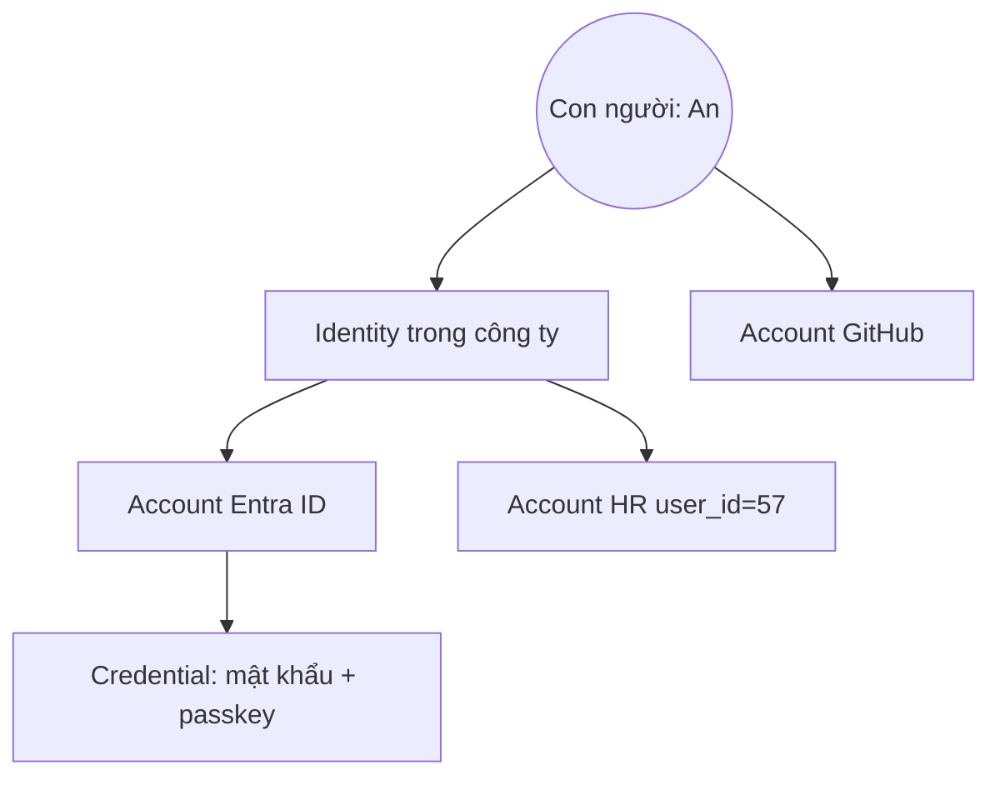
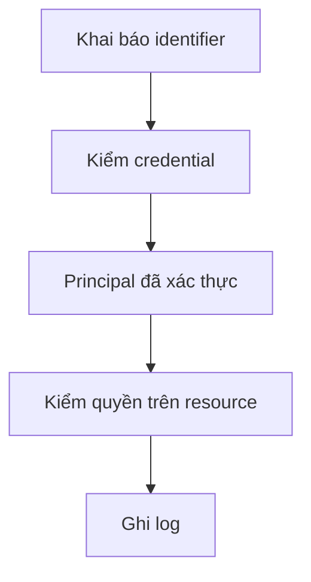
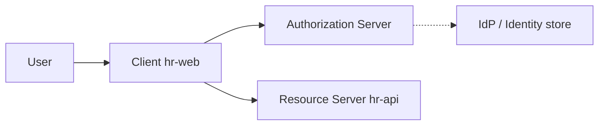
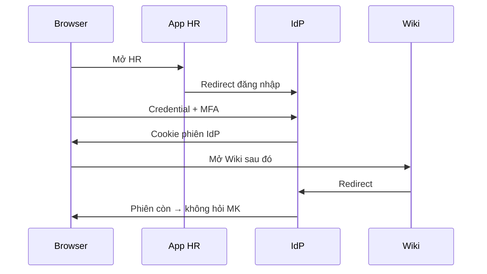

# Part 1 — Identity & authentication fundamentals

> [!NOTE]
> **Mục tiêu:** gọi đúng tên identity, account, credential, AuthN/AuthZ; nắm IdP/RP/AS/RS; phân biệt SSO, federation, MFA thật vs giả.
> **Cần biết trước:** [Part 0](README.md).
> **Thời lượng:** ~1 giờ · **Đầu ra kiểm được:** vẽ sơ đồ vai trò cho một app HR + IdP; phân biệt 401 và 403.
> [← Part 0](README.md) · [Part 2 →](part-2-core-skills.md)

Ví dụ xuyên suốt (từ bộ nguồn): **Kaopiz HR** — nhân viên An vào **hr-web** xem lương, API **hr-api**, đăng nhập qua **Microsoft Entra ID** (IdP).

## L1 What — Ngôn ngữ chung

#### Identity (danh tính)
**Là gì:** tập thông tin biểu diễn một thực thể (người, dịch vụ, thiết bị) trong **một ngữ cảnh**.
**Ví dụ đời thường:** “An — kỹ sư R&D, mã NV 1024” trong công ty.
**Use case:**
- Gắn quyền theo phòng ban, không theo email cá nhân.
- Federation: cùng một người, ngữ cảnh khác nhau ở hai tổ chức.

#### Account (tài khoản)
**Là gì:** bản ghi quan hệ giữa thực thể và **một hệ thống cụ thể**.
**Ví dụ đời thường:** thẻ thành viên ở từng cửa hàng — mỗi nơi một thẻ.
**Use case:**
- Entra ID: `an.nv@company.com`; GitHub: `annv-dev`; DB HR: `user_id = 57`.

#### Identifier (định danh)
**Là gì:** giá trị để **tra cứu** account (username, email, `sub` trong token).
**Ví dụ đời thường:** số in trên thẻ thành viên.
**Use case:**
- Form đăng nhập nhận email — chỉ là khai báo (identification), chưa chứng minh.

#### Credential (bằng chứng xác thực)
**Là gì:** thứ dùng để **chứng minh** quyền sở hữu account.
**Ví dụ đời thường:** mã PIN, chữ ký, passkey.
**Use case:**
- Mật khẩu Entra ID; private key trong passkey; chứng thư client TLS.

#### Authentication (AuthN) và Authorization (AuthZ)
**Là gì:** AuthN = kiểm tra bằng chứng (“đúng là An”); AuthZ = quyết định được làm gì trên tài nguyên nào.
**Ví dụ đời thường:** bảo vệ xem CCCD (AuthN); thẻ từ chỉ mở tầng 5 (AuthZ).
**Use case:**
- An đăng nhập OK nhưng gọi `GET /payroll/88` → **403** (AuthZ fail).

#### Accounting / auditing
**Là gì:** ghi nhận sự kiện để kiểm toán và điều tra.
**Use case:**
- Entra sign-in log; hr-api audit “user 57 xem payroll 57”.

## L2 Why — Sai từ → sai thiết kế

Coi email là bằng chứng, coi “đã đăng nhập” là “làm mọi thứ”, hoặc không biết app nào kiểm mật khẩu — đều dẫn tới lỗi khó sửa sau này. API đọc `X-User-Email` và trả lương: đó là dùng **identifier như credential**; ai gửi đúng header đều đọc được dữ liệu người khác. Đúng ra cần token do IdP ký và kiểm tra chữ ký + claim.

Một người nhiều account: nếu gắn dữ liệu theo email thay vì mã ổn định (`iss` + `sub`), đổi email hoặc tái sử dụng địa chỉ sẽ gộp nhầm hai người — chi tiết ở [Part 3](part-3-multi-component.md).

## L3 How — Mô hình và luồng tư duy

### Identity → account → credential

**Dễ nhầm (tối đa 4 cột):**

| Tiêu chí | Identity | Account | Identifier | Credential |
|---|---|---|---|
| Câu hỏi | Ai/cái gì? | Hồ sơ ở hệ X? | Tra hồ sơ nào? | Chứng minh bằng gì? |
| Bí mật? | Không | Không | Không | Có |
| HR ví dụ | An, R&D | Entra + DB 57 | email, `sub` | Mật khẩu/passkey |

### Identification → AuthN → AuthZ → audit

**Ví dụ An xem lương:** (1) gõ email → identification; (2) Entra kiểm passkey → AuthN; (3) hr-api chỉ cho `payroll/57` → AuthZ; (4) audit log.

### HTTP 401 và 403

| Status | Tầng lỗi | Client nên |
|---|---|---|
| 401 | AuthN: thiếu/sai token | Đăng nhập lại / refresh |
| 403 | AuthZ: đã biết ai nhưng không đủ quyền | Không retry vô ích |

**Hiểu lầm:** tên `401 Unauthorized` di sản — thực chất là **unauthenticated**; thiếu quyền là **403**.

### Các vai trò (IdP, RP, SP, AS, RS)

| Thuật ngữ | Vai trò ngắn | Gặp ở |
|---|---|---|
| IdP | Đăng nhập, phát assertion/token tin cậy | Entra, Keycloak, Google |
| RP | App **tin** kết quả OIDC | hr-web (OIDC) |
| SP | App **tin** assertion SAML | hr-web (SAML) |
| AS | Cấp OAuth access token | Cùng máy Keycloak/Entra |
| RS | API kiểm token | hr-api |
| Client (OAuth) | App xin token / gọi API | SPA, service |

**Use case:** hr-web không lưu mật khẩu; redirect Entra; nhận token; gọi hr-api với Bearer.

### SSO, federation, MFA

#### Single Sign-On (SSO)
**Là gì:** đăng nhập **một lần** tại IdP, vào nhiều app không gõ lại mật khẩu (phiên IdP còn hiệu lực).
**Use case:** An mở hr-web rồi Wiki — lần hai IdP không hỏi mật khẩu.

**Hiểu lầm:** SSO ≠ một session chung — mỗi app thường có **session riêng**; chia sẻ là **phiên IdP**.

#### Federation
**Là gì:** hai miền bảo mật thiết lập **tin** kết quả do bên kia ký (metadata + certificate).
**Use case:** đối tác đăng hr-web bằng IdP của họ — Kaopiz không cần mật khẩu họ.

| Tiêu chí | SSO | Federation |
|---|---|---|
| Bản chất | Trải nghiệm người dùng | Quan hệ tin giữa hệ thống |
| Phạm vi | Có thể trong một miền | Luôn **giữa** miền |
| Kerberos domain | SSO có, federation không bắt buộc | Federation không cần |

#### MFA (Multi-Factor Authentication)
**Là gì:** ≥ 2 yếu tố thuộc **nhóm khác nhau**: know / have / are.

| Nhóm | Ví dụ | Không thuộc nhóm |
|---|---|---|
| Know | Mật khẩu, PIN | Mã TOTP = **have** (secret trên máy) |
| Have | Điện thoại TOTP, passkey | SMS OTP = have nhưng yếu hơn passkey |
| Are | Vân tay mở authenticator | PIN Hello = know |

**Hiểu lầm:** hai màn hình nhập = MFA — sai nếu cả hai là “know” (mật khẩu + câu hỏi bảo mật).

**Là MFA:** mật khẩu + TOTP; passkey (have + PIN/are). **Không phải MFA:** mật khẩu + mật khẩu cấp 2.

#### Authentication factors (phương thức phổ biến)
**Use case nhanh:**
- Mật khẩu: mọi nơi; rủi ro phishing, reuse.
- TOTP: MFA bổ sung; có thể bị AiTM lừa gõ mã.
- Passkey: chống phishing; cần thiết bị/sync (xem [Part 5](part-5-production-security-ops.md)).
- Certificate / smart card: doanh nghiệp, have factor mạnh.

## L7 Architecture — Định hướng các Part sau

#### Khi nào tập trung vào IdP
**Use case:** nhiều app nội bộ, MFA tập trung, offboarding một chỗ — hr-web, Wiki, CRM cùng Entra.

#### Khi nào API tự kiểm token
**Use case:** hr-api là RS — không session cookie riêng; chỉ Bearer + policy AuthZ ([Part 6](part-6-projects.md)).

#### Bản đồ phương thức (xem đầy đủ)
So sánh password, OAuth/OIDC, SAML, passkey, Kerberos, API key, mTLS, không xác thực → [Part 7 — Bản đồ giải pháp](part-7-troubleshooting-mastery.md#bản-đồ-giải-pháp).

**Thực hành JWT/PKCE trên dự án:** [Identity Part 1–4](../identity/README.md) — không lặp ở Part 2–3 của lộ trình này.

### Lab hoãn (ô ma trận L4 = –)

Lab hands-on gom [TB-050](../../issues/TB-050-identity-auth-lab-dual-provider.md) ([identity-auth-lab.md](../../architecture/identity-auth-lab.md)): `Auth:Provider` Identity hoặc Keycloak (profile 8090). Để tự kiểm tra AuthN/AuthZ ngay: [Identity Part 1 Lab 1.1](../identity/part-1-fundamentals.md) (giải mã JWT tay).

| Bài lab nguồn | Trạng thái |
|---|---|
| Lab 1–4 (JWT API, PKCE…) | [TB-050](../../issues/TB-050-identity-auth-lab-dual-provider.md) |
| Lab 5 (SAML) | Ngoài identity; lý thuyết Part 4 |

## Tự kiểm tra

1. Phân biệt account và credential với ví dụ Entra + GitHub của cùng một người.
2. An đăng nhập OK nhưng 403 khi xem lương người khác — bước nào vẫn OK?
3. SSO và federation: nêu một ví dụ có SSO không cần federation.
4. Tại sao “mật khẩu + câu hỏi bảo mật” thường không được coi là MFA?
5. IdP và AS khác nhau thế nào trong stack OAuth?

Đáp án ngắn

1. Một người, nhiều account; credential riêng từng hệ (MK Entra ≠ MK GitHub).
2. Authentication OK; authorization fail.
3. Kerberos trong một Active Directory domain — SSO nội bộ, không liên miền.
4. Cả hai thuộc nhóm **know** — một trang phishing có thể lấy cả hai.
5. IdP = danh tính + đăng nhập; AS = điểm cấp token OAuth (thường cùng sản phẩm, khác vai trong giao thức).

## Nguồn và độ tin cậy

| Nội dung | Nguồn | Mức |
|---|---|---|
| Bài 1.1, 1.2 | `auth_std_roadmap-main` site `m01-*` | Vừa (viết lại) |
| 401/403 | RFC 7231 semantics; thực hành API | Vừa |
| MFA factors | NIST SP 800-63B (tóm tắt) | Chưa kiểm chi tiết bản 2024 |
| Hands-on dự án | [identity-learning.md](../../architecture/identity-learning.md) | Chắc (nội bộ) |