# Part 2 — Cryptography, session, token & HTTP auth

> [!NOTE]
> **Mục tiêu:** phân biệt encoding, mã hóa, băm, chữ ký và HMAC; quản lý phiên cookie an toàn; hiểu ba loại token OAuth/OIDC và vòng đời; đọc header `Authorization` / `WWW-Authenticate` và chọn scheme HTTP phù hợp.
> **Cần biết trước:** [Part 1](part-1-fundamentals.md).
> **Thời lượng:** ~2 giờ · **Đầu ra kiểm được:** điền bảng phân biệt công cụ mật mã; vẽ luồng session-based và token-based; liệt kê checklist validate access token; chọn API key, Basic, Bearer hay Client Credentials cho 3 tình huống.
> [← Part 1](part-1-fundamentals.md) · [Part 3 →](part-3-multi-component.md)

Bài gốc Module 02 (2.1–2.5) gom dưới đây theo tầng L; ví dụ dùng ngữ cảnh web/API HR (hr-web, hr-api, Keycloak) như bộ nguồn.

## L1 What — Khái niệm nền (Bài 2.1–2.3)

#### Encoding (Base64 / Base64url)
**Là gì:** đổi cách biểu diễn dữ liệu để truyền qua HTTP/JSON; **không có key**, không bảo mật.
**Ví dụ đời thường:** viết tiếng Việt không dấu để gửi qua hệ thống cũ — ai cũng đọc lại được.
**Use case:**
- Header JWT (`header`, `payload`) — chỉ encode, không mã hóa.
- `Authorization: Basic …` — decode ra `username:password` không cần key.

#### Plaintext và ciphertext
**Là gì:** bản rõ (ai cũng đọc) và bản mã (cần key mới đọc lại).
**Use case:** mật khẩu trong body login là plaintext trên kênh TLS; cookie ASP.NET Data Protection là ciphertext.

#### Mã hóa đối xứng (AES) và bất đối xứng (RSA / ECC)
**Là gì:** đối xứng — một secret dùng chung; bất đối xứng — cặp public/private, public phát rộng được.
**Ví dụ đời thường:** một chìa két chung so với hộp thư có khe ném thư (public) nhưng chỉ chủ mở (private).
**Use case:**
- TLS: bất đối xứng thỏa thuận key, AES mã hóa luồng dữ liệu.
- JWE (ít gặp): mã hóa nội dung token.

#### Hash (SHA-256)
**Là gì:** hàm một chiều, không key, không “giải mã”; cùng input → cùng digest.
**Use case:** checksum file; lưu hash API key (input entropy cao) — **không** dùng cho mật khẩu người dùng.

#### Password hashing (Argon2id, scrypt, PBKDF2, bcrypt)
**Là gì:** băm **cố ý chậm**, có salt (và có thể pepper); server chỉ so sánh, không lưu plaintext.
**Use case:** cột `PasswordHash` khi đăng ký/đăng nhập; chi tiết triển khai BCL xem [Part 2 Identity — băm mật khẩu](../identity/part-2-core-skills.md).

#### Salt và pepper
**Là gì:** salt — ngẫu nhiên **riêng từng user**, lưu cạnh hash, **không cần bí mật**; pepper — secret **chung**, lưu ngoài DB.
**Use case:** salt chặn bảng băm dựng sẵn; pepper thêm lớp khi chỉ DB bị lộ.

#### Chữ ký số (digital signature)
**Là gì:** private key ký, public key verify — chứng minh nguồn và toàn vẹn, **không** che nội dung.
**Use case:** JWT RS256/ES256; certificate CA.

#### HMAC (HS256)
**Là gì:** “tag” từ secret **chung**; bên có secret vừa tạo vừa kiểm được — không chống chối bỏ trước bên thứ ba.
**Use case:** JWT HS256 (một issuer, nhiều bên verify cùng secret — rủi ro); chữ ký webhook.

#### Certificate, CA, PKI, TLS / HTTPS, mTLS
**Là gì:** certificate gắn public key với danh tính (tên miền), do CA ký; TLS bảo vệ kênh; mTLS còn xác thực client bằng certificate.
**Use case:** `https://sso…`; service-to-service với client certificate.

#### Session, session ID, cookie, token
**Là gì:** session — trạng thái đăng nhập ở server (hoặc ticket mã hóa); session ID — mã tham chiếu; cookie — cơ chế trình duyệt lưu/gửi; token — “vé” client gắn (thường `Authorization: Bearer`).
**Ví dụ đời thường:** quầy giữ đồ (session), số thẻ (session ID), túi áo (cookie), vé tự cầm (token).
**Use case:** hr-web session Redis; hr-api nhận access token JWT.

#### Stateful và stateless (ở tầng xác thực)
**Là gì:** stateful — server nhớ phiên; stateless — request tự mang bằng chứng đã ký (JWT), vẫn có thể cần store cho refresh/revoke.
**Use case:** logout tức thì → session; scale API → JWT verify cục bộ.

#### Access token, ID token, refresh token
**Là gì:** access — gọi API; ID — OIDC, cho **client** biết ai đăng nhập; refresh — đổi access mới tại AS, **không** gửi API.
**Use case:** hr-web giữ ID token; gửi access cho hr-api; refresh chỉ tới token endpoint Keycloak.

#### Opaque token và JWT
**Là gì:** opaque — chuỗi tham chiếu, API hỏi AS; JWT — claims trong token + chữ ký (JWS) hoặc mã hóa (JWE).
**Use case:** thu hồi tức thì → opaque hoặc introspection; hiệu năng → JWT JWS.

## L2 Why — Vì sao nhầm công cụ là lỗi hệ thống

Phần lớn sự cố auth không đến từ “hack AES”, mà từ **dùng sai abstractions**: Base64 tưởng là mã hóa, SHA-256 cho mật khẩu, JWT tưởng bí mật, Basic tưởng an toàn vì HTTPS, cookie `HttpOnly` tưởng chống CSRF. Mỗi công cụ giải một bài toán khác (bí mật, toàn vẹn, nguồn gốc, lưu mật khẩu); trộn vai trò là mở cửa.

Session và JWT là **đánh đổi**, không phải “nâng cấp”: session thu hồi dễ, scale cần store chung; JWT scale dễ nhưng access đã phát khó chết trước `exp` nếu không introspect/denylist. Access ngắn + refresh có rotation là cách cân bằng thường gặp.

## L3 How — Cơ chế theo bài 2.1–2.5

### Bài 2.1 — Cryptography essentials

#### Phân biệt dễ nhầm — Encoding / mã hóa / hash (phần 1)

| Khái niệm | Mục đích | Khôi phục gốc? | Ví dụ auth |
|---|---|---|---|
| Encoding (Base64) | Đổi định dạng, không bảo mật | Có, ai cũng được | Basic auth, phần JWT |
| Encryption | Bí mật nội dung | Có, nếu có key | TLS, JWE, cookie DP |
| Hash | Digest đối chiếu | Không | Hash API key, checksum |

#### Phân biệt dễ nhầm — Password hash / chữ ký / HMAC

| Khái niệm | Mục đích | Ai giữ key? | Ví dụ auth |
|---|---|---|---|
| Password hashing | Lưu/kiểm mật khẩu | Không (salt công khai) | Argon2id, PBKDF2 |
| Digital signature | Nguồn + toàn vẹn | Private ký, public verify | JWT RS256, cert |
| HMAC | Thông điệp + shared secret | Hai bên cùng secret | HS256, webhook |

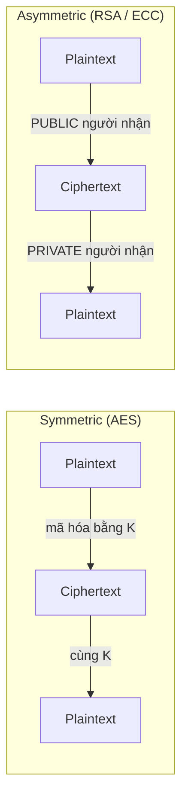

| Tiêu chí | Symmetric | Asymmetric |
|---|---|---|
| Số key | 1 secret chung | Cặp private + public |
| Khó chính | Phân phối secret an toàn | Public key của ai? → certificate |
| Trong HR | Cookie DP (một app) | Keycloak ký token, API verify JWKS |

#### Phân biệt dễ nhầm — Salt vs pepper

| Tiêu chí | Salt | Pepper |
|---|---|---|
| Số lượng | Một salt / mỗi hash | Một (hoặc vài) cho hệ thống |
| Bí mật? | Không — lưu cạnh hash | Có — Key Vault / HSM |
| Chống gì | Rainbow table, hash trùng | Chỉ DB lộ vẫn khó đoán |

> [!WARNING]
> Không lưu mật khẩu plaintext; không “mã hóa” mật khẩu reversible; không `SHA-256(password)` cho user password.

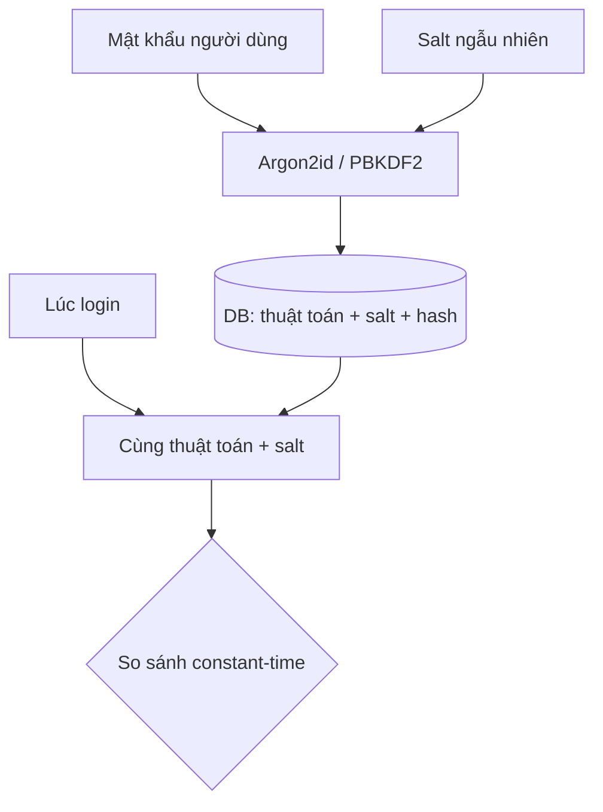

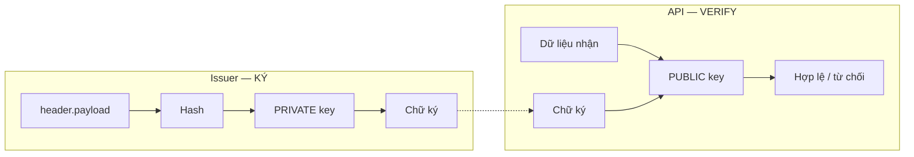

| Tiêu chí | Chữ ký (RS256) | HMAC (HS256) |
|---|---|---|
| Ai tạo được? | Chỉ giữ private key | Mọi bên có secret |
| Hợp khi | Một issuer, nhiều API verify | Hai bên tin nhau (webhook) |
| JWT | Keycloak → nhiều API | Chỉ khi secret không lộ cho API |

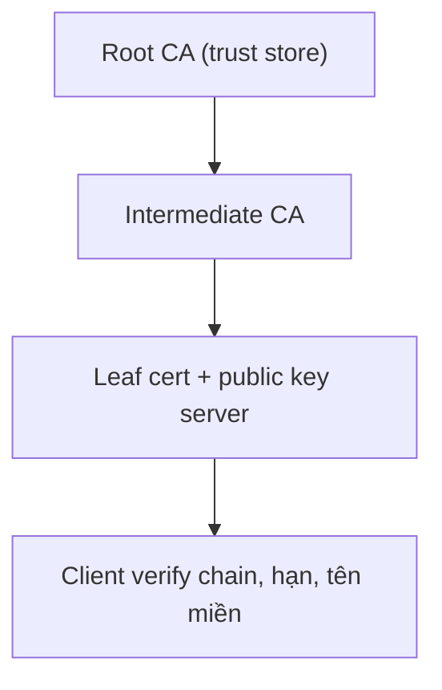

| Tiêu chí | TLS thường | mTLS |
|---|---|---|
| Certificate | Chỉ server | Server và client |
| Server biết client? | Không (cần token/cookie) | Có, từ cert client |
| Hay dùng | Trình duyệt ↔ API | Service-to-service |

#### Hiểu lầm hay gặp — mật mã (2.1)

| Hiểu lầm | Thực tế |
|---|---|
| Base64 trong Basic đã che mật khẩu | Decode không cần key; bảo vệ thật là TLS |
| Hash là loại mã hóa | Hash một chiều; encryption đảo ngược bằng key |
| File kèm SHA-256 chống giả mạo có chủ đích | Kẻ sửa file tính lại hash; cần HMAC/chữ ký hoặc kênh tin cậy khác |
| Salt phải giữ bí mật | Salt công khai; pepper mới là secret chung ngoài DB |
| Chữ ký = dữ liệu đã giấu | Payload JWS vẫn đọc được; chữ ký chỉ chống sửa |
| Có ổ khóa HTTPS = site đáng tin | Cert hợp lệ cho **tên miền đang mở** — vẫn có thể lừa đảo |

### Bài 2.2 — Session, cookie và quản lý phiên

#### Phân biệt dễ nhầm — Session vs cookie vs token

| Tiêu chí | Session | Cookie | Token (access) |
|---|---|---|---|
| Là gì | Trạng thái app quản lý | Cơ chế browser lưu/gửi | Chuỗi do AS cấp |
| Nằm ở đâu | Server / ticket mã hóa | Browser | Client gửi header |
| Ai gửi? | — | Trình duyệt tự động | Code client chủ động |

Cookie `hr_lang=vi` là cookie **không** phải session. Session ID thường nằm trong cookie `__Host-hr_sid=…`.

| Tiêu chí | Stateful | Stateless |
|---|---|---|
| Phiên ở đâu | Redis/DB/memory | Trong request (JWT ký, ticket DP) |
| Thu hồi | Xóa session → tức thì | Khó trước `exp` |
| Scale | Store chung | Mỗi instance tự verify |

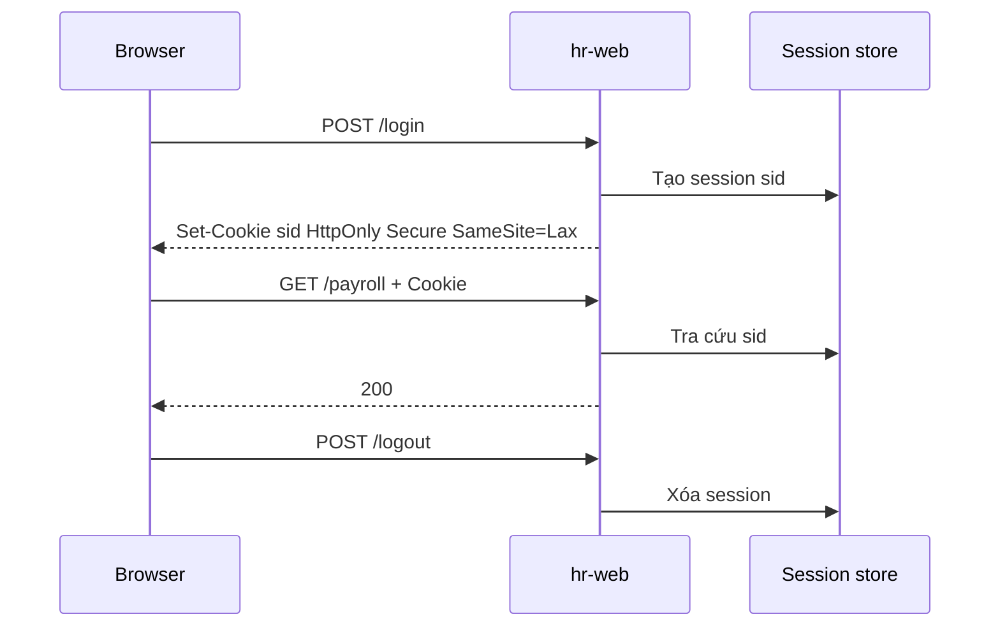

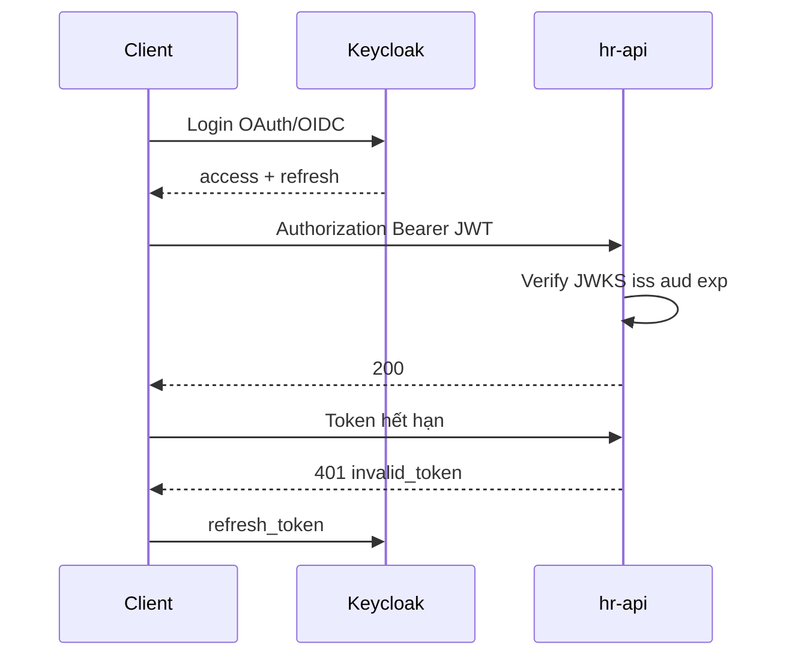

#### Cookie đăng nhập — thuộc tính quan trọng

| Thuộc tính | Tác dụng | Khuyến nghị |
|---|---|---|
| `HttpOnly` | JS không đọc | Luôn bật |
| `Secure` | Chỉ HTTPS | Luôn bật |
| `SameSite` | Gửi cross-site | `Lax` hoặc `Strict`; `None` cần `Secure` + chống CSRF |
| `Domain` | Phạm vi subdomain | Không đặt / dùng `__Host-` |

| Tiêu chí | `HttpOnly` | `Secure` |
|---|---|---|
| Chặn | JavaScript đọc cookie | Gửi qua HTTP thường |
| Không chặn | XSS gửi request thay user | XSS, CSRF |

| SameSite | Gửi cookie khi… | Ghi chú |
|---|---|---|
| `Strict` | Chỉ same-site | Link ngoài → trang đầu như chưa login |
| `Lax` | Same-site + top-level GET | Chặn POST cross-site |
| `None` | Mọi ngữ cảnh | iframe/SSO — cần biện pháp CSRF khác |

**Session management (Should):** session ID ngẫu nhiên (CSPRNG), **regenerate sau login/nâng quyền** (chống fixation); idle + absolute timeout; step-up trước thao tác nhạy cảm; remember-me = token riêng có thu hồi; logout **hủy server**, không chỉ xóa cookie client.

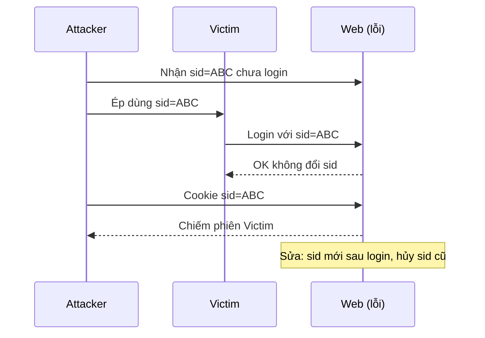

| Tiêu chí | Idle timeout | Absolute timeout |
|---|---|---|
| Hết hạn khi | Không hoạt động X phút | Quá Y giờ kể từ login |
| Chống | Máy bỏ quên | Kẻ “giữ ấm” session đánh cắp |

#### Hiểu lầm hay gặp — session (2.2)

| Hiểu lầm | Thực tế |
|---|---|
| Cookie = session | Cookie là transport; `hr_lang` không phải session |
| JWT luôn tốt hơn session web | Đánh đổi thu hồi vs scale |
| `HttpOnly` chống CSRF | CSRF dùng cookie tự gửi; cần SameSite + anti-CSRF |
| `Domain=*.company` thu hẹp phạm vi | Domain **mở rộng** sang mọi subdomain |
| Đóng trình duyệt = logout | Server timeout + restore session; máy chung cần logout |
| Chỉ idle timeout đủ | Attacker ping định kỳ → cần absolute |

### Bài 2.3 — Token, JWT và kiểm tra API

**Quy tắc nhớ:** Access → API · ID → client · Refresh → AS.

| | Access | ID | Refresh |
|---|---|---|---|
| Chuẩn | OAuth 2.0 | OIDC | OAuth 2.0 |
| Người nhận | Resource Server | Client (`aud`=client_id) | Authorization Server |
| Gọi API? | Có | Không | Không |
| Thời hạn | Ngắn (phút) | Ngắn | Dài hơn |

| Tiêu chí | Opaque | JWT (JWS) |
|---|---|---|
| Claims ở đâu | DB AS | Trong token |
| API verify | Introspection | Public key / JWKS |
| Thu hồi sớm | Dễ | Khó tới `exp` |
| Ai đọc payload | Chỉ AS | Ai cầm token |

| Tiêu chí | JWT (định dạng) | JWS | JWE |
|---|---|---|---|
| Vai trò | Claims JSON | Ký (3 phần) | Mã hóa (5 phần) |
| Đọc payload? | — | Ai cũng được | Chỉ có key |
| Bảo vệ | — | Toàn vẹn | Bí mật |

> [!TIP]
> Cấu trúc JWT, JWS/JWE, thuật toán, decode vs verify, dựng/ký bằng BCL: [Part 1 Identity](../identity/part-1-fundamentals.md) và [Part 2 Identity](../identity/part-2-core-skills.md). Phần dưới chỉ tóm tắt **hành vi API** — không lặp mechanics.

#### JWT — API cần nhớ (không thay thế Part Identity)

- Compact JWS: `header.payload.signature` (3 phần); 5 phần → JWE; không decode được → có thể opaque.
- **Decode ≠ verify** — debug được payload; tin token chỉ sau verify + claim.
- Claim API hay kiểm (ngoài chữ ký): `iss`, `aud`, `exp`/`nbf`, đúng loại (access, không phải ID), `scope`/role.

**Checklist access token JWT (tóm tắt):** định dạng Bearer header; `alg` trong **allowlist** (từ chối `none`); verify bằng JWKS tin cậy theo `kid`; `iss`/`aud` khớp; lifetime + clock skew; scope/role cho endpoint; ưu tiên thư viện (JwtBearer), không tự decode Base64.

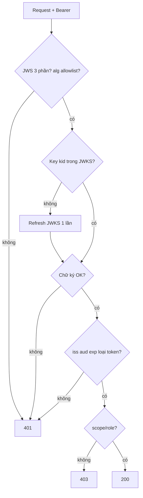

| Claim | Câu hỏi | Nhầm thì… |
|---|---|---|
| `iss` | Ai phát? | Nhận token realm khác |
| `aud` | Dành cho API nào? | Token client khác dùng được |
| `sub` | Về ai? | Dùng email thay khóa ổn định |
| `azp` | Client nào xin? | Nhầm với `aud` |

| Hiểu lầm | Thực tế |
|---|---|
| Token có chữ ký là gửi API được | Chỉ access token; ID/refresh sai audience |
| Refresh = access sống lâu | Refresh chỉ tới AS |
| Access luôn là JWT | Opaque hợp lệ — dùng introspection |
| JWT ký = payload bí mật | JWS đọc được; nhạy cảm → JWE/opaque |
| Decode đẹp = đã validate | Ai cũng giả payload; cần verify |
| Tin `alg` trong header | Allowlist phía API; tránh alg confusion |

### Bài 2.4 — Vòng đời token

Chuỗi: **cấp → dùng → hết hạn → refresh → revoke**. Access **ngắn hơn** refresh vì đi mọi request, dễ lộ. Refresh **rotation**: mỗi lần dùng cấp refresh mới, vô hiệu cũ; **reuse detection**: gửi lại refresh đã dùng → AS thu hồi cả grant (người dùng thật cũng phải login lại).

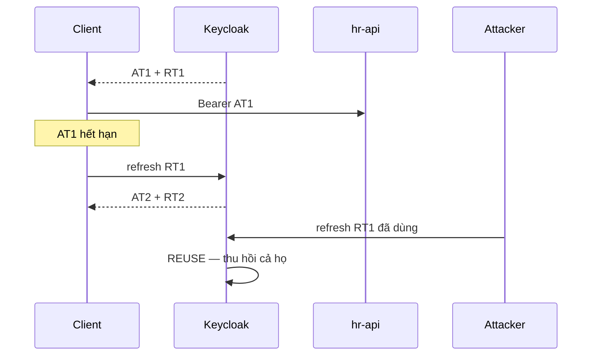

| Tiêu chí | Hết hạn (`exp`) | Thu hồi | Logout |
|---|---|---|---|
| JWT access đang chạy | Từ chối sau `exp` | Vẫn OK tới `exp` nếu không introspect | Tương tự thu hồi refresh |
| Refresh | — | AS vô hiệu | Thường kèm logout |

**Key rotation (signing key):** công bố key mới JWKS → ký bằng key mới → giữ key cũ đến hết token cũ → gỡ. API: cache JWKS, `kid` lạ → refresh JWKS có giới hạn, không hard-code một public key.

| Tiêu chí | Refresh token rotation | Key rotation |
|---|---|---|
| Đổi gì | Refresh của một phiên | Signing key toàn AS |
| Mục đích | Phát hiện trộm refresh | Giảm thiệt hại lộ private key |

**Introspection (RFC 7662):** RS hỏi AS `active?` + claims — opaque hoặc khi cần revoke tức thời; RS tự xác thực với AS. Response hết hạn: `200` + `"active": false` (không lý do).

**Revocation (RFC 7009):** client báo AS hủy token (logout, mất thiết bị); thành công luôn `200`, kể cả token đã invalid.

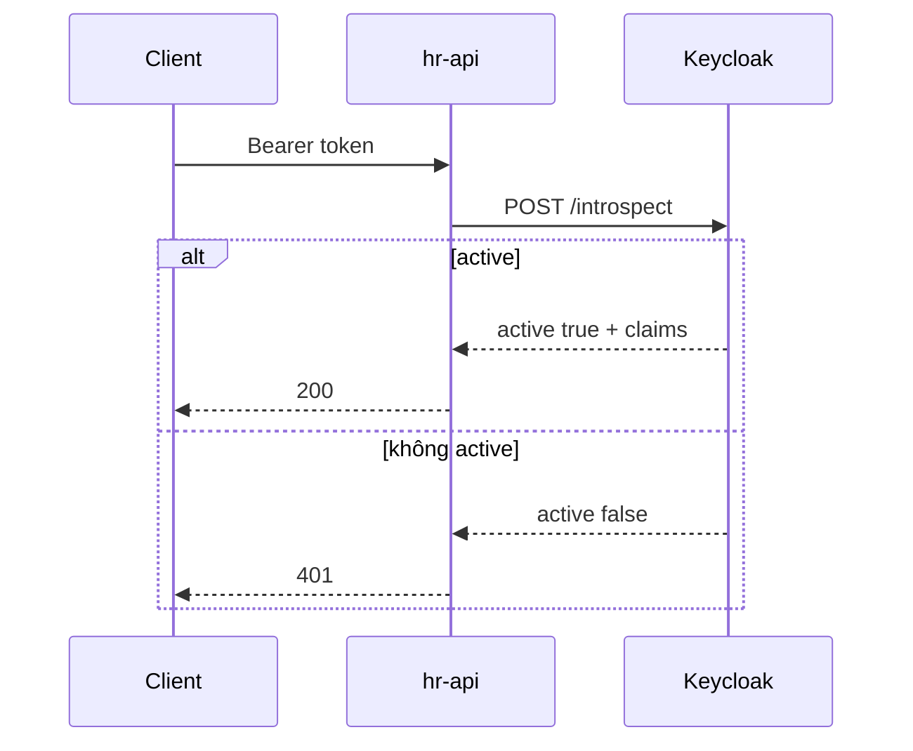

| Tiêu chí | Introspection | Revocation |
|---|---|---|
| Ai gọi | Resource Server | Client |
| Đổi trạng thái? | Không (đọc) | Có (hủy) |
| Khi | Mỗi request (cache ngắn) | Logout, mất máy |

#### Hiểu lầm — vòng đời (2.4)

| Hiểu lầm | Thực tế |
|---|---|
| Logout = access token chết ngay | JWT verify cục bộ tới `exp` trừ introspect/denylist |
| Rotation chặn trộm refresh ngay | Lần dùng đầu vẫn thành công; reuse mới phát hiện |
| Access token nên sống nhiều ngày | Độ liền mạch do refresh; access ngắn giới hạn lộ |
| `kid` lạ = token giả | Có thể key rotation — refresh JWKS |
| Revocation 200 = vừa hủy thành công | 200 cả khi token đã không tồn tại (RFC 7009) |

### Bài 2.5 — Header HTTP và API key (tóm tắt cơ chế)

`Authorization: <scheme> <credentials>`. Server từ chối kèm `WWW-Authenticate` (đặc biệt Bearer `error`, `error_description`).

| Mã (Bearer) | HTTP | Ý nghĩa | Client |
|---|---|---|---|
| `invalid_request` | 400 | Sai định dạng request | Sửa code |
| `invalid_token` | 401 | Hết hạn, sai aud/iss/chữ ký… | Refresh / sửa cấu hình |
| `insufficient_scope` | 403 | Token OK, thiếu scope | Xin scope/consent |

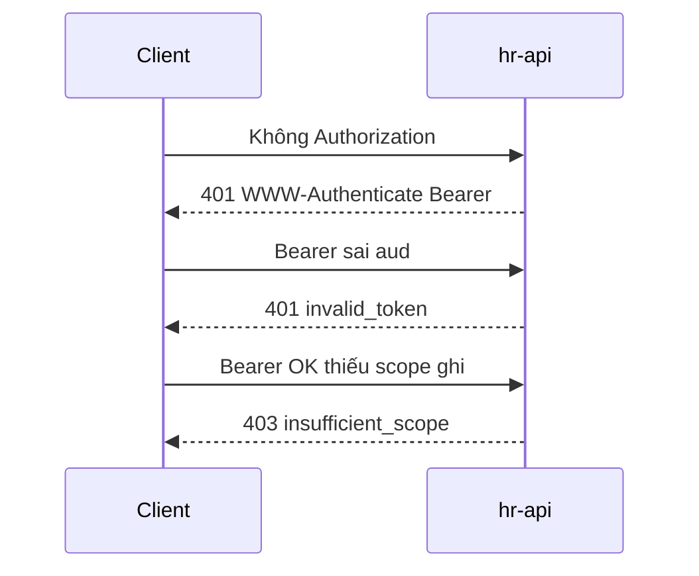

**Basic:** `base64(user:pass)` — chỉ qua TLS; không scope/hạn; legacy / `client_secret_basic` tới token endpoint.

**Bearer (RFC 6750):** ai cầm dùng được — header only, không query string; token ngắn; lộ = dùng tới `exp` (sender-constraint là tầng khác).

**API key:** định danh **ứng dụng**, không user; sống lâu; header riêng (`X-API-Key`); server lưu hash; rotation/revoke tự xây.

### Lab hoãn (ô ma trận L4 = –)

> [!NOTE]
> **Lab Module 02 (L4):** triển khai [TB-050](../../issues/TB-050-identity-auth-lab-dual-provider.md) — JWT decoder/API, thực hành issuer Identity hoặc Keycloak đối chiếu; xem [identity-auth-lab.md](../../architecture/identity-auth-lab.md).

| Bài nguồn | L4 trong Part này |
|---|---|
| 2.1 Cryptography | – |
| 2.2 Session & cookie | – |
| 2.3 Token & JWT | – |
| 2.4 Token lifecycle | – |
| 2.5 HTTP auth & API key | – |

Thực hành JWT/PBKDF2 bằng BCL: [Part 2 Identity](../identity/part-2-core-skills.md) (lab đã chạy trong lộ trình identity).

## L5 Troubleshooting — Đọc 401 và phiên

| Triệu chứng | Kiểm tra | Nguyên nhân gốc | Hướng xử lý |
|---|---|---|---|
| 401 `invalid_token` + audience | `WWW-Authenticate`, decode `aud` | Token không cho API này | Audience mapper / `ValidateAudience` |
| 401 sau logout vài phút | API có introspect? | JWT còn `exp` | Token ngắn; denylist `jti`; introspect API nhạy cảm |
| Session “sống mãi” khi bị đánh cắp | Chỉ sliding idle? | Thiếu absolute timeout | Thêm `login_at` + absolute 8h |
| CSRF đổi dữ liệu dù `HttpOnly` | Method + SameSite | Cookie tự gửi POST | Anti-CSRF; không GET phụ |
| Cert lỗi máy dev | Trust store | Thiếu root CA nội bộ | Cài `.crt` root, không `Callback => true` |
| Refresh hàng loạt `invalid_grant` | Nhiều tab refresh | Rotation + reuse | Một nơi refresh; handle logout chung |

## L6 Production — Vận hành an toàn

- **Mật khẩu:** OWASP khuyến nghị Argon2id (hoặc scrypt/PBKDF2 với work factor đo thật); ASP.NET Identity PBKDF2 — tăng `IterationCount` theo OWASP; salt mọi hash; pepper tùy chọn ngoài DB.
- **Cookie auth:** `__Host-` + `HttpOnly` + `Secure` + `SameSite=Lax`; regenerate session ID sau login; idle + absolute; logout xóa server (`ITicketStore` / security stamp nếu ticket trong cookie).
- **Token:** access vài phút; refresh rotation + reuse (public client theo RFC 9700 ⚠); JWKS auto-refresh; không log token; API key chỉ hash phía server, constant-time compare.
- **TLS:** mọi credential giả định HTTPS; không tắt validation cert production.

## L7 Architecture — Chọn cơ chế HTTP và phiên

### Khi nào session cookie vs Bearer JWT

| Tiêu chí | Session cookie (stateful) | Bearer JWT (stateless API) |
|---|---|---|
| Thu hồi / khóa user | Nhanh | Chậm trừ introspect |
| Scale nhiều instance | Store chung | Verify cục bộ |
| Trình duyệt | Tự gửi cookie → CSRF | Token trong header → XSS/BFF |
| Phù hợp | Server-rendered web | API, microservice |

### So sánh scheme HTTP (Deliverable 6 — bảng 4 cột)

| Scheme | Định danh | Gửi mỗi request | Thời hạn / vòng đời |
|---|---|---|---|
| API key | Ứng dụng/dự án | Secret dài hạn (header) | Tới revoke/tự đặt expiry |
| Basic | User hoặc account kỹ thuật | Username + password thật | Tới đổi mật khẩu |
| Bearer | User ± client (trong token) | Access token | Theo `exp`; refresh riêng |
| Client Credentials | Client (service) | Chỉ token tới API; secret tới AS | Token ngắn, xin lại |

| Scheme | Scope / audience | Phù hợp | Rủi ro chính |
|---|---|---|---|
| API key | Tự cài, không chuẩn | Public API, quota đơn giản | Lộ key = truy cập lâu |
| Basic | Không | Legacy nội bộ qua TLS | Lộ log = lộ mật khẩu |
| Bearer | `scope`, `aud` chuẩn | API hiện đại, có user | Ai cầm dùng được |
| Client Credentials | Chuẩn OAuth | Batch service, không user | Scope rộng; lộ client secret |

**Gợi ý chọn (TeamBoard / HR):**
- Người dùng qua trình duyệt gọi API → Bearer từ OAuth/OIDC (Authorization Code + PKCE), không nhúng secret trong SPA.
- Job đêm không user → Client Credentials (`aud` + `scope`), không API key nếu cần audit OAuth.
- API công khai đếm quota → API key server-side, hash + rotation.
- Tool cũ chỉ Basic → tài khoản kỹ thuật, kế hoạch migrate.

| Hiểu lầm | Thực tế |
|---|---|
| API key = xác thực user | Chỉ biết ứng dụng nào gọi |
| Obfuscate key trong WPF/SPA đủ an toàn | Public client không giữ secret |
| Basic + HTTPS = như Bearer | Mật khẩu thật mọi request; lộ log nặng |
| Bearer “có chữ ký” nên trộm vô dụng | Bearer = ai cầm dùng; cần DPoP/mTLS nếu ràng buộc |
| 401 vs 403 giống nhau | 401 không tin token; 403 tin nhưng thiếu quyền |

## Tự kiểm tra

1. Nêu ba khác biệt giữa encryption, hash và digital signature (mục đích và có khôi phục gốc không).
2. Vì sao `SHA-256(password)` không đủ cho mật khẩu user nhưng `SHA-256(api_key)` có thể chấp nhận được?
3. Cookie đăng nhập cần `HttpOnly` và `Secure`; `SameSite=Lax` chặn được POST CSRF từ site khác không?
4. Sau login hr-web nhận 3 token — token nào gửi hr-api, token nào chỉ gửi Keycloak?
5. An logout lúc 09:02; access JWT hạn 09:05; hr-api chỉ verify cục bộ. Kẻ có bản copy token lúc 09:01 gọi API lúc 09:03 — kết quả?
6. Đọc `WWW-Authenticate: Bearer error="invalid_token"` — liệt kê ba nguyên nhân khác hết hạn.
7. payroll-batch không có user gọi hr-api — API key hay Client Credentials, vì sao?

Đáp án ngắn

1. Encryption giấu nội dung (có key thì đọc lại); hash digest một chiều; chữ ký chứng minh nguồn/toàn vẹn, không che payload.
2. Mật khẩu entropy thấp, cần hàm chậm + salt; API key 256-bit ngẫu nhiên, brute-force bất khả dù hash nhanh.
3. Lax chặn POST cross-site; vẫn gửi cookie khi bấm link GET — endpoint GET thay đổi dữ liệu vẫn nguy hiểm.
4. Access → hr-api; refresh → token endpoint Keycloak; ID giữ ở client.
5. 200 tới 09:05 (hành vi bình thường); muốn chặn ngay: introspect, denylist, hoặc access rất ngắn.
6. Sai `aud`/`iss`, sai chữ ký/`kid`, sai loại token (ID token), clock skew/`nbf`, v.v.
7. Client Credentials — token ngắn, `scope`/`aud` chuẩn, audit; API key chỉ khi quota đơn giản và secret ở backend an toàn.

## Nguồn và độ tin cậy

**Đã tự mở và đối chiếu:** HTML Module 02 bài 2.1–2.5 trong `auth_std_roadmap-main/site/m02-*.html`; `authentication_standards_15h_roadmap.md` (Module 02); khuôn [part-template.md](../../../.agents/skills/learning-hub/references/part-template.md); lab L4 → [TB-050](../../issues/TB-050-identity-auth-lab-dual-provider.md).

**Đã tham chiếu trong repo:** [Part 1 Identity](../identity/part-1-fundamentals.md), [Part 2 Identity](../identity/part-2-core-skills.md) (JWT/PBKDF2 chi tiết và lab).

**Chỉ qua nguồn thứ cấp hoặc chưa tự mở (⚠):** OWASP Password Storage Cheat Sheet (tham số Argon2id/PBKDF2); RFC 7515/7516/7519, 6750, 7662, 7009, 7617, 9110; RFC 9700 (refresh public client); RFC 9449 DPoP; RFC 8705 mTLS token binding; hành vi Keycloak cụ thể (menu rotation, audience mapper).

**Chưa kiểm:** chạy lại widget/lab HTML trên trình duyệt; xác nhận số OWASP/Identity `IterationCount` trên môi trường production; mọi lab L4 Module 02 (chưa tích hợp).