# Part 3 — Multi-component (OAuth 2.0 / 2.1 & OIDC)

> [!NOTE]
> **Mục tiêu:** phân biệt ủy quyền và xác thực; nắm bốn vai OAuth, Authorization Code + PKCE, grant phụ (Client Credentials, Device), bộ bốn ổ khóa (`state`, `nonce`, PKCE, redirect URI), OIDC (ID token, Discovery, JWKS, logout), và khóa định danh `iss` + `sub`.
> **Cần biết trước:** [Part 2](part-2-core-skills.md) (session, access/refresh token, JWT ở mức kiểm); JWT chi tiết xem [Identity Part 2](../identity/part-2-core-skills.md).
> **Thời lượng:** ~3 giờ (lý thuyết Module 03) · **Đầu ra kiểm được:** vẽ/ghi giải thích được Code + PKCE và Client Credentials; checklist validate ID token; giải thích vì sao không dùng `email` làm khóa chính.
> **Bài gốc:** 3.1–3.7 (bộ `auth_std_roadmap-main`, Module 03).
> [← Part 2](part-2-core-skills.md) · [Part 4 →](part-4-advanced.md)

## L1 What — Bốn vai và thuật ngữ (bài 3.1)

#### OAuth 2.0
**Là gì:** khung **ủy quyền** (delegated authorization): client được cấp **access token** có **scope** để gọi API thay người dùng, **không** cần mật khẩu của họ tại client.
**Use case:** PrintNow đọc album ảnh trên PhotoCloud với scope `photos.read`.

#### Bốn role (RFC 6749)
| Role | Việc |
|---|---|
| **Resource Owner** | Người có quyền cấp truy cập (thường là người dùng). |
| **Client** | Ứng dụng xin quyền (không phải “trình duyệt”). |
| **Authorization Server (AS)** | Đăng nhập, consent, **phát token**. |
| **Resource Server (RS)** | API bảo vệ tài nguyên, **kiểm access token**. |

#### OpenID Connect (OIDC) — khái niệm (bài 3.5)
**Là gì:** lớp **xác thực** trên OAuth: thêm scope `openid`, **ID token** (JWT), UserInfo, Discovery. Trả lời “**ai** đang dùng app”, không thay OAuth.
**Use case:** nút “Đăng nhập bằng Keycloak” → cần OIDC, không chỉ OAuth thuần.

#### Thuật ngữ hay gặp
`client_id` (công khai), `client_secret` (chỉ confidential client), `redirect_uri`, `scope`, `state`, `nonce` (OIDC), `grant_type`, authorization **code** (phiếu đổi token), **access token** (vé gọi API), **refresh token** (đổi access token mới tại AS).

#### Public vs confidential client
**Confidential:** code chạy trên server bạn kiểm soát → giữ được secret. **Public:** SPA, desktop, mobile → không giữ secret được; AS dựa vào **PKCE** + redirect URI chính xác ([bài 3.2](#l3-how--cơ-chế-và-luồng)).

#### Front-channel vs back-channel
**Front-channel:** qua trình duyệt (redirect, URL). **Back-channel:** client ↔ AS qua HTTPS, trình duyệt không thấy. Thiết kế hiện đại: front-channel chỉ mang **code** ngắn hạn; **token** chỉ back-channel.

## L2 Why — Vì sao OAuth và vì sao OIDC

**Password anti-pattern:** client nhận mật khẩu người dùng → quyền vô hạn, không thu hồi riêng từng app, phá MFA/SSO, lộ credential khi client bị hack. OAuth tách: đăng nhập **tại AS**, client chỉ nhận token có scope và hạn.

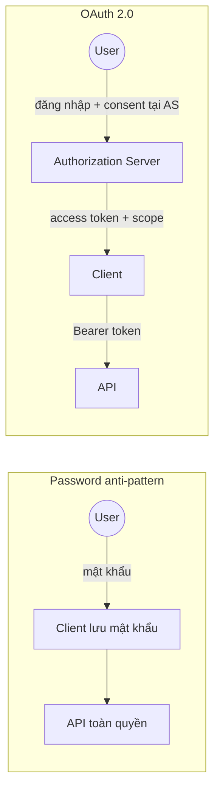

**OAuth không đủ để “đăng nhập”:** access token cho **API** đọc; client coi “có access token = đã login” dễ **token substitution**. OIDC chuẩn hóa **ID token** (`aud` = `client_id`, `nonce`) cho RP.

| Tiêu chí | OAuth | OIDC |
|---|---|---|
| Câu hỏi | App **được làm gì**? | **Ai** đang dùng app? |
| Kết quả chính | Access token | ID token (+ access token) |
| Ai đọc | API | Client (RP) |

**Scope ≠ permission nội bộ:** scope giới hạn **app**; API vẫn phải kiểm **quyền người** trên từng tài nguyên (tránh IDOR).

## L3 How — Cơ chế và luồng

### 3.1 — Luồng OAuth trừu tượng

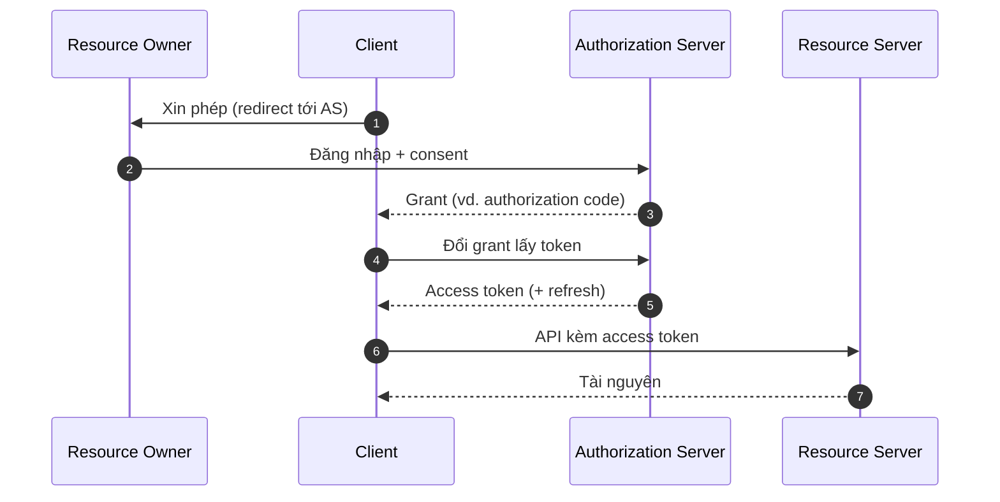

Năm ý ghép mọi flow: **redirect**, **consent**, **scope**, **authorization code** (một lần, ngắn), **đổi code ở back-channel**.

### 3.2 — Chọn grant và Authorization Code + PKCE

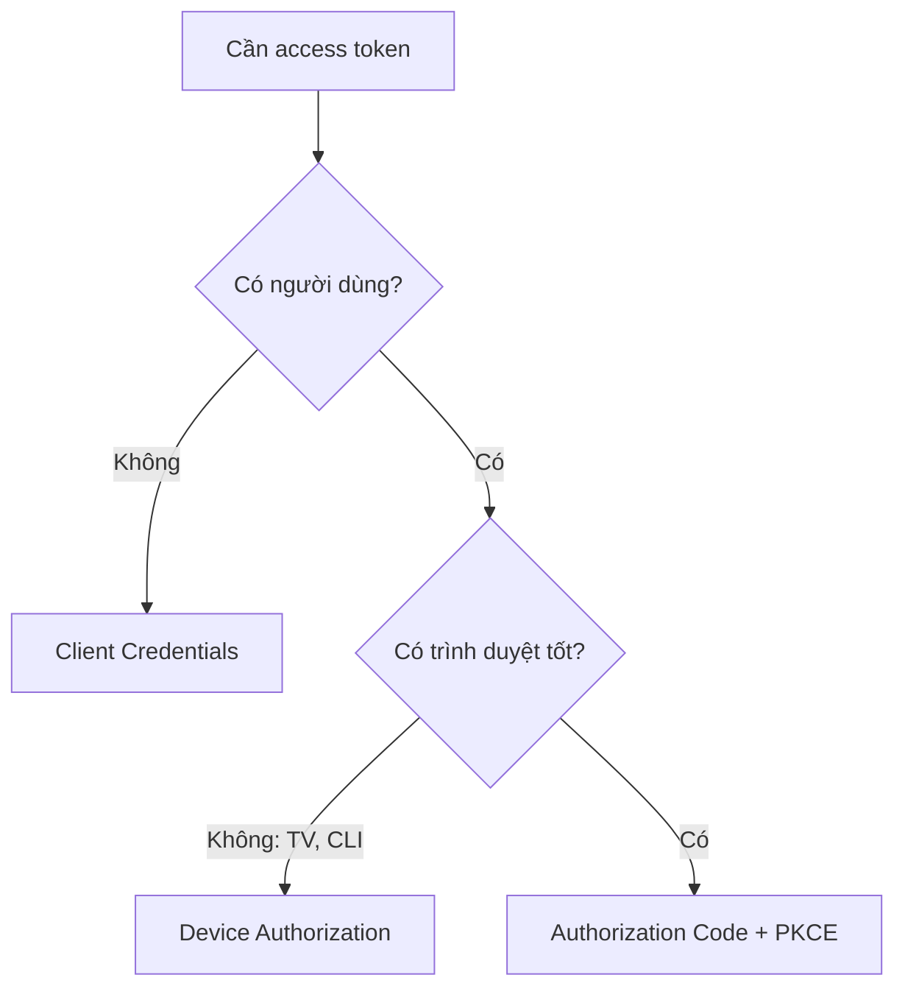

**Authorization Code (confidential, có backend):** trình duyệt chỉ nhận `code` + `state`; backend POST `/token` kèm `client_secret`.

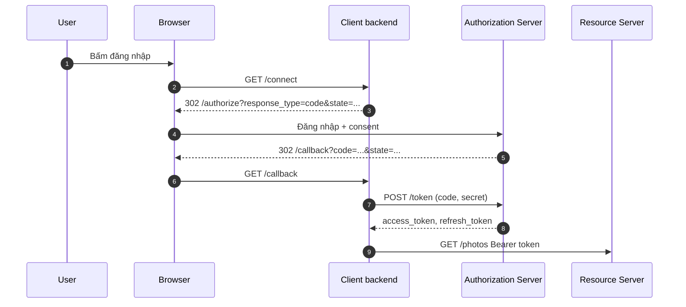

**PKCE (RFC 7636):** `code_challenge` = BASE64URL(SHA256(`code_verifier`)) ở bước authorize; `code_verifier` chỉ ở token request. Ai trộm **code** mà không có verifier → `invalid_grant`. OAuth 2.1 / RFC 9700: PKCE cho **mọi** client dùng Authorization Code; luôn `S256`, không `plain`.

**Public client (desktop/SPA):** không `client_secret`; loopback `http://127.0.0.1:{port}/` (port động được phép theo RFC 8252).

Độ sâu lab PKCE (verifier/challenge, vector RFC 7636, tấn công interception): **[Identity Part 4 — Lab 4.1–4.2](../identity/part-4-advanced.md#l4-hands-on--lab-part-4)** — không lặp lab tấn công ở đây.

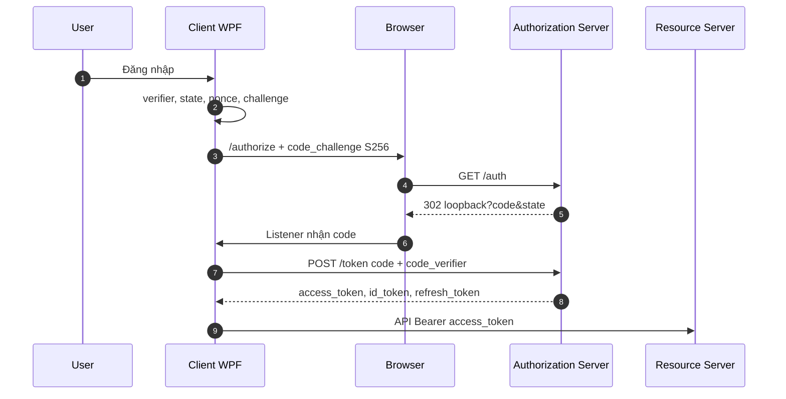

### 3.3 — Client Credentials, Device, refresh; grant cũ & OAuth 2.1

**Client Credentials:** một POST token, không redirect, không user; token đại diện **service** (`sub` = service account). Chỉ **confidential** client. Thường **không** refresh token — cache access token đến gần `expires_in` rồi xin lại. Chi tiết máy–máy trong TeamBoard: [Identity Part 3](../identity/part-3-multi-component.md).

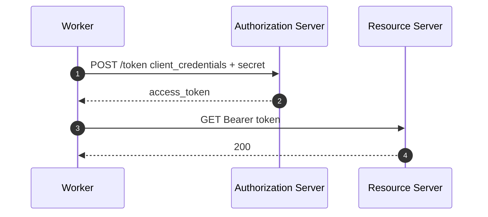

**Device Authorization (RFC 8628):** thiết bị hiển thị `user_code`, user đăng nhập trên thiết bị khác; thiết bị **polling** `device_code`. Rủi ro: device code phishing.

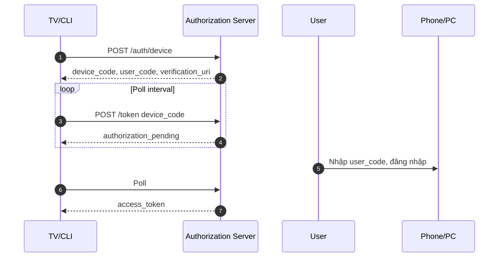

**ROPC** (`grant_type=password`) và **Implicit** (`response_type=token` trong URL fragment): **không** dùng thiết kế mới — client thấy mật khẩu hoặc token trên front-channel; RFC 9700 MUST NOT / SHOULD NOT; OAuth 2.1 loại bỏ.

**OAuth 2.1 (draft, chưa RFC):** hợp nhất best practice — PKCE bắt buộc, bỏ Implicit/ROPC/`plain`, redirect URI **exact match** (ngoại lệ loopback port), không bearer token trên query, refresh token public client: rotation hoặc sender-constrained (DPoP). Thực tế IdP hiện đại đã áp dụng phần lớn; tham chiếu chính thức hôm nay: **RFC 9700**.

### 3.4 — `state`, `nonce`, PKCE, redirect URI (bài 3.4)

Bốn cơ chế **không thay nhau**:

| Cơ chế | Ai kiểm | Chống gì |
|---|---|---|
| `state` | Client | CSRF callback, login CSRF, correlation |
| `nonce` | Client (trong ID token) | ID token replay / injection |
| PKCE | AS (token endpoint) | Code interception / injection |
| Redirect URI exact | AS (trước login) | Open redirect, trộm code |

**Login CSRF khi thiếu `state`:**

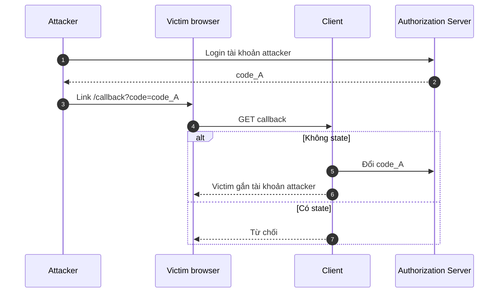

`state` phải ngẫu nhiên, gắn session, dùng một lần — giá trị cố định như `state=app` vô hiệu.

**Redirect URI:** so khớp **chuỗi chính xác**; không wildcard; không prefix. Muốn nhớ trang đích sau login → lưu trong session (gắn `state`), không nhét vào `redirect_uri`.

PKCE chi tiết và diagram interception: [Identity Part 4](../identity/part-4-advanced.md).

### 3.5 — OIDC, ID token, UserInfo (bài 3.5)

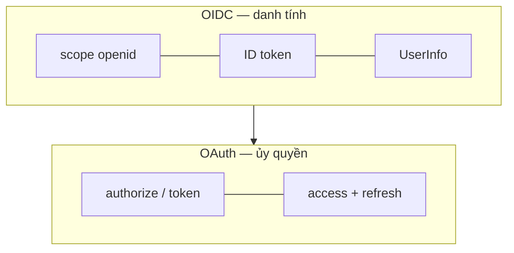

**Scope OIDC:** `openid` (bắt buộc cho ID token), `profile`, `email`, `offline_access`… **Claim** là giá trị trong token/UserInfo — không nhầm scope với claim.

**ID token — claim bắt buộc (OIDC Core):** `iss`, `sub`, `aud` (chứa `client_id` RP), `exp`, `iat`; `nonce` nếu request có; `auth_time` khi cần `max_age`; `azp` nên khớp client.

**Checklist validate ID token (tóm tắt):** chữ ký JWKS + pin `alg`; `iss` exact; `aud` chứa client_id; `exp`/`iat`; `nonce` khớp; không dùng ID token gọi API. Algorithm confusion và thứ tự kiểm JWT: [Identity Part 2](../identity/part-2-core-skills.md).

| Tiêu chí | ID token | Access token | Refresh token |
|---|---|---|---|
| Dành cho | RP (client) | API | AS |
| `aud` điển hình | `client_id` | API resource | — |
| Gửi tới API? | **Không** (Bearer) | Có | Chỉ token endpoint |

**Luồng OIDC đầy đủ (server-side RP):**

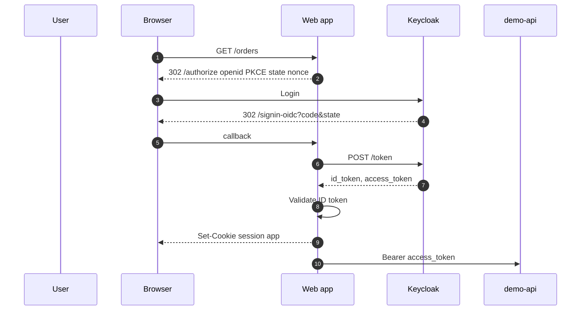

Sau đăng nhập RP dùng **session cookie riêng**, không gửi ID token mỗi request.

### 3.6 — Discovery, JWKS, logout (bài 3.6)

**Discovery:** `GET {issuer}/.well-known/openid-configuration` → `authorization_endpoint`, `token_endpoint`, `jwks_uri`, `end_session_endpoint`, … Cấu hình `Authority` trong .NET để handler tự tải.

**JWKS:** public keys + `kid`. Chọn key: header `kid` → JWK khớp → verify. **Key rotation:** đưa key mới vào JWKS **trước** khi ký; giữ key cũ đến hết token cũ. Cache JWKS; gặp `kid` lạ → refresh **có rate limit** (tránh spam AS). Không hardcode public key vĩnh viễn; không tin `jku` trong token.

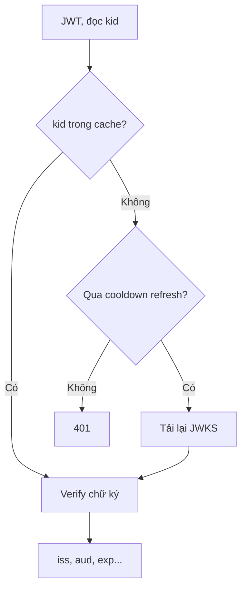

Xoay khoá đa service: [Identity Part 3 — JWKS](../identity/part-3-multi-component.md).

**Ba trạng thái logout:** (1) session cookie app, (2) session OP (SSO), (3) access/refresh token. Local logout chỉ (1) → đăng nhập lại có thể **SSO vào tài khoản cũ**.

**RP-initiated logout:** redirect `end_session_endpoint` + `id_token_hint`, `post_logout_redirect_uri` (đăng ký exact). Revoke refresh token nếu có. Single Logout không hoàn hảo: JWT access còn hiệu lực đến `exp`.

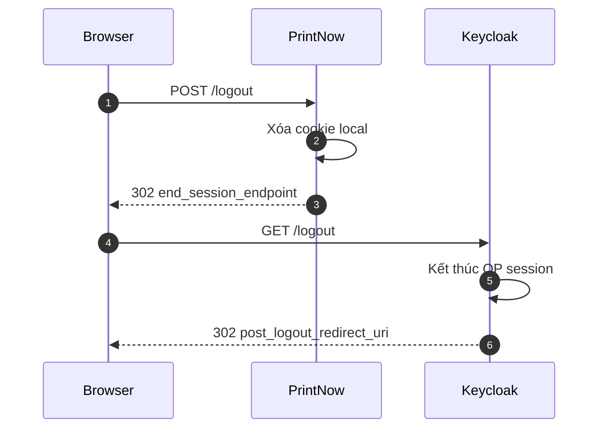

### 3.7 — `iss` + `sub`, external login, linking (bài 3.7)

Khóa định danh ổn định: **`(iss, sub)`** — `sub` chỉ unique trong một issuer. **Không** dùng `email` làm khóa: đổi được, tái sử dụng, `email_verified` có thể false, một số OP cho tự sửa email.

**Bảng gợi ý:**

- `users`: user nội bộ (`id`, `display_name`, `contact_email` chỉ hiển thị).
- `external_logins`: `issuer`, `subject`, `user_id` FK, **UNIQUE (issuer, subject)**.

**Account linking:** an toàn nhất — user **đang đăng nhập** chủ động liên kết provider. Tự gộp theo email chỉ khi `email_verified` và provider đáng tin domain; email chưa xác minh → account takeover.

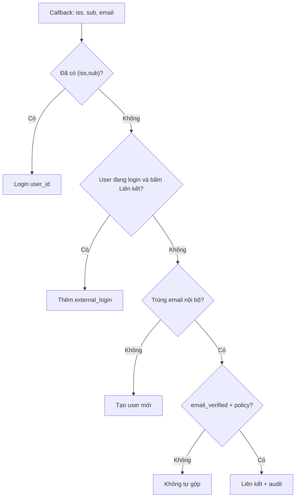

**Multi-tenant (Entra):** mỗi tenant một `iss`/`tid` — whitelist tenant, không tin mọi tenant trên `/common`.

**On-Behalf-Of / Token Exchange (RFC 8693):** API A đổi access token user lấy token `aud` = API B, `sub` vẫn là user — không chuyển tiếp token sai `aud`, không dùng Client Credentials + `userId` trong body.

### Lab hoãn (ô ma trận L4 = –)

**L4 (code):** [TB-050](../../issues/TB-050-identity-auth-lab-dual-provider.md) — lab OAuth/OIDC 1–3; Keycloak chỉ khi `Auth:Provider=Keycloak`. Lý thuyết vẫn ở Part này.

Thực hành liên quan đã có trên lộ trình **Identity** (môi trường `127.0.0.1`, không lặp ở đây):

| Chủ đề | Nơi chạy |
|---|---|
| Authorization Code + PKCE, refresh rotation | [Identity Part 4 — Lab 4.1, 4.2](../identity/part-4-advanced.md#l4-hands-on--lab-part-4) |
| JWKS, `kid`, xoay khoá | [Identity Part 3 — Lab 3.1](../identity/part-3-multi-component.md#l4-hands-on--lab-part-3) |
| Client Credentials + scope | [Identity Part 3 — Lab 3.2](../identity/part-3-multi-component.md#l4-hands-on--lab-part-3) |
| Giải mã / validate JWT RS256 | [Identity Part 2 — Lab 2.2](../identity/part-2-core-skills.md) |

## L5 Troubleshooting — Triệu chứng và nguyên nhân

| Triệu chứng | Nguyên nhân thường gặp | Cách kiểm |
|---|---|---|
| `invalid_grant` đổi code | Code hết hạn/đã dùng; sai `code_verifier`; sai `redirect_uri` | So verifier/challenge; log AS |
| `invalid_redirect_uri` | URI không exact (slash, port, scheme) | So từng ký tự với đăng ký |
| Login vào nhầm tài khoản | Login CSRF, thiếu/không ngẫu nhiên `state` | Cookie session + state one-time |
| ID token hợp lệ chữ ký nhưng từ chối | Sai `aud`, `iss`, `nonce` | Decode payload |
| API 401 sau SSO OK | Gửi **ID token** thay access token; sai `aud` access | So `aud` với API |
| 401 sau xoay JWKS | Hardcode key; cache JWKS cũ | `kid` trong header vs JWKS |
| Logout xong vẫn SSO | Chỉ local logout, OP session còn | Có gọi `end_session_endpoint`? |
| User trùng / mất dữ liệu | Khóa theo email thay `(iss,sub)` | Schema `external_logins` |

## L6 Production — Cân nhắc vận hành

- **Grant:** user-facing → Code + PKCE; batch/daemon → Client Credentials (secret trong vault, cache token).
- **Token:** access ngắn; refresh rotation cho public client; không log token/code/verifier.
- **Redirect / logout URI:** đăng ký exact; tách môi trường; callback không nhúng third-party, `Referrer-Policy` chặt.
- **JWKS:** `Authority` + cache có cooldown; OP xoay key có overlap.
- **Định danh:** persist `(iss, subject)`; cập nhật email/display mỗi login; linking có audit.
- **Logout:** kỳ vọng JWT access vẫn sống đến `exp`; cần revoke/introspection nếu cần dừng tức thì (⚠, đánh đổi).

## L7 Architecture — So sánh cần giữ

| So sánh | Kết luận ngắn |
|---|---|
| OAuth vs OIDC | Ủy quyền vs “là ai”; OIDC trên OAuth |
| Auth Code vs Client Credentials | Có user vs M2M |
| Public vs confidential | Giữ được secret hay không |
| Access vs ID vs refresh | API vs RP vs chỉ AS |
| JWT vs opaque access | Client không nên parse access JWT |
| PKCE vs `client_secret` | Ràng buộc code vs xác thực client — confidential dùng **cả hai** |
| `state` vs `nonce` | Callback vs ID token |
| Local vs federated logout | Cookie app vs session OP |
| `iss`+`sub` vs email | Khóa vs thuộc tính |
| Chuyển tiếp token vs OBO | Sai `aud` vs đổi audience đúng chuẩn |

**Endpoint:** authorization = người (GET redirect); token = máy (POST). Refresh chỉ tới AS, không tới API.

### Bài mở bổ sung (chi tiết L8 nằm ở Part 7)

1. Vẽ lại Code + PKCE và Client Credentials từ nhớ (đủ Client, Browser, AS, RS).
2. Bảng một dòng: mỗi ổ khóa (`state`, `nonce`, PKCE, redirect) chống tấn công nào.
3. Thiết kế schema `users` + `external_logins` cho TeamBoard với Google và Keycloak nội bộ.
4. Trình bày vì sao BFF + session cookie phù hợp SPA hơn Implicit (RFC 10017, ⚠ chưa chạy BFF thật).

**Tiêu chí thành thạo Part 3:** trả lời đúng phần lớn mục “Tự kiểm tra”; giải thích được deliverable Module 03 (sơ đồ, bảng token, bảng bảo vệ redirect) mà không nhầm vai token.

## Tự kiểm tra

1. OAuth có tự xác thực người dùng cho client không?
2. OIDC thêm gì so với OAuth thuần?
3. Vì sao SPA/desktop cần PKCE dù là app “first-party”?
4. `client_secret` có thể giấu trong file .exe không?
5. API nhận ID token hay access token?
6. `aud` của ID token và access token có thể khác không? Ví dụ?
7. Client Credentials có đại diện user đang đăng nhập không?
8. Chữ ký JWT hợp lệ nhưng `aud` sai — API có nên chấp nhận?
9. Vì sao không dùng email làm khóa định danh?
10. OAuth 2.1 (draft) bắt buộc / loại bỏ những gì? RFC nào đã ban hành tương đương?

Đáp án ngắn

1. Không — chỉ ủy quyền; “ai” là OIDC / ID token.
2. Scope `openid`, ID token, UserInfo, Discovery, logout specs.
3. Public client không có secret; code lộ = token lộ nếu không PKCE.
4. Không — public client; dùng PKCE (+ BFF nếu cần secret).
5. Access token (đúng `aud`/scope); không Bearer ID token.
6. Có — `aud` = `client_id` vs `aud` = API (vd. `demo-api`).
7. Không — `sub` là service account.
8. Không — `aud` sai = token không dành cho API này.
9. Email đổi/tái sử dụng/chưa verify; `sub` ổn định trong `iss`.
10. PKCE bắt buộc; bỏ Implicit, ROPC, `plain`; exact redirect; không token trên query; refresh public client constrained/rotation. **RFC 9700** (BCP) đã ban hành nhiều yêu cầu tương đương.

## Nguồn và độ tin cậy

**Nguồn chính (đọc khi soạn Part này):** Module 03 trong `authentication_standards_15h_roadmap.md`; site `m03-1-oauth-basics.html` … `m03-7-user-identity.html` (bộ `auth_std_roadmap-main`).

**Đã tự chạy:** không — L4 chờ TB-050; Keycloak không bật mặc định (profile `keycloak-lab`).

**Chỉ qua tài liệu / agent (⚠):** RFC 6749, 6750, 7636 (PKCE), 8628 (Device), 7009 (revoke), 9207 (`iss` trong response), 9700 (OAuth security BCP), OIDC Core 1.0, Discovery, RP-Initiated Logout; OAuth 2.1 vẫn Internet-Draft (11/2026).

**Liên kết thực hành trong repo:** [Identity Part 2–4](../identity/part-2-core-skills.md) (JWT, PKCE lab, JWKS) — tránh trùng lab tấn kích/JWT ở Part này.

**Chưa kiểm trên hệ thống thật:** cấu hình Entra multi-tenant, Token Exchange/OBO, DPoP, BFF production.