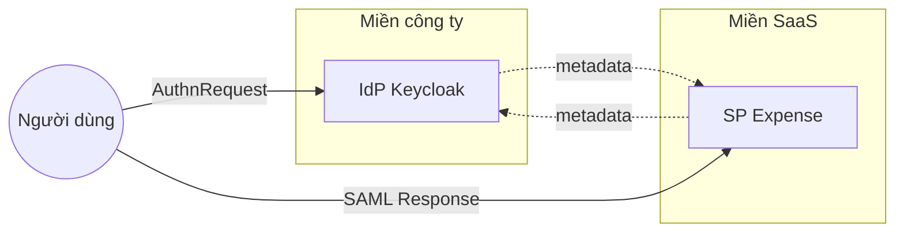
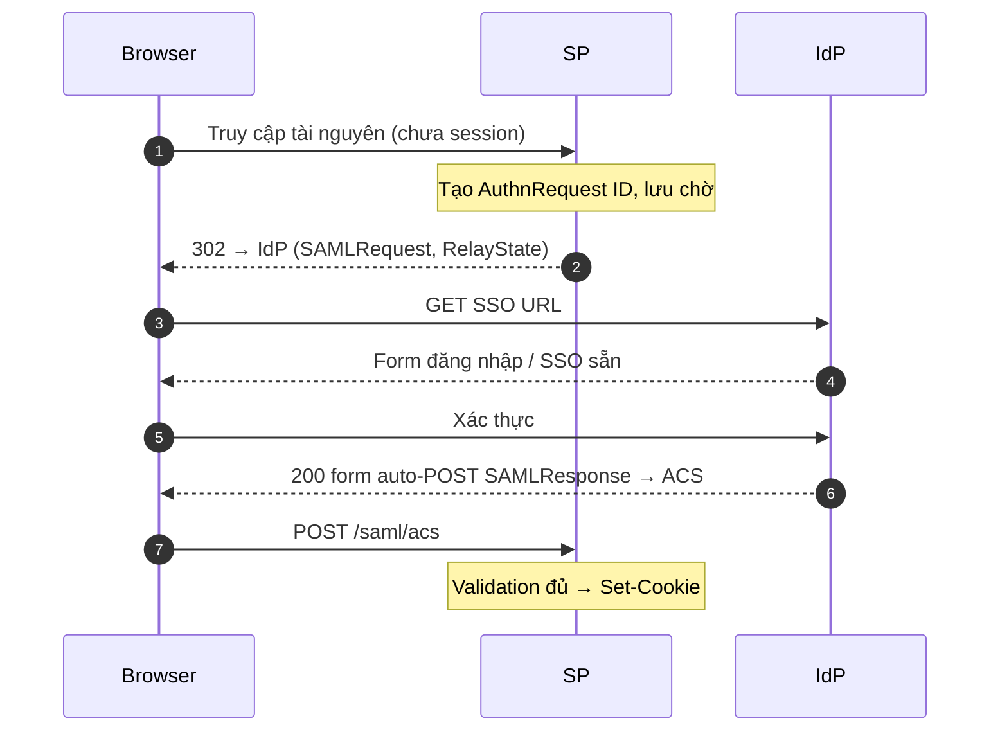
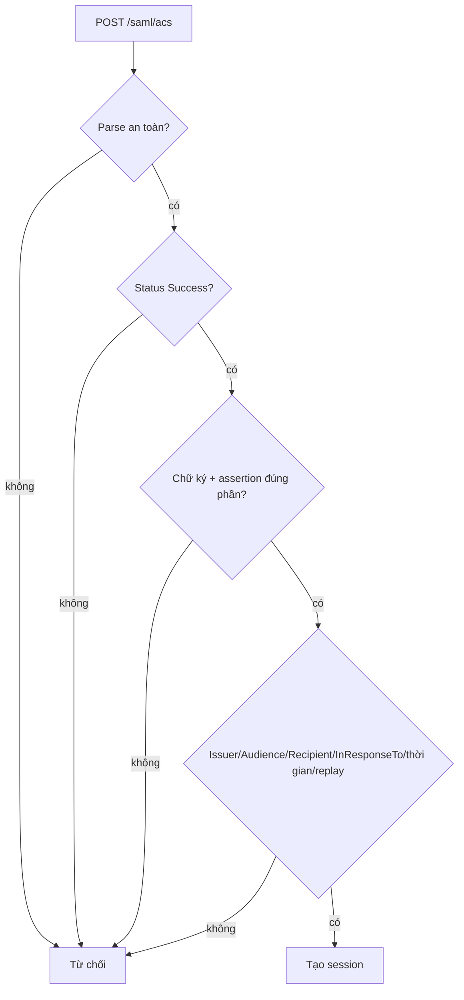

# Part 4 — Advanced (Authentication Standards)

> [!NOTE]
> **Mục tiêu:** đọc được SAML Response, phân biệt SP-initiated và IdP-initiated, chọn binding phù hợp, và biết checklist SP phải kiểm trước khi tin assertion; so sánh SAML với OIDC khi chọn chuẩn.
> **Cần biết trước:** [Part 3](part-3-multi-component.md) (OAuth/OIDC); nền PKI/XML signature từ Module 02 trong bộ gốc.
> **Thời lượng:** ~3 giờ · **Đầu ra kiểm được:** vẽ luồng SP-initiated; liệt kê ≥8 mục validation; giải thích vì sao IdP-initiated rủi ro hơn.
> [← Part 3](part-3-multi-component.md) · [Part 5 →](part-5-production-security-ops.md)

*Nội dung ánh xạ Module 04 (bài 4.1–4.4) — SAML 2.0 & Enterprise SSO.*

## L1 What — Thành phần và tài liệu SAML

#### SAML 2.0 (Security Assertion Markup Language)
**Là gì:** chuẩn OASIS (2005) trao đổi **tuyên bố đăng nhập** dạng XML giữa hai miền tin cậy — IdP xác thực, SP tin assertion có chữ ký.
**Ví dụ đời thường:** HR cấp giấy giới thiệu có dấu; bảo vệ tòa nhà đối tác (SP) chỉ tin dấu đã đăng ký.
**Use case:**
- SSO vào SaaS B2B (Salesforce, Jira Cloud…) bằng tài khoản công ty
- Federation giữa tổ chức (trường, cơ quan)
- **Không** dùng cho mobile/SPA gọi API — đó là OAuth/OIDC

#### Identity Provider (IdP)
**Là gì:** nơi người dùng đăng nhập thật (mật khẩu, MFA); **viết và ký** assertion.
**Use case:** Keycloak realm, Entra ID, AD FS, Okta.

#### Service Provider (SP)
**Là gì:** ứng dụng **nhận và kiểm** SAML Response, rồi tạo session cục bộ; không giữ mật khẩu domain.
**Use case:** ứng dụng Expense chỉ nhận assertion từ Keycloak.

#### Metadata, Entity ID, ACS
**Là gì:** metadata = XML “danh thiếp” (entityID, endpoint, certificate); **ACS** (Assertion Consumer Service) = URL SP nhận Response.
**Use case:** IT trao đổi metadata một lần khi cấu hình federation.

#### Assertion vs Response vs AuthnRequest
**Là gì:** AuthnRequest = phiếu yêu cầu (SP); Response = phong bì giao thức (`samlp:`); Assertion = lá thư (`saml:`) bên trong.
**Use case:** debug — kiểm Status trên Response trước khi đọc NameID trong Assertion.

| Loại tài liệu | Ai viết | Khi nào |
|---|---|---|
| Metadata | Mỗi bên tự xuất | Cài đặt / đổi cert |
| AuthnRequest | SP | Mỗi lần SP-initiated |
| Response | IdP | Mỗi lần đăng nhập |
| Assertion | IdP | Trong Response (khi thành công) |

> [!WARNING] **Hiểu lầm:** SAML lỗi thời, không cần học. **Thực tế:** vẫn rất phổ biến trong enterprise SSO; khách B2B thường yêu cầu “SSO SAML với AD FS/Entra của chúng tôi”.

> [!WARNING] **Hiểu lầm:** Expense gọi thẳng Keycloak lấy assertion. **Thực tế:** với Redirect/POST, message đi **qua trình duyệt**; assertion là bearer — phải ngắn hạn và ký chặt.

## L2 Why — Vì sao doanh nghiệp vẫn dùng SAML

- **Một nơi khóa:** nghỉ việc → khóa tài khoản IdP, mất SSO vào hàng chục app.
- **Hợp đồng B2B:** nhà cung cấp SaaS đã hỗ trợ SAML trước OIDC; tích hợp theo yêu cầu khách.
- **Cái giá:** XML phức tạp, XXE/XSW, metadata/cert rollover thủ công; không có access token cho API như OIDC.

## L3 How — Assertion, luồng và binding

### 3.1 Ba loại Statement trong Assertion

| Statement | Trả lời | SP thường dùng để |
|---|---|---|
| AuthnStatement | Đăng nhập lúc nào, cách nào | Tạo session, MFA, SLO |
| AttributeStatement | Email, nhóm… | Map role **tại SP** |
| AuthzDecisionStatement | Được làm X trên Y? | Hiếm; gần như không dùng |

**Liên hệ OIDC:** Authn ≈ `auth_time`/`acr`/`amr`; Attribute ≈ `email`/`groups`; NameID ≈ `sub`; Audience ≈ `aud`.

> [!WARNING] **Hiểu lầm:** SP chờ IdP gửi quyền trong assertion. **Thực tế:** IdP gửi attribute (`groups`); **SP tự map** quyền nghiệp vụ.

### 3.2 SP-initiated SSO (mặc định nên dùng)

| Bước | Chi tiết |
|---|---|
| SP tạo request | ID ngẫu nhiên, có thể ký request |
| IdP trả về | Response + Assertion ký; thường **HTTP-POST** |
| SP ACS | Checklist (mục L6); `InResponseTo` khớp request đang chờ |

**RelayState:** opaque, spec **≤80 byte** — lưu URL thật ở server, chỉ gửi khóa; không redirect tùy ý (open redirect).

**SameSite:** cookie “request đang chờ” thường cần `SameSite=None; Secure` vì POST cross-site từ IdP → SP.

### 3.3 IdP-initiated (unsolicited response)

**Là gì:** người dùng bấm app trên portal IdP; Response **không có** `InResponseTo`.
**Rủi ro:** login CSRF/injection (kẻ tấn công POST Response hợp lệ của mình vào ACS nạn nhân), replay mạnh hơn.
**Use case:** chỉ bật khi bắt buộc; tắt `AllowUnsolicitedAuthnResponse` nếu có; hoặc SP nhận unsolicited rồi **khởi động lại** luồng SP-initiated.

| Tiêu chí | SP-initiated | IdP-initiated |
|---|---|---|
| AuthnRequest | Có | Không |
| InResponseTo | Bắt buộc khớp | Không |
| Chống login CSRF | Tốt | Yếu |
| Khuyến nghị | Mặc định | Hạn chế |

### 3.4 Binding: Redirect vs POST vs Artifact

| Binding | Chở message | Chữ ký | Thường dùng |
|---|---|---|---|
| HTTP-Redirect | Query (DEFLATE+base64) | Trên **query** (`Signature=`) | AuthnRequest nhỏ |
| HTTP-POST | Form ẩn, base64 trong body | Trong XML (`ds:Signature`) | SAML Response |
| HTTP-Artifact | Mã ngắn trên browser | Lấy message qua back-channel SOAP | Hiếm; assertion không qua browser |

> [!WARNING] **Hiểu lầm:** Response gửi Redirect được. **Thực tế:** Browser SSO profile không dùng Redirect cho Response (dài, lộ URL/log/Referer).

> [!WARNING] **Hiểu lầm:** Redirect binding ký trong XML như POST. **Thực tế:** ký chuỗi query; `ds:Signature` trong XML phải bỏ.

### 3.5 So sánh SAML và OIDC (khi chọn chuẩn)

| Tiêu chí | OIDC | SAML 2.0 |
|---|---|---|
| Định dạng | JSON/JWT | XML |
| Phổ biến | Web/mobile/API mới | Enterprise SSO, SaaS |
| Gắn request / CSRF | `state`, `nonce`, PKCE | `InResponseTo`, RelayState |
| Trust | Discovery + JWKS | Metadata XML, cert |
| API | Access token | Không có access token chuẩn |

**Mẫu kiến trúc:** app .NET mới → **OIDC**; SaaS khách chỉ SAML → SP SAML của Keycloak; app chỉ OIDC client → **Keycloak broker** (SAML ra ngoài, OIDC vào trong).

### Lab hoãn (ô ma trận L4 = –)

> **Hoãn** (TB-049): Lab SAML trong bộ `auth_std_roadmap` (Lab 5) tích hợp ở issue riêng. Phần này không ghi đầu ra lab giả định.

## L5 Troubleshooting — Triệu chứng thường gặp

| Triệu chứng | Nguyên nhân gốc | Cách kiểm |
|---|---|---|
| InResponseTo không khớp | Cookie chờ bị SameSite chặn; scale SP không chia state | Cookie `None+Secure`; sticky session / store tập trung |
| SSO đột ngột hỏng toàn công ty | Cert IdP đổi/hết hạn, SP metadata cũ | Theo dõi hạn cert; rollover có kế hoạch |
| Chữ ký OK nhưng sai user | XSW: verify một assertion, đọc assertion khác | Thư viện cập nhật; chỉ 1 assertion |
| Audience lỗi | Assertion cho app khác | So entity ID SP với Audience |
| Clock skew | Lệch giờ SP/IdP | NTP; cho phép skew nhỏ |

> [!WARNING] **Hiểu lầm:** InResponseTo sai là lỗi IdP. **Thực tế:** thường SP **mất** request đang chờ (cookie, tab, back).

## L6 Production — Validation và triển khai an toàn

#### Checklist SP tại ACS (tóm tắt)
**Use case:** mọi Response qua ACS đều phải pass trước khi `Set-Cookie`.

1. Parser XML: **tắt DTD/entity** (chống XXE)
2. `Status` = Success
3. Chữ ký hợp lệ bằng cert **từ metadata tin cậy** (không tin cert trong `KeyInfo` message)
4. Phần tử được ký = phần tử đọc dữ liệu (chống **XSW**)
5. Issuer, Audience, Destination/Recipient đúng SP
6. `InResponseTo` (SP-initiated): khớp, dùng một lần
7. `NotBefore` / `NotOnOrAfter` + clock skew
8. Chống replay: cache **ID assertion** đã dùng
9. SubjectConfirmation bearer hợp lệ
10. Map account: **Issuer + NameID** (persistent); cẩn trọng auto-link email

#### XXE vs XSW

| | XXE | XSW |
|---|---|---|
| Tấn công | Parser XML | Logic verify vs đọc dữ liệu |
| Thời điểm | Trước verify chữ ký | Sau parse; chữ ký vẫn “đúng” |
| Attacker cần | POST bất kỳ XML | Response/assertion hợp lệ rồi wrap |
| Phòng | `DtdProcessing.Prohibit` | Thư viện SAML; 1 assertion; DOM đã verify |

> [!WARNING] **Hiểu lầm:** Chữ ký hợp lệ là đủ. **Thực tế:** assertion đúng chữ ký nhưng **sai Audience** vẫn phải từ chối.

> [!WARNING] **Hiểu lầm:** Dùng cert trong `KeyInfo` của response. **Thực tế:** kẻ tấn công tự ký bằng cert của mình — chỉ tin metadata IdP.

#### Thư viện (.NET)
**Use case:** không tự implement XMLDSig/C14N/XSW.

- **Sustainsys.Saml2**, **ITfoxtec.Identity.Saml2** — cập nhật bản vá; không nới lỏng “unsigned”, unsolicited
- Hoặc **broker IdP** (Keycloak): app chỉ OIDC

## L7 Architecture — SAML, OIDC, WS-Federation

| Chuẩn | Nhận biết | Khi gặp |
|---|---|---|
| SAML 2.0 | `samlp:`, ACS POST | SaaS enterprise, federation |
| OIDC | `/authorize`, JWT | App/modern API |
| WS-Federation | `wa=wsignin1.0`, `wtrealm=` | .NET cũ, SharePoint on-prem; assertion thường bọc SAML |

**IdP vs OP / SP vs RP:** cùng vai — SAML gọi SP, OIDC gọi RP.

**Quyết định nhanh:**
- Web/mobile/API mới → OIDC
- Khách yêu cầu SAML metadata → SAML SP (hoặc broker)
- Legacy WS-Fed → package tương thích hoặc migration OIDC

## Tự kiểm tra

1. Khác nhau giữa Response và Assertion? Chữ ký có thể nằm ở đâu?
2. SP-initiated an toàn hơn IdP-initiated ở điểm nào?
3. Vì sao AuthnRequest thường Redirect còn Response thường POST?
4. Liệt kê ba kiểm tra SP hay bỏ sót (ngoài “verify chữ ký”).
5. Khi nào chọn broker Keycloak thay vì SAML trực tiếp trong app?

Đáp án ngắn

1. Response = phong bì (`Status`, `InResponseTo`, `Destination`); Assertion = nội dung user. Chữ ký có thể trên Response, Assertion, hoặc cả hai — SP phải biết phần nào được ký và đọc đúng phần đó.
2. SP-initiated có AuthnRequest + `InResponseTo` gắn phiên browser, chống login CSRF; IdP-initiated thiếu mắt xích đó.
3. Request nhỏ, ký query; Response lớn (assertion + cert), không đưa bearer lên URL.
4. Audience/Recipient, InResponseTo một lần, replay ID assertion, cert từ metadata (không KeyInfo), parser chống XXE, chỉ một assertion (XSW).
5. App chỉ cần OIDC; khách có IdP SAML; muốn gom xử lý XML/security vào IdP đã kiểm định.

## Nguồn và độ tin cậy

**Đã đối chiếu nội dung:** bài 4.1–4.4 trong bộ `auth_std_roadmap-main` (HTML module M04), cấu trúc theo [part-template](../../../.agents/skills/learning-hub/references/part-template.md).

**Chuẩn tham chiếu (⚠ chưa mở lại từng RFC/XML trong phiên này):** [SAML 2.0 Core](http://docs.oasis-open.org/security/saml/v2.0/saml-core-2.0-os.pdf), [SAML Bindings](http://docs.oasis-open.org/security/saml/v2.0/saml-bindings-2.0-os.pdf), XML Signature (W3C).

**Chỉ qua tài liệu thứ cấp (⚠):** CVE ruby-saml XSW (2024–2025); hành vi cụ thể Sustainsys.Saml2 / ITfoxtec — kiểm lại advisory NuGet trước production.

**Chưa kiểm:** chạy lab SAML; soạn metadata Keycloak thật với TeamBoard.