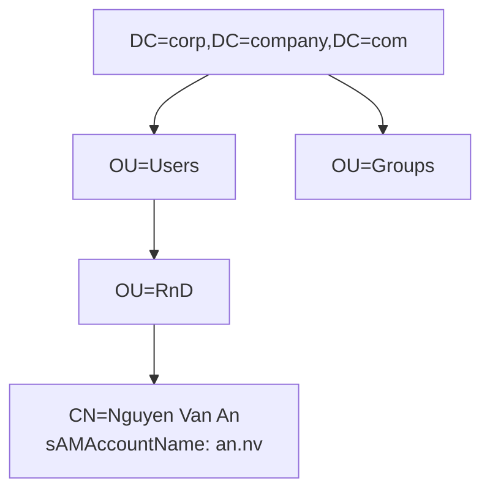
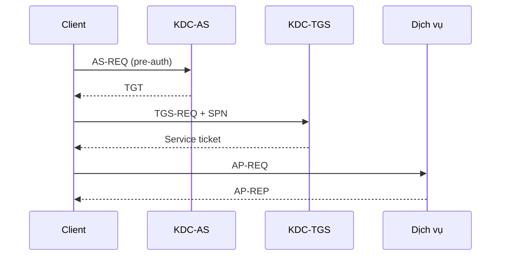
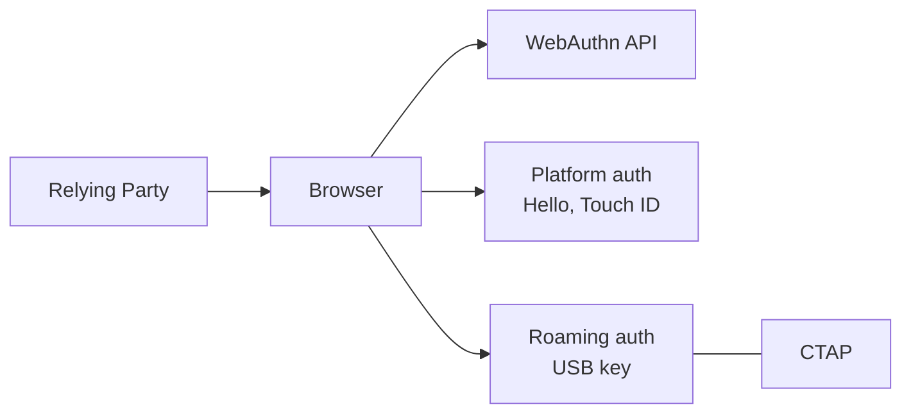

# Part 5 — Production, security & ops (Authentication Standards)

> [!NOTE]
> **Mục tiêu:** phân biệt LDAP, AD và Entra ID; nắm luồng Kerberos ở mức vận hành; triển khai WebAuthn/passkey an toàn (origin, UP/UV, recovery).
> **Cần biết trước:** [Part 4](part-4-advanced.md) (SAML); PKI/password hashing từ Module 02 bộ gốc.
> **Thời lượng:** ~3,5 giờ · **Đầu ra kiểm được:** giải thích vì sao “login LDAP” không phải SSO; vẽ 3 pha Kerberos; nêu vì sao passkey chống phishing không cần sinh trắc.
> [← Part 4](part-4-advanced.md) · [Part 6 →](part-6-projects.md)

*Nội dung ánh xạ Module 05 (bài 5.1–5.4) — Enterprise auth & passwordless.*

## L1 What — Directory và passwordless

#### Directory vs database
**Là gì:** **directory** = danh bạ tổ chức (user, nhóm, máy), đọc nhiều ghi ít; **database** = dữ liệu nghiệp vụ từng app.
**Use case:** email/Wi-Fi/HR cùng hỏi “An thuộc nhóm nào” → directory; bảng lương → DB riêng.

#### LDAP (Lightweight Directory Access Protocol)
**Là gì:** **giao thức** hỏi/sửa directory (RFC 4510–4519), không phải bản thân AD.
**Use case:** app bind + search lấy `mail`, `memberOf`.

#### Distinguished Name (DN) và tên đăng nhập AD
**Là gì:** **DN** = đường dẫn đầy đủ trong cây; **sAMAccountName** = `CORP\an.nv`; **UPN** = `an.nv@corp.company.com`.
**Use case:** filter search dùng `(sAMAccountName=an.nv)`, không `(cn=an.nv)` nếu CN là họ tên.

#### Active Directory Domain Services (AD DS)
**Là gì:** directory on-prem của Microsoft trên **Domain Controller** — LDAP, Kerberos, GPO, DNS.
**Use case:** laptop join domain; SSO nội bộ Windows.

#### Microsoft Entra ID
**Là gì:** IdP **cloud** (OIDC/OAuth/SAML), không thay thế LDAP bind trực tiếp cho app cũ.
**Use case:** Microsoft 365; hybrid đồng bộ từ AD.

#### FIDO2 / WebAuthn / passkey
**Là gì:** **FIDO2** = WebAuthn (W3C) + CTAP (thiết bị); **passkey** = credential FIDO discoverable, thay mật khẩu.
**Use case:** đăng nhập HR không gửi mật khẩu qua mạng.

| Khái niệm | Loại | App web hiện đại |
|---|---|---|
| LDAP | Giao thức | Tra directory (nếu còn) |
| AD DS | Sản phẩm on-prem | Domain join, Kerberos |
| Entra ID | IdP cloud | OIDC/SAML |
| WebAuthn | API xác thực | Passkey tại RP |

> [!WARNING] **Hiểu lầm:** LDAP = SSO như OIDC. **Thực tế:** “login LDAP” = app **nhận mật khẩu** và bind — không redirect IdP, không token.

> [!WARNING] **Hiểu lầm:** Entra ID = AD trên cloud, code LDAP bind vẫn chạy. **Thực tế:** phải chuyển OIDC/SAML (hoặc Entra Domain Services — sản phẩm khác).

## L2 Why — Vì sao doanh nghiệp và passwordless song song

- **AD/Kerberos:** SSO trong mạng nội bộ, mật khẩu không đi qua dây khi dùng ticket.
- **LDAP/LDAPS:** tra nhóm/email; **bắt buộc TLS** (389+StartTLS hoặc 636) — simple bind trần = lộ mật khẩu.
- **Passkey:** chống phishing ở bước đăng nhập; **recovery yếu** (SMS) hạ toàn bộ độ an toàn.

## L3 How — LDAP bind, Kerberos, WebAuthn

### 3.1 LDAP bind vs search

| | Bind | Search |
|---|---|---|
| Câu hỏi | Ai đang nói? | Tìm entry thỏa filter? |
| Tương tự SQL | `CONNECT user/pass` | `SELECT … WHERE` |
| Kiểm mật khẩu user | **Bind lại** bằng DN user + password | Không |

**LDAP injection:** escape `* ( ) \` trong filter (RFC 4515); tài khoản bind chỉ đọc tối thiểu.

**LDAPS / StartTLS:**

| Cách | Cổng | Ghi chú |
|---|---|---|
| LDAP trần | 389 | Không credential |
| StartTLS | 389 | Bắt buộc nâng cấp thành công |
| LDAPS | 636 | TLS từ đầu |

> [!WARNING] **Hiểu lầm:** Bind OK với mật khẩu rỗng = đúng mật khẩu. **Thực tế:** unauthenticated bind — app phải **từ chối** password rỗng trước khi bind.

> [!WARNING] **Hiểu lầm:** OU = nhóm quyền. **Thực tế:** OU tổ chức cây/GPO; quyền qua **group** (`memberOf`).

### 3.2 Kerberos (tổng quan)

**Là gì:** xác thực bằng **ticket**; **KDC** (trên DC) gồm AS + TGS; mật khẩu không gửi qua mạng (pre-auth mã hóa).

| Thành phần | Vai trò |
|---|---|
| TGT | “Vé xin vé”; mã hóa bởi `krbtgt` |
| Service ticket | Vé cho một **SPN** cụ thể |
| SPN | VD `HTTP/hr.corp.company.com` |

**Vận hành:** đồng hồ UTC lệch ≤ ~5 phút (mặc định AD); SPN đúng tên host (truy cập bằng IP → thường rơi NTLM); nhóm mới trong AD → cần vé mới (đăng nhập lại).

**Web .NET:** `WWW-Authenticate: Negotiate` → Kerberos hoặc NTLM fallback (`Microsoft.AspNetCore.Authentication.Negotiate`).

| | Kerberos | NTLM (legacy) |
|---|---|---|
| Cơ chế | Ticket KDC | Challenge-response |
| Server hỏi DC mỗi lần? | Không (giải mã vé) | Thường có |
| Mutual auth | Có (AP-REP) | Không |

> [!WARNING] **Hiểu lầm:** AS trong Kerberos = Authorization Server OAuth. **Thực tế:** **Authentication Server** trong KDC — chỉ trùng viết tắt.

### 3.3 FIDO2 stack

| Tên | Là gì | Developer web |
|---|---|---|
| WebAuthn | `navigator.credentials.create/get` | Có |
| CTAP | Browser ↔ thiết bị rời | Trình duyệt lo |
| Passkey | Credential FIDO | Kết quả UI |

**Registration (tóm tắt):** server sinh **challenge** → `create()` → authenticator giữ **private key**, gửi public key + credential ID (+ attestation tùy chọn).

**Authentication:** `get()` → ký `authenticatorData` + hash `clientDataJSON` (có challenge, **origin**).

| WebAuthn assertion | SAML assertion |
|---|---|
| Chữ ký passkey trên challenge | XML IdP ký danh tính federated |
| Chỉ trùng tên “assertion” | |

### 3.4 Chống phishing, UP/UV, loại passkey

**Origin binding:** `rpId` khớp domain; `clientDataJSON.origin` do browser ghi — trang giả không dùng được credential của RP thật.

> [!WARNING] **Hiểu lầm:** Chống phishing nhờ vân tay. **Thực tế:** nhờ **origin binding**; key chỉ chạm (UV=0) vẫn chống phishing.

| | User Presence (UP) | User Verification (UV) |
|---|---|---|
| Nghĩa | Có người chạm/bấm | Đã xác minh chủ (PIN/sinh trắc) |
| MFA đầy đủ | Chỉ “have” | Have + know/are |

**Synced vs device-bound:**

| | Synced (BE=1) | Device-bound (BE=0) |
|---|---|---|
| Private key | Đồng bộ cloud (E2E) | Chỉ một thiết bị |
| Mất máy | Khôi phục qua tài khoản provider | Cần key dự phòng / recovery RP |
| Phù hợp | Nhân viên văn phòng | Admin, quyền cao |

**Recovery:** nhiều passkey; không để SMS yếu làm cửa sau; hybrid QR cho máy lạ.

**Windows Hello vs WHfB vs passkey:**

| | Windows Hello | WHfB | Passkey |
|---|---|---|---|
| Mục đích | Mở khóa cục bộ | Đăng nhập Windows/Entra/AD | Đăng nhập website |
| Credential | — | Key/cert doanh nghiệp | FIDO per RP |

### 3.5 Password vs OTP vs push vs passkey (chọn yếu tố)

| Tiêu chí | Password | OTP | Push | Passkey |
|---|---|---|---|---|
| Phishing/AiTM | Dễ | Dễ (gõ mã) | Dễ (bấm duyệt) | **Khó** (origin) |
| Replay | Lâu dài | ~30s TOTP | Mỗi lần | Challenge mới |
| Server lưu | Hash password | Secret TOTP / SĐT | Thiết bị đã đăng ký | Public key |

**Kết hợp phổ biến:** người dùng đăng nhập **IdP bằng passkey** → app nhận **OIDC** (Keycloak/Entra) — WebAuthn là cơ chế; OIDC là lớp federation.

### Lab hoãn (ô ma trận L4 = –)

> **Hoãn** (TB-049): lab WebAuthn (Lab 6 bộ gốc) và lệnh `ldapsearch` / `klist` chưa chạy trong repo. Khi lab có: ghi đầu ra thật hoặc ⚠.

## L5 Troubleshooting — Enterprise & passkey

| Triệu chứng | Nguyên nhân gốc | Hướng xử lý |
|---|---|---|
| Clock skew Kerberos | Giờ máy sai | NTP; kiểm policy 5 phút |
| 401 rồi hỏi password nội bộ | SPN thiếu / URL IP | `setspn`; truy cập đúng hostname |
| LDAP bind OK, search rỗng | Sai filter/CN vs sAMAccountName | Đúng attribute AD |
| Passkey không hiện | Sai `rpId`/localhost vs domain | HTTPS + RP ID khớp |
| UV=0 bị từ chối | Policy đòi MFA | `userVerification: required` + từ chối nếu UV=0 |

## L6 Production — Vận hành an toàn

- **LDAP:** chỉ LDAPS hoặc StartTLS bắt buộc; LDAP signing + channel binding trên DC (⚠, theo khuyến nghị Microsoft); không dùng LDAP bind làm SSO thay OIDC.
- **Kerberos:** audit SPN trùng; hạn chế NTLM theo lộ trình Microsoft (deprecated).
- **WebAuthn:** `attestation: "none"` cho web công khai; challenge một lần, entropy đủ; kiểm **UP** luôn, **UV** theo policy; rate limit `/passkeys/*`.
- **Passkey:** recovery mạnh tương xứng; log đăng ký/xóa credential; không log challenge/private key.

> [!WARNING] **Hiểu lầm:** Có passkey thì recovery làm sao cũng được. **Thực tế:** SMS để thêm passkey mới = đường tấn công mới.

## L7 Architecture — Chọn cơ chế trong doanh nghiệp

| Nhu cầu | Hướng | Tránh |
|---|---|---|
| SSO web/SaaS B2B | SAML hoặc OIDC qua IdP | LDAP bind từ form app |
| App nội bộ Windows | Kerberos / Negotiate | NTLM mặc định lâu dài |
| Wi-Fi/VPN | RADIUS + AD (⚠ ngoài phạm vi chi tiết Part) | RADIUS thay OIDC cho web |
| Đăng nhập không mật khẩu user-facing | Passkey tại RP hoặc IdP | OTP SMS làm recovery duy nhất |
| Tra nhóm/email | LDAPS read-only service account | Ghi password user vào app |

**AAA (mạng):** Authentication / Authorization / Accounting — RADIUS/TACACS+ **không** thay OIDC cho browser; dùng cho NAS (Wi-Fi, VPN).

## Tự kiểm tra

1. Filter LDAP nào tìm user `an.nv` — vì sao không dùng `cn`?
2. Bước nào trong “login LDAP 3 bước” thực sự kiểm mật khẩu?
3. TGT khác service ticket ở chỗ nào? SPN thiếu thì hay gặp gì?
4. Developer web có cần code CTAP không?
5. Passkey chống AiTM bằng cơ chế gì (không liệt kê “vân tay”)?
6. `UP=1, UV=0` — chấp nhận khi nào?

Đáp án ngắn

1. `(sAMAccountName=an.nv)` — `cn` thường là họ tên hiển thị, không phải login name.
2. Bind lần 2 bằng DN của user + mật khẩu user vừa gõ; search chỉ tra cứu.
3. TGT đổi tại TGS; service ticket trình cho dịch vụ. Thiếu SPN → không lấy vé Kerberos → NTLM/hỏi password.
4. Không — chỉ WebAuthn; browser/OS gọi CTAP.
5. Browser kiểm `rpId` vs origin; `clientDataJSON.origin` nằm trong dữ liệu được ký; RP từ chối origin sai.
6. Policy thường ngày có thể chấp nhận (security key chạm); thao tác nhạy cảm / MFA đầy đủ → từ chối nếu thiếu UV=1.

## Nguồn và độ tin cậy

**Đã đối chiếu nội dung:** bài 5.1–5.4 trong bộ `auth_std_roadmap-main` (HTML module M05).

**Chuẩn tham chiếu (⚠ chưa mở lại đầy đủ trong phiên này):** RFC 4510–4519 (LDAPv3), RFC 4120 (Kerberos v5), [Web Authentication Level 3](https://www.w3.org/TR/webauthn-3/) (W3C), FIDO Alliance CTAP.

**Chỉ qua tài liệu thứ cấp (⚠):** Microsoft Learn (AD, Entra, WHfB, LDAP channel binding); lộ trình deprecated NTLM Windows 11 24H2 / Server 2025.

**Chưa kiểm:** chạy `ldapsearch`, `klist`, `setspn` trên môi trường thật; tích hợp passkey vào TeamBoard.