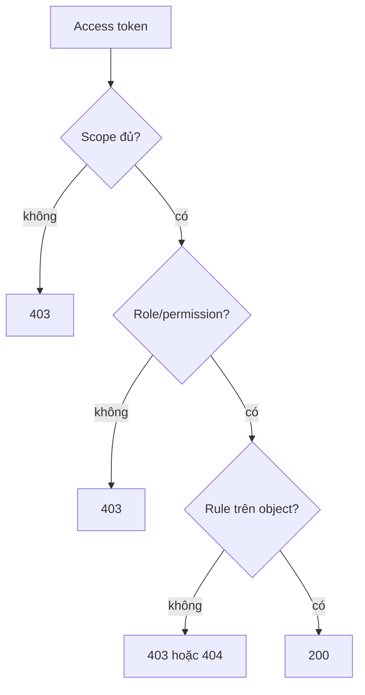

# Part 6 — Projects (Authorization & Security)

> [!NOTE]
> **Mục tiêu:** phân biệt permission, role, scope, claim và policy; triển khai phân quyền API (401/403, deny by default, BOLA); nhận diện CSRF/XSS và tấn công danh tính; áp chính sách mật khẩu NIST và chọn cách lưu token (ưu tiên BFF).
> **Cần biết trước:** [Part 1 đến 5](README.md) — OAuth/OIDC, session, token đã có ở các Part trước hoặc [lộ trình Identity](../identity/README.md).
> **Thời lượng:** ~5 giờ · **Đầu ra kiểm được:** giải thích được ba lớp scope ∩ role ∩ rule trên tài nguyên; chọn đúng 401 vs 403 vs 404; liệt kê biện pháp chống BOLA, CSRF, XSS; soát mật khẩu theo SP 800-63B-4; so sánh localStorage với BFF.
> [← Part 5](part-5-production-security-ops.md) · [Part 7 →](part-7-troubleshooting-mastery.md)

**Ánh xạ bài gốc:** 6.1 mô hình phân quyền · 6.2 authorization trong API · 6.3 CSRF, XSS, session fixation · 6.4 MFA fatigue, AiTM, JWT, enumeration · 6.5 NIST mật khẩu, token storage, checklist.

## L1 What — Viên gạch phân quyền (bài 6.1)

#### Permission, Role, Policy, Scope, Claim
**Là gì:** năm khái niệm mô tả “ai được làm gì” ở các mức khác nhau.
**Ví dụ đời thường:** thẻ nhân viên in phòng ban (claim), quyền mở kho (permission), gói quyền Trưởng phòng (role), giấy ủy quyền cho đơn vị giao hàng (scope), nội quy ghép điều kiện (policy).
**Use case:**
- API đọc `sub`, `department` từ token → **claim**
- Kiểm `order:approve` trong code → **permission**
- Gán `Manager` trên IdP → **role**
- Token của SPA có `orders.read` → **scope** (giới hạn **client**, không thay kiểm tra trên từng đơn)
- “Manager cùng phòng mới duyệt đơn #1024” → **policy**

> [!WARNING]
> Quyền hiệu lực ≈ **(scope của client) ∩ (quyền user) ∩ (rule trên tài nguyên)**. Scope `orders.read` không có nghĩa đọc được mọi đơn.

#### RBAC (Role-Based Access Control)
**Là gì:** quyền gắn với role; kiểm tra “có role/permission loại này không”.
**Use case:**
- IdP gán `Employee` / `Manager` → map sang permission trong app
- ASP.NET `[Authorize(Roles="Manager")]` ở tầng coarse-grained
**Lưu ý:** role explosion khi cần điều kiện theo phòng, giờ, ownership — đừng chỉ thêm role.

#### ABAC (Attribute-Based Access Control)
**Là gì:** policy trên thuộc tính subject, resource, action, environment (giờ, thiết bị…).
**Use case:**
- “Đọc đơn chỉ khi `subject.department == order.department` và trong giờ hành chính”
- Compliance: hạn mức, phân loại dữ liệu
**Lưu ý:** phụ thuộc chất lượng thuộc tính trên IdP; audit khó hơn RBAC.

#### ACL và ReBAC
**Là gì:** ACL — danh sách quyền trên **từng** tài nguyên; ReBAC — quyền suy từ quan hệ (owner, member, manager…).
**Use case:**
- ACL: chia sẻ file/tài liệu theo từng bản ghi
- ReBAC: “manager của team sở hữu đơn được duyệt” (mô hình Zanzibar / OpenFGA)
**Lưu ý:** hệ thật thường **kết hợp** RBAC + ABAC + ownership (ReBAC đơn giản).

#### PEP và PDP (policy engine)
**Là gì:** PEP (Policy Enforcement Point) chặn request; PDP (Policy Decision Point) trả permit/deny (OPA, Cedar, OpenFGA…).
**Use case:**
- Middleware API là PEP; gọi OPA trước khi duyệt đơn
- Endpoint quên gọi PEP → **không có bảo vệ** dù policy đúng
**Lưu ý:** engine không thay xác thực token; cần **deny by default** (bài 6.2).

| Tiêu chí | RBAC | ABAC | ACL | ReBAC |
|---|---|---|---|---|
| Gắn quyền với | Role | Biểu thức thuộc tính | Từng tài nguyên | Quan hệ đồ thị |
| Phù hợp | Vai trò tổ chức rõ | Điều kiện động, compliance | Chia sẻ tài liệu | SaaS cộng tác |

## L2 Why — Pipeline API và 401/403 (bài 6.2)

#### Pipeline xác thực và phân quyền
**Là gì:** mọi request đi qua authentication → coarse-grained (scope/role) → tải tài nguyên → fine-grained (ownership) → business rule.
**Use case:**
- Token hết hạn → dừng ở bước 1 (**401**), chưa hỏi quyền
- Token hợp lệ, không phải chủ đơn → **403** (hoặc **404** nếu lộ “có tồn tại” là rủi ro)
**Lưu ý:** “token hợp lệ” ≠ “được phép”.

#### 401 Unauthorized vs 403 Forbidden
**Là gì:** 401 = chưa xác thực được (thiếu/sai token); 403 = đã biết ai gọi nhưng không đủ quyền.
**Use case:**
- Client refresh/login lại chỉ hợp lý với **401** (RFC 6750: `invalid_token`, `insufficient_scope`)
- HR: xem lương đồng nghiệp → 403 hoặc 404 nhất quán toàn API
**Lưu ý:** refresh token khi 403 là vòng lặp vô ích.

#### Deny by default và least privilege
**Là gì:** không có rule cho phép thì từ chối; cấp đúng scope/permission tối thiểu.
**Use case:**
- ASP.NET `FallbackPolicy` + `[AllowAnonymous]` có chủ đích cho endpoint công khai
- SPA chỉ xin `orders.read`, worker service chỉ scope cần thiết
**Lưu ý:** `FallbackPolicy` chỉ bắt đăng nhập — quyền cụ thể vẫn phải khai báo.

#### BOLA / IDOR
**Là gì:** Broken Object Level Authorization — API trả dữ liệu theo ID client gửi mà không kiểm quyền trên object đó (OWASP API1:2023).
**Use case:**
- `GET /payroll/chi` với token của An → phải 403/404 sau `AuthorizeAsync(user, payslip, Read)`
- Lọc query `WHERE OwnerId = @sub` cho danh sách
**Lưu ý:** GUID khó đoán **không** thay kiểm tra object-level; ẩn nút UI **không** thay API.

| Triệu chứng | Nguyên nhân gốc | Cách sửa |
|---|---|---|
| 401 kèm `expired` | Access token hết hạn | Refresh / đăng nhập lại; NTP |
| 403 dù token mới | Thiếu scope, role, hoặc ownership | Pipeline fine-grained; không refresh vô ích |
| Đọc được bản ghi người khác | Thiếu BOLA | Resource-based authorization sau khi tải entity |
| Endpoint mới không bảo vệ | Thiếu PEP / `[Authorize]` | FallbackPolicy + review endpoint |

## L3 How — CSRF, XSS, session (bài 6.3)

#### CSRF (Cross-Site Request Forgery)
**Là gì:** trang độc lợi dụng browser **tự gửi cookie** để thực hiện hành động thay nạn nhân.
**Use case:**
- Cookie session + `POST` đổi trạng thái → `SameSite=Lax/Strict`, anti-forgery token, kiểm `Origin`
- BFF/SPA: custom header (`X-CSRF`) kích hoạt CORS preflight
**Lưu ý:** API chỉ Bearer **không** bị CSRF cổ điển; token trong JS lại nhạy cảm XSS.

#### XSS (Cross-Site Scripting)
**Là gì:** script độc chạy **trong origin** của app — đọc DOM/storage, gọi API như user.
**Use case:**
- Stored/reflected/DOM: encode output, CSP, tránh `innerHTML`/`@Html.Raw` với dữ liệu user
- Không lưu refresh token trong `localStorage`
**Lưu ý:** `HttpOnly` chặn đọc cookie nhưng script vẫn gọi API từ tab nạn nhân; XSS **vô hiệu** anti-CSRF.

#### Session fixation vs hijacking
**Là gì:** fixation — kẻ gian cài session ID trước login; hijacking — lấy session sau login.
**Use case:**
- Cấp session ID **mới** sau login và khi tăng đặc quyền; `__Host-` cookie; không nhận sid qua URL
- Chống hijacking: `HttpOnly`, `Secure`, TLS, timeout, chống XSS
**Lưu ý:** SameSite không chặn subdomain cùng site — vẫn cần anti-CSRF.

### Lab hoãn (ô ma trận L4 = –)

> [!NOTE]
> **L4:** lab Keycloak/JWT từ bộ gốc → [TB-050](../../issues/TB-050-identity-auth-lab-dual-provider.md). Phân quyền/cookie thực hành: [Identity Part 2–5](../identity/README.md).

**Đầu ra khi lab có:** chạy pipeline 401/403; tái hiện BOLA bằng đổi ID trên URL; cấu hình antiforgery cho BFF.

## L5 Troubleshooting — Tấn công danh tính (bài 6.4)

#### MFA fatigue (push bombing)
**Là gì:** spam push MFA đến khi user bấm Approve.
**Use case:** number matching, hiển thị ngữ cảnh, giới hạn số push, nút “không phải tôi”.
**Lưu ý:** number matching **không** chặn AiTM (proxy hiển thị đúng số).

#### AiTM phishing
**Là gì:** reverse proxy trang login thật, chuyển tiếp OTP/push và **lấy session** sau MFA.
**Use case:** ưu tiên passkey/FIDO2 (origin gắn RP ID); conditional access; session ngắn, revoke
**Lưu ý:** HTTPS trên domain giả **không** chứng minh domain thật.

#### JWT `alg=none` và key confusion
**Là gì:** server tin `alg` trong header: bỏ chữ ký hoặc RS256→HS256 với public key làm secret.
**Use case:** `ValidAlgorithms` cố định; khóa gắn đúng thuật toán; kiểm `iss`, `aud`, `exp`, loại token
**Lưu ý:** JWT JWS là base64 — đọc/sửa payload được; an toàn nhờ verify đúng.

#### Account enumeration và recovery yếu
**Là gì:** phản hồi login/reset khác nhau (hoặc thời gian khác) lộ email có tài khoản.
**Use case:** thông báo chung; hash giả khi user không tồn tại; reset “nếu email tồn tại đã gửi mail”
**Lưu ý:** recovery phải mạnh **ngang** login; không dùng câu hỏi bảo mật (NIST SHALL NOT KBA).

| Tấn công | Chặn chính |
|---|---|
| Credential stuffing / spraying | MFA, blocklist, rate limit |
| MFA fatigue | Number matching, giới hạn push |
| AiTM | Passkey, CA/policy thiết bị |
| JWT confusion | Allowlist alg, thư viện chuẩn |

Chi tiết tấn công tự dựng JWT/OAuth: [Identity Part 5](../identity/part-5-production-security-ops.md).

## L6 Production — NIST mật khẩu và token (bài 6.5)

#### NIST SP 800-63B-4 (mật khẩu)
**Là gì:** hướng dẫn xác thực Mỹ; bản final 07/2025 thay bản 2017.
**Use case:**
- Chỉ mật khẩu: tối thiểu **15** ký tự (SHALL); có MFA: có thể ≥ **8**
- SHALL NOT: composition rules, đổi định kỳ; SHALL: blocklist, rate limit (≤100 lần sai liên tiếp)
- SHALL đổi mật khẩu **khi có bằng chứng bị lộ**
**Lưu ý:** tối đa nên cho phép ≥ **64** ký tự (SHOULD), không phải giới hạn 64.

#### Lưu token trong browser
**Là gì:** đánh đổi XSS vs CSRF theo nơi cất access/refresh token.
**Use case:**

| Nơi lưu | XSS | CSRF |
|---|---|---|
| `localStorage` | Cao — mang token đi máy khác | Thấp |
| Memory (JS) | Trung bình — khó mang đi, vẫn gọi API khi tab mở | Thấp |
| Cookie HttpOnly | Thấp hơn — không đọc được | Cần chống CSRF |
| **BFF** (token trên server) | Thấp nhất | Cần chống CSRF |

**Lưu ý:** không nơi nào miễn nhiễm XSS hoàn toàn — XSS phải chặn từ gốc (encode, CSP).

#### BFF (Backend for Frontend)
**Là gì:** server nhỏ sau SPA; đổi code OIDC (confidential client), giữ token; browser chỉ cookie session.
**Use case:** SPA dữ liệu nhạy cảm; pattern an toàn trong RFC 10017 (browser-based OAuth).
**Lưu ý:** BFF **vẫn** cần SameSite + antiforgery — không bỏ CSRF.

#### Checklist bảo mật (tóm tắt M06)
- **AuthN:** MFA, passkey ưu tiên; mật khẩu NIST; recovery mạnh
- **Flow:** Code + PKCE public client; bảo vệ `redirect_uri`, `state`, `nonce`
- **Token:** verify đầy đủ; access ngắn; refresh rotation; không log/URL token
- **AuthZ:** least privilege, deny by default, BOLA
- **Ops:** audit không ghi credential; revoke session; rotate signing key

### Ba lớp quyết định AuthZ (bản đồ đầy đủ ở Part 7)

Kiến trúc SPA nhạy cảm: ưu tiên **server-side web** hoặc **SPA + BFF** — chi tiết ở [Part 7](part-7-troubleshooting-mastery.md).

## Tự kiểm tra

1. Vì sao token có `orders.read` vẫn không đọc được đơn phòng khác?
2. Khi nào trả 404 thay vì 403?
3. CSRF và XSS khác nhau ở đâu; cái nào phá được chống CSRF?
4. Theo NIST, mật khẩu 12 ký tự không MFA có hợp lệ không?
5. Chuyển từ `localStorage` sang BFF cần thêm biện pháp gì?

Đáp án ngắn

1. Scope giới hạn client; quyền trên từng đơn do API (ownership/phòng ban).
2. Khi việc lộ “bản ghi tồn tại” là rò rỉ (ví dụ bảng lương).
3. CSRF: site khác mượn cookie; XSS: script trong origin — XSS đọc được anti-CSRF.
4. Không — cần ≥15 ký tự khi mật khẩu là yếu tố duy nhất.
5. Chống CSRF (SameSite, antiforgery, custom header).

## Nguồn và độ tin cậy

**Đã tự mở và đối chiếu (khi biên soạn):** [NIST SP 800-63B-4](https://pages.nist.gov/800-63-4/sp800-63b.html); [RFC 6750](https://www.rfc-editor.org/rfc/rfc6750) (401/403 Bearer); [OWASP API Security API1:2023 BOLA](https://owasp.org/API-Security/editions/2023/en/0xa1-broken-object-level-authorization/).
**Chỉ qua nguồn roadmap HTML (⚠):** nội dung chi tiết bài 6.1–6.5 từ `auth_std_roadmap-main` (m06-*.html); số liệu Microsoft Authenticator number matching (2023) chưa tự đối chiếu bài gốc.
**Chưa kiểm:** lab Part 6 (TB-050 chưa xong); ví dụ Kaopiz HR trong nguồn là minh họa, không phải hệ thống thật của repo.