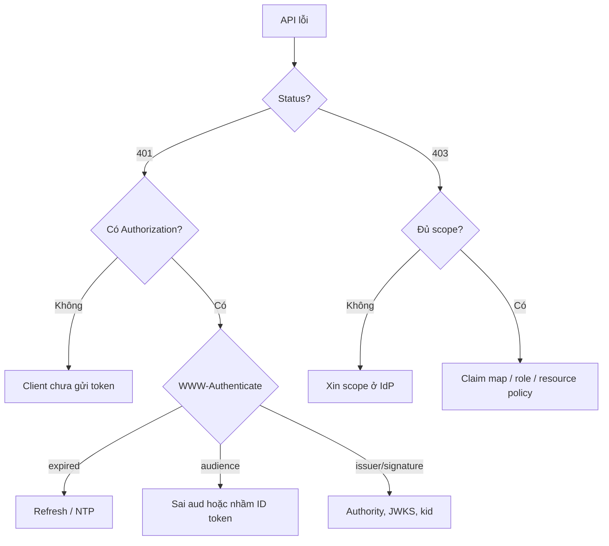
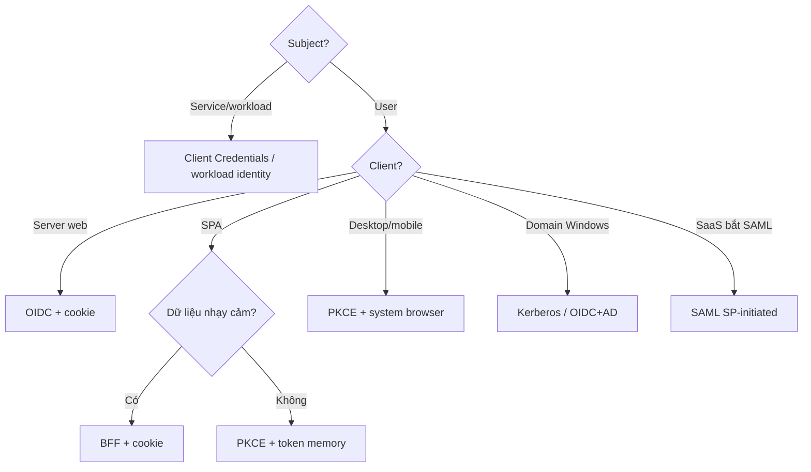

# Part 7 — Troubleshooting & Mastery (Kiến trúc)

> [!NOTE]
> **Mục tiêu:** trả lời 10 câu hỏi thiết kế trước khi chọn giao thức; so sánh web server-side, SPA và BFF; thiết kế desktop/mobile và service-to-service; hiểu provisioning/offboarding; chẩn đoán 401/403 và lỗi OIDC; **chọn phương thức xác thực** qua Bản đồ giải pháp (đã thay file `identity/auth-methods-map.md`, TB-049).
> **Cần biết trước:** [Part 1 đến 6](README.md), đặc biệt [Part 6](part-6-projects.md).
> **Thời lượng:** ~6 giờ · **Đầu ra kiểm được:** điền bảng 10 câu cho một hệ thống thật; chọn flow theo loại client; lập checklist offboarding; phân biệt ba loại 401; trả lời 6 câu mastery.
> [← Part 6](part-6-projects.md) · [Part 0](README.md)

**Ánh xạ bài gốc:** 7.1 quy trình + web/SPA/BFF · 7.2 native + S2S · 7.3 provisioning + WPF · 7.4 case studies + troubleshooting · 7.5 decision matrix.

## L1 What — Mười câu hỏi thiết kế (bài 7.1)

Trước khi chọn OIDC, SAML hay Kerberos, trả lời theo thứ tự (ví dụ **WPF + Order API** trong nguồn):

| # | Câu hỏi | Vì sao quan trọng |
|---|---|---|
| 1 | **Subject** là user, admin, service, device, workload? | User → OIDC; không user → Client Credentials / workload identity |
| 2 | **Client** là server web, SPA, desktop, mobile, CLI, service? | Public vs confidential; redirect URI |
| 3 | **Resource** cần bảo vệ: web, REST API, DB, mạng? | API → access token; mạng → RADIUS |
| 4 | Cần **SSO/federation** với tổ chức khác? | Nhiều issuer; SAML/OIDC federation |
| 5 | **MFA, passwordless, phishing resistance?** | Passkey, CA policy |
| 6 | **Delegated access** API thay user? | OAuth scope vs chỉ OIDC login |
| 7 | **Token/session** lưu ở đâu, vòng đời? | Rủi ro đánh cắp; UX đăng nhập lại |
| 8 | **Authorization** quyết ở đâu? | [Part 6](part-6-projects.md): server + object-level |
| 9 | **Provisioning**, audit, recovery? | JIT vs SCIM; compliance |
| 10 | **Logout, revoke, rotation, incident?** | Runbook lộ secret / lộ signing key |

> [!WARNING]
> Chọn xong flow (vd “OIDC”) **chưa xong** thiết kế. Câu 7–10 (cất token, offboarding, revoke) là chỗ hệ thống hay hỏng.

**Use case:** nhân viên + service `worker` đồng bộ → user: Code+PKCE trên WPF; worker: Client Credentials scope tối thiểu.

## L2 Why — Token ở đâu, ai giữ secret

| Tiêu chí | Server-side web | SPA thuần | SPA + BFF |
|---|---|---|---|
| Đổi code lấy token | Backend web | JS trong browser | BFF |
| Client secret | Backend (confidential) | Không (public + PKCE) | BFF |
| Access token | Server | Browser (memory/storage) | Server |
| Browser cầm | Session cookie | Bearer header | Session cookie |
| Rủi ro chính | CSRF, session hijacking | XSS đánh cắp token | CSRF (XSS vẫn gọi API qua tab) |

**Rule:** token trên server + cookie = server-side hoặc BFF; token trong browser = SPA thuần.

**Use case TeamBoard:** API gateway kiểm JWT — service vẫn kiểm `aud` và quyền tài nguyên ([Identity Part 3](../identity/part-3-multi-component.md)).

## L3 How — Web, SPA, BFF, native, S2S

#### Server-side web (Razor/MVC)
**Là gì:** OIDC Authorization Code; backend đổi code + secret; cookie app session (`HttpOnly`, `Secure`, `SameSite`).
**Use case:** intranet HR; downstream API dùng access token đúng `aud`, không chuyển tiếp ID token.
**Lưu ý:** CSRF bắt buộc; PKCE nên bật cả confidential client (OAuth 2.1 / RFC 9700).

#### SPA thuần
**Là gì:** Code + PKCE; token trong memory (chấp nhận mất khi reload) hoặc tệ hơn `localStorage`.
**Use case:** admin nội bộ ít nhạy cảm, chấp nhận rủi ro XSS.
**Lưu ý:** tránh Implicit; tránh refresh token dài hạn trong storage.

#### SPA + BFF
**Là gì:** BFF confidential client; OIDC + cookie; SPA gọi `/bff/api/*` + anti-CSRF.
**Use case:** dữ liệu nhạy cảm (lương, PII); token không vào browser.
**Lưu ý:** BFF không open proxy — allowlist API; logout revoke refresh.

#### Desktop / native (bài 7.2)
**Là gì:** public client; **system browser** (RFC 8252 MUST NOT WebView cho authorize); Code + PKCE; loopback `127.0.0.1:port`.
**Use case:** WPF chấm công; token cache DPAPI / MSAL.
**Lưu ý:** không nhúng client secret; không ROPC.

#### Mobile (bài 7.2)
**Là gì:** `ASWebAuthenticationSession` / Custom Tabs; PKCE; Keychain/Keystore.
**Use case:** app nhân viên gọi API thay user.
**Lưu ý:** Universal Links / App Links an toàn hơn custom scheme.

#### Service-to-service
**Là gì:** Client Credentials hoặc workload identity; tuỳ chọn mTLS (RFC 8705) / DPoP.
**Use case:** `payroll-batch` ghi `hr-api` scope `payroll.write`.
**Lưu ý:** token máy **không** có user; API vẫn authorization theo scope — không thay BOLA.

#### Kerberos / IWA (intranet)
**Là gì:** Integrated Windows Authentication trong domain.
**Use case:** app nội bộ máy domain-joined.
**Lưu ý:** không cho client Internet; OIDC liên kết AD là thay thế khi cần mobile/cloud.

### Lab hoãn (ô ma trận L4 = –)

> [!NOTE]
> **L4:** OIDC/BFF/WPF hands-on → [TB-050](../../issues/TB-050-identity-auth-lab-dual-provider.md) + [Identity](../identity/README.md).

## L5 Troubleshooting — Case và chẩn đoán (bài 7.4)

#### Case studies (chọn giải pháp)

| Tình huống | Hướng thường chọn |
|---|---|
| Nhân viên SSO nhiều SaaS | SAML hoặc OIDC federation |
| SPA/native gọi API thay user | OIDC Code + PKCE (BFF nếu nhạy cảm) |
| Service ↔ service | Client Credentials / workload identity |
| Windows domain | Kerberos; hoặc OIDC qua AD |
| Passwordless chống phishing | Passkey / WebAuthn |
| Wi-Fi/VPN | RADIUS + EAP-TLS |
| AuthZ theo ownership + phòng | RBAC + ABAC ([Part 6](part-6-projects.md)) |
| B2C social login | OIDC + account linking theo `iss`+`sub`, không gộp chỉ vì email |
| Đối tác API + quota | API key (ít nhạy cảm) hoặc Client Credentials |
| Offboarding tức thời | SCIM + revoke refresh + access token ngắn + CAE nếu có |

**Case 1 — Social login:** không auto-link chỉ vì email trùng; chỉ link khi user đã đăng nhập rồi chủ động liên kết.

**Case 2 — API key vs Client Credentials:** key = định danh app dài hạn; CC = token ngắn, scope, quản lý IdP.

**Case 3 — Nghỉ việc 17:00:** HR khóa IdP + SCIM `active=false` + revoke session + audit.

#### Cây chẩn đoán 401/403

| Triệu chứng | Kiểm tra | Sửa |
|---|---|---|
| 401 `expired` | `exp`, clock | Refresh; NTP |
| 401 `audience invalid` | Decode `aud` | Xin token cho API; không tắt validate |
| 401 `issuer invalid` | `iss` vs Authority | Hostname/realm khớp |
| 403 dù token mới | Scope/role vs object | [Part 6](part-6-projects.md) pipeline |
| IdP `invalid redirect_uri` | So ký tự URI | Allowlist khớp tuyệt đối |
| `invalid_client` ở /token | Secret, loại client | Public không gửi secret |
| Lỗi **trước** form login | redirect_uri | Lỗi **sau** login khi đổi code | client/ grant |

> [!TIP]
> 401 → sửa **xác thực** token. 403 → **phân quyền**. Đừn sửa policy khi token hết hạn.

## L6 Production — Provisioning và offboarding (bài 7.3)

#### JIT vs SCIM
**Là gì:** JIT tạo user lúc đăng nhập SSO lần đầu; SCIM IdP đẩy create/update/deactivate (RFC 7643/7644).
**Use case:**
- JIT nhanh cho POC
- SCIM khi cần offboarding và đồng bộ group
**Lưu ý:** JIT **không biết** user nghỉ — account app vẫn “active”.

#### Offboarding đầy đủ
**Là gì:** khóa IdP **+** revoke refresh/session **+** SCIM **+** access token ngắn **+** CAE/introspection nếu có.
**Use case:** nhân viên nghỉ — thu hồi thiết bị, API key cá nhân, rotate secret dùng chung.
**Lưu ý:** JWT còn hợp lệ đến `exp` nếu API chỉ verify JWKS — revoke refresh không hủy access ngay.

| Triệu chứng | Nguyên nhân | Cách sửa |
|---|---|---|
| User khóa IdP vẫn vào app | Session/refresh còn | Revoke + SCIM + session ngắn |
| Báo cáo vẫn đếm người nghỉ | Chỉ JIT, không SCIM | PATCH `active=false` |
| API vẫn chấp nhận 10 phút | JWT tự chứa | Giảm TTL; CAE |

**WPF + API (tóm tắt 7.3):** WPF → system browser → IdP; API là trust boundary — mọi quyết định authZ tại API ([Part 6](part-6-projects.md)).

## L7 Architecture — Quyết định và bản đồ

#### Ma trận use case → giao thức (tóm tắt 7.5)

| Use case | Lựa chọn chính | Tránh |
|---|---|---|
| Web nội bộ mới | OIDC code + cookie | Tự quản lý mật khẩu rời |
| SaaS enterprise | SAML/OIDC + SCIM | Tài khoản shared |
| SPA | OIDC + PKCE qua BFF | Implicit, localStorage |
| Desktop/mobile | Code + PKCE, system browser | ROPC, WebView, secret nhúng |
| S2S | Client Credentials / workload | User làm service account |
| Domain Windows | Kerberos / IWA | NTLM khi tránh được |
| Admin đặc quyền | Passkey + CA | OTP/push đơn thuần |
| Wi-Fi/VPN | RADIUS EAP-TLS | PSK dùng chung |
| Đối tác API | API key hoặc CC | Key trong query string |
| Thiết bị không bàn phím | Device Authorization | Nhập mật khẩu trên TV |

**Hiểu lầm:** một giao thức cho cả hệ — thực tế **một IdP**, nhiều flow (OIDC, SAML, CC, RADIUS) theo từng cửa.

#### Checklist kiến trúc (rút gọn G.4)

- **BFF:** token server-only; `__Host-` cookie; anti-CSRF; proxy allowlist; logout revoke
- **CORS:** allowlist origin; không coi CORS là auth; preflight trước auth middleware
- **mTLS/S2S:** cert từng service; mTLS ≠ authorization
- **Key rotation:** JWKS song song key cũ/mới theo `kid`; runbook lộ khóa
- **Secrets:** Key Vault/Vault; không secret trong SPA/desktop/mobile

### Bản đồ giải pháp

Bản đồ dưới đây thay `identity/auth-methods-map.md` (đã xoá, TB-049): chọn **cơ chế xác thực** theo subject/client/rủi ro, không copy một phương thức vì “ai cũng dùng”.

| Lựa chọn | Khi chọn | Cái giá / không dùng khi |
|---|---|---|
| **Không xác thực** | Dữ liệu công khai 100%; prototype trong mạng tin cậy đã chốt rủi ro | Mọi PII, ghi/sửa, hoặc “ẩn danh” có quota/abuse |
| **Mật khẩu + session cookie** | Một web một miền, backend server-side | CSRF; SSO đa app; token mobile |
| **OAuth/OIDC** (Code + PKCE, JWT/opaque) | SPA, mobile, desktop, API delegation, federation hiện đại | Độ phức tạp IdP, JWKS, thu hồi token |
| **SAML 2.0** | SaaS/đối tác chỉ hỗ trợ SAML; enterprise SSO có sẵn | Mobile/API delegation kém; XML + quản lý cert |
| **Passkey (WebAuthn/FIDO2)** | Chống phishing; giảm phụ thuộc mật khẩu | Khôi phục tài khoản; tương thích thiết bị |
| **Kerberos / LDAP (AD)** | Máy domain-joined, intranet, IWA | Internet, client ngoài domain |
| **API key** | S2S đối tác, metering/quota, dữ liệu ít nhạy cảm | User delegation; rotate khó; lộ trong log |
| **mTLS** (± Client Credentials) | Service mesh, mạng kín, tuân thủ PKI | Vận hành CA; không thay phân quyền API |

**Chọn nhanh theo client (sau 10 câu hỏi):**

**Điều kiện đổi quyết định:** SaaS đổi hỗ trợ OIDC; rủi ro XSS buộc BFF; scale S2S buộc workload identity thay API key dài hạn; compliance buộc passkey cho admin.

Chi tiết từng phương thức (session, token, enterprise): [Identity Part 1–5](../identity/README.md).

## L8 Mastery — Câu hỏi và bài mở

#### Câu hỏi thiết kế (trả lời bằng đánh đổi)

1. **SPA gọi API nhạy cảm:** BFF hay SPA + memory + PKCE? Nêu một điều kiện đổi.
2. **WPF có nên nhúng client secret từ Key Vault?** Vì sao public client + PKCE?
3. **Khóa user ở IdP lúc 17:00** — liệt kê 4 bước ngoài khóa tài khoản.
4. **SaaS chỉ SAML + app mobile cần API:** giao thức từng phía?
5. **API key cho đối tác đọc dữ liệu thay mặt user của bạn?** Nên dùng gì?
6. **Kerberos cho nhân viên WFH qua Internet?** Phương án thay thế?

#### Bài mở 1 — Thiết kế auth cho sản phẩm mới
Ứng dụng quản lý task nhóm (~10k user, web + mobile, đăng nhập Microsoft). **Yêu cầu:** điền bảng 10 câu; chọn mục Bản đồ; token lifetime; offboarding; quan sát; **điều kiện đổi** nếu thêm đối tác API.

#### Bài mở 2 — Gỡ “401 sau 5 phút lúc có lúc không”
Liệt kê ≥5 giả thuyết (exp, clock skew, refresh, session BFF, gateway strip header) và thứ tự kiểm bằng log.

#### Bài mở 3 — Soát checklist kiến trúc
Lấy một thiết kế đã có; đánh dấu BFF/CORS/rotation/secret items trong G.4; nêu 3 mục đỏ nhất.

**Tiêu chí thành thạo:**
- Giải thích vì sao mỗi lựa chọn trong Bản đồ phù hợp **subject + client**, không chỉ “hiện đại”.
- Phân biệt 401 (authN) vs 403 (authZ) vs lỗi redirect/client.
- Offboarding mô tả được JWT còn sống sau revoke refresh.
- Thừa nhận phạm vi Part 7 (không lab) và trỏ nơi kiểm chứng thật.

## Tự kiểm tra

1. Hai câu đầu trong bảng 10 câu quyết định điều gì?
2. Vì sao CORS không thay xác thực API?
3. JIT thiếu gì so với SCIM khi nhân viên nghỉ?
4. Khi nào chọn SAML thay OIDC cho app **mới**?
5. Mục nào trong Bản đồ cho traffic API công khai chỉ đọc không đăng nhập?

Đáp án ngắn

1. Subject (ai) và client (app nào) → gần như chọn hết flow.
2. CORS chỉ là policy browser; server vẫn phải verify token.
3. JIT không nhận deactivate; account app vẫn active.
4. Hầu như không — chỉ khi bên kia **bắt** SAML hoặc đầu tư SAML sẵn.
5. **Không xác thực** — nếu đã xác nhận không có abuse và không có dữ liệu riêng.

## Nguồn và độ tin cậy

**Đã tự mở:** [RFC 8252](https://www.rfc-editor.org/rfc/rfc8252) (native apps); [RFC 9700](https://www.rfc-editor.org/rfc/rfc9700) (OAuth security BCP); [RFC 7644](https://www.rfc-editor.org/rfc/rfc7644) (SCIM protocol).
**Chỉ qua roadmap HTML (⚠):** m07-1..7.5 (`auth_std_roadmap-main`); bảng troubleshooting 22 dòng — chưa đối chiếu từng dòng với tài liệu nhà cung cấp.
**Chưa kiểm:** RFC 10017 (BFF) chi tiết; CAE/CAEP triển khai cụ thể; ví dụ Kaopiz HR trong nguồn.
**Thay thế tài liệu:** Bản đồ giải pháp ở L7 thay `identity/auth-methods-map.md` (đã xoá).